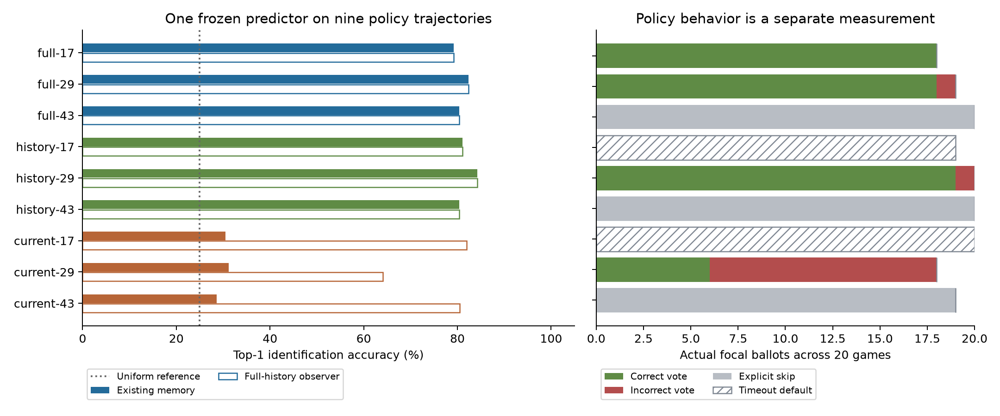
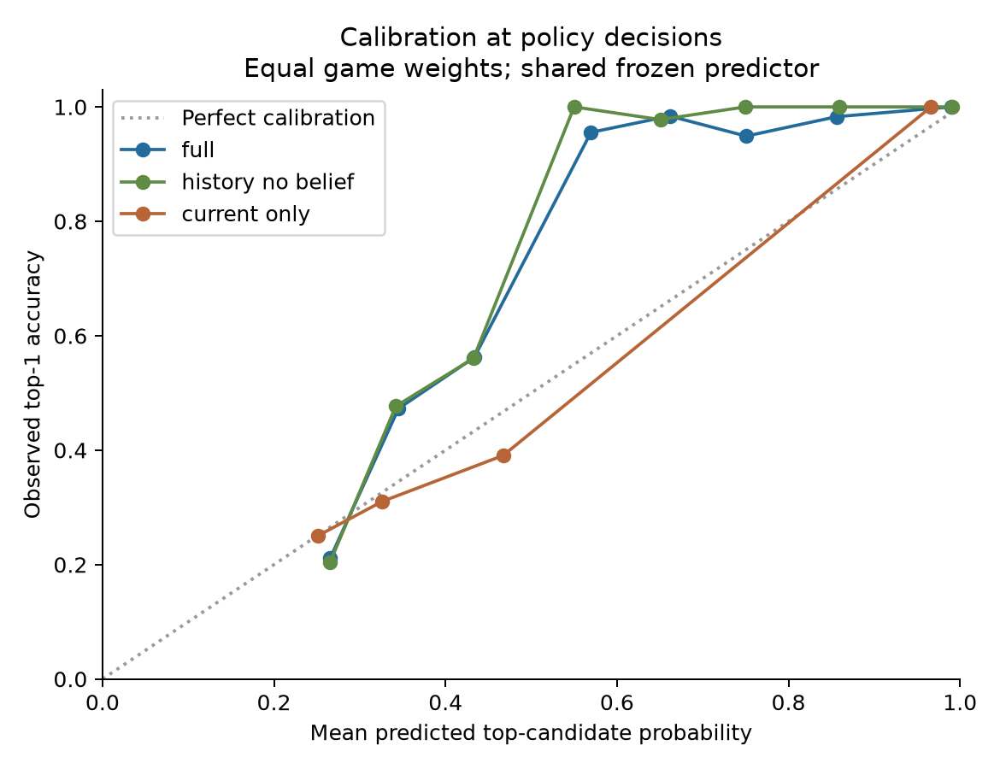
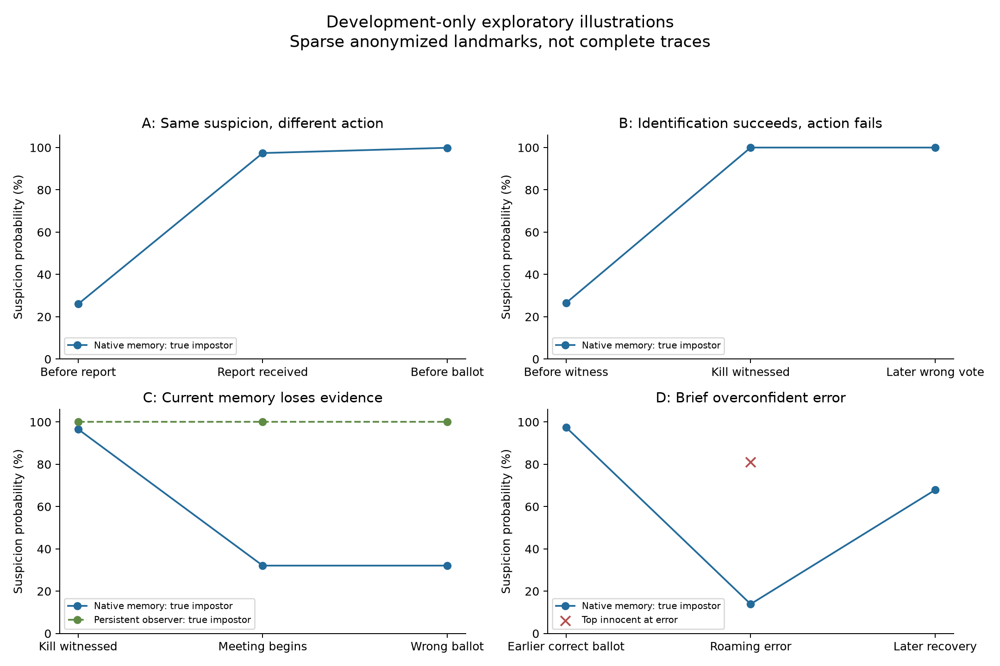

# Development-only exploratory diagnostic: can the existing AI identify the impostor?

**Yes, on these development scenarios when useful evidence is retained—but correct suspicion does not reliably produce a vote. General deduction ability is not yet established. Phase 6.1 acceptance remains pending.**

Completed 2026-10-26: nine validation-selected strategic policies × development seeds
**1250000–1250019**, exactly **180 executions of 20 paired scenarios**. The games took
**963.41 seconds (16.06 minutes)**, sequential CPU evaluation, including recording and
per-model startup. This is evaluation time, not training. No final familiar/patient
evaluation was opened. No model was retrained, selected again, or changed.

There is **one frozen Phase 4 belief predictor** shared across these evaluations. The nine
Phase 6 policies were trained separately to choose actions. The predictor estimates who
the impostor is; the policy chooses tasks, movement, statements, votes or skips. These are
different capabilities, and this diagnostic measures them separately.

## Publication scope

This publication contains the protocol, aggregate results, comparison tables, figures and
sanitized illustrative examples only. Complete observation traces, actor feature matrices,
individual ballot/event records, per-game post-game role labels and local runtime manifests
remain preserved locally and are not included in this branch or its new commits. Sparse
examples remove scenario/player identifiers and exact timestamps; probabilities are rounded.
This is a development-only, exploratory diagnostic, not final-test evidence or acceptance.

## What the results say

- With retained history, the predictor is highly accurate during meetings: **98.9%** on
  full-policy trajectories and **99.8%** on history-without-belief trajectories. At all
  116 corresponding cast/skip ballot snapshots, its top candidate was correct.
- This does not guarantee action: **full-43 explicitly skipped 20 times**, despite
  high-confidence correct suspicion every time. Two other policies produced 39 skips
  under similarly correct retained-history predictions: 20 explicit and 19 timeout defaults.
  The predictor's outputs were hidden from these two ablated policies.
- Current-only memory is a separate limitation: native identification is **30.1%** overall.
  The **same predictor**, retaining the same legitimate observations in an independent
  observer, reaches **75.5% on those same trajectories**. This observer never acts.
- Evidence is sparse before a body/report: full-policy accuracy is **35.4% before versus
  98.5% after** first meaningful evidence in the 48 full-policy executions with both states.
  Only six executions, representing three scenarios, contain a focal witnessed elimination.
- Strong meeting results have a major qualification: **all 173 observed body reports
  were made by the actual impostor**, across 145 executions and 18 scenarios. A simple
  public-reporter baseline almost matches retained-history identification. This is an
  opponent-behavior shortcut available in legitimate observations, not evidence of a
  hidden-role input. It prevents a claim of broad deduction competence.

## Identification, separately from action

Primary scores use snapshots immediately before live policy decisions, averaging within
each execution first. Each of the three initializations receives equal weight. The four
original non-self candidates are preserved, even if a candidate is publicly dead/ejected.
Top-1 accuracy shares credit between exact ties; deterministic argmax sensitivity is in
[summary.json](summary.json). Lower NLL, Brier and ECE are better.

| Policy trajectory condition | Top-1 | NLL | Brier | Calibration ECE | Roaming | Meetings | Full-history observer |
|---|---:|---:|---:|---:|---:|---:|---:|
| full | 80.7% | 0.419 | 0.223 | 0.063 | 64.8% | 98.9% | 80.7% |
| history_no_belief | 81.9% | 0.370 | 0.197 | 0.046 | 65.8% | 99.8% | 81.9% |
| current_only | 30.1% | 1.244 | 0.703 | 0.018 | 23.7% | 34.9% | 75.5% |
| Uniform four candidates | 25.0% | 1.386 | 0.750 | — | — | — | — |

Only **full** policies receive the predictor's probability/logit channels. Both ablations
receive uniform probability and zero logit channels; history_no_belief still receives
historical evidence features. Current-only discards historical memory. Observer scores
on ablated-policy trajectories measure information that the shared predictor can extract,
not a belief signal those policies were necessarily given.

All conditions have 60 executions on the same 20 scenarios. Roaming covers all 60;
meetings cover 48 full, 49 history_no_belief and 48 current_only executions. Roaming includes
periods **after** earlier meetings, so it is not equivalent to evidence-free exploration.
The equal-game, every-0.2-second accuracy is 64.2%, 66.1% and 27.2%, respectively. It is
lower than decision-snapshot accuracy because long movement options have few policy
decisions, whereas meetings have many. Neither thousands of decisions nor ticks are
independent experiments.

### Every selected policy

These rows are evaluations of the **same belief predictor along nine different policy
trajectories and memory conditions**, not nine trained belief models. Every row has 20 games.

| Condition / initialization | Selected step | Top-1 | NLL | Brier | ECE | Roaming | Meetings | Observer |
|---|---:|---:|---:|---:|---:|---:|---:|---:|
| full / 17 | 6144 | 79.3% | 0.456 | 0.239 | 0.085 | 59.9% | 99.6% | 79.3% |
| full / 29 | 8192 | 82.4% | 0.427 | 0.228 | 0.071 | 70.5% | 97.1% | 82.4% |
| full / 43 | 4096 | 80.4% | 0.374 | 0.201 | 0.038 | 63.8% | 100.0% | 80.4% |
| history_no_belief / 17 | 4096 | 81.0% | 0.363 | 0.196 | 0.030 | 67.9% | 100.0% | 81.0% |
| history_no_belief / 29 | 6144 | 84.2% | 0.373 | 0.195 | 0.077 | 65.7% | 99.4% | 84.2% |
| history_no_belief / 43 | 4096 | 80.4% | 0.374 | 0.201 | 0.038 | 63.8% | 100.0% | 80.4% |
| current_only / 17 | 2048 | 30.5% | 1.226 | 0.697 | 0.013 | 25.2% | 34.8% | 82.0% |
| current_only / 29 | 4096 | 31.2% | 1.249 | 0.701 | 0.031 | 24.1% | 35.0% | 64.1% |
| current_only / 43 | 8192 | 28.6% | 1.258 | 0.711 | 0.025 | 21.7% | 34.9% | 80.4% |

CSV: [model-comparison.csv](model-comparison.csv). NLL uses natural logarithms; Brier is
the sum of four squared probability errors (uniform = 0.75). ECE uses ten fixed confidence
bins and equal execution weights; no temperature or model calibration was fitted here.
Current-only's small ECE reflects mostly low-confidence predictions, not strong identification.

### Uncertainty and simple baselines

Approximate 95% bootstrap intervals resample the **20 scenario IDs together across all
nine policies**, 5,000 draws, RNG seed 606. They condition on these selected policies and
are developmental, descriptive intervals—not final-test or training-population guarantees.

| Contrast | Top-1 difference, percentage points (95% interval) |
|---|---:|
| full − uniform four | +55.7 (+43.5, +65.7) |
| full − body-victim exclusion baseline | +48.6 (+37.7, +57.4) |
| full − history_no_belief | −1.2 (−5.5, +3.3) |
| full − current_only | +50.6 (+39.7, +59.6) |
| current_only − body-victim exclusion baseline | −1.5 (−4.2, +1.7) |

The body baseline uses only legitimate knowledge of body victims, assigning equal
probability to the remaining candidates. It reaches 32.1%, 32.3% and 31.6% on the respective
conditions' trajectories. Full's NLL improvement over this baseline is −0.734
(95% interval −0.867 to −0.587), Brier improvement −0.457 (−0.541 to −0.365).
Full's apparent advantage over history_no_belief is not established; their input
predictor is identical and their encountered evidence depends on their different actions.

**Exploratory reporter audit, added after seeing the report correlation:** assigning
probability one to the latest public reporter after a report, and using the body baseline
beforehand, reaches **79.0%, 79.4% and 75.1%** on the same three trajectory sets. It does
not consult roles to make a prediction; roles only score its output. This is a post-hoc
context check, not a registered competing model or a recommended gameplay rule.
The predictor's high accuracy here therefore does **not** establish that it would work
when innocent crewmates also report bodies. Nor does the correlation prove which input
features caused the neural predictor's decisions; that needs an intervention/probe.

## Evidence availability and changes in suspicion

Meaningful evidence is an exposure marker: body sighting, public body report, witnessed
elimination, an elimination/near-body claim, or a directly contradicted claim. It does not
mean every such event proves an identity. Claims retain claim provenance and are never
treated as hidden truth. Event types can overlap at the same tick.

| First exposure type | Executions exposed / 180 | Distinct scenarios / 20 |
|---|---:|---:|
| Public body report | 145 | 18 |
| Direct body sighting | 10 | 4 |
| Witnessed elimination | 6 | 3 |
| Elimination/near-body claim | 17 | 5 |
| Directly contradicted claim | 35 | 6 |

| Existing memory condition | Executions with before/after decisions | Before first evidence | After first evidence |
|---|---:|---:|---:|
| full | 48 | 35.4% | 98.5% |
| history_no_belief | 49 | 34.9% | 99.8% |
| current_only | 48 | 21.3% | 32.8% |

For all 145 executions with both states, the persistent observer moves from 33.1% to
99.5%. Its scenario-balanced paired increase is +66.8 percentage points (95% interval
+54.7 to +78.1), based on 18 scenario IDs. Native-memory accuracy moves from 30.5% to
77.2% across all conditions. These are descriptive before/after comparisons: time,
survival, opponent behavior and other evidence also change. They are not causal estimates.

Immediately across the first public-report frame, retained-history top-1 rises from
51.7% to 100% in 145 executions. Across six first witnessed eliminations it rises from
16.7% to 100%. Body sightings overlap with witnessed kills or nearby-player evidence,
so their strong immediate score cannot be attributed to a body alone.

## Suspicion versus actual voting

There were **75 cast votes: 61 correct and 14 incorrect**, plus **98 skips**. Of those
skips, **59 were explicitly selected and 39 were simulator timeout defaults** after
no submission. No self-votes occurred. An actual timeout skip is not described as the
policy deliberately abstaining. All counts are focal-agent ballots; multiple meetings
can occur in a game.

| Policy | Correct / cast | Incorrect | Explicit skips | Timeout skips | Wins / 20 | Own tasks/game |
|---|---:|---:|---:|---:|---:|---:|
| full-17 | 18/18 | 0 | 0 | 0 | 20 | 2.20 |
| full-29 | 18/19 | 1 | 0 | 0 | 16 | 2.05 |
| full-43 | —/0 | 0 | 20 | 0 | 20 | 2.20 |
| history_no_belief-17 | —/0 | 0 | 0 | 19 | 18 | 2.20 |
| history_no_belief-29 | 19/20 | 1 | 0 | 0 | 19 | 2.15 |
| history_no_belief-43 | —/0 | 0 | 20 | 0 | 20 | 2.20 |
| current_only-17 | —/0 | 0 | 0 | 20 | 20 | 2.25 |
| current_only-29 | 6/18 | 12 | 0 | 0 | 18 | 1.65 |
| current_only-43 | —/0 | 0 | 19 | 0 | 18 | 2.25 |

At the **116 high-confidence (>=0.8) ballot snapshots**, retained-history suspicion was
correct every time, but policies cast only 57 votes (55 correct) and skipped 59 times.
The **full** policies alone had 57 such ballots: 37 votes (36 correct) and 20 explicit
skips. This is direct evidence that correct identification and choosing a useful action
are separate. A skip can be rational under some objectives; these data demonstrate the
behavior gap, not the reward mechanism causing it.

The other 57 ballots all came from current-only policies, with confidence below 0.6;
they produced 18 votes (6 correct) and 39 skips. Ties matter: all 18 current_only-29 targets
belonged to a tied top set, so "target agrees with top suspicion" is not evidence of
correct deduction. Its belief channels are also ablated in the acting policy.

Team wins were 169/180 despite these voting failures. These games still contain scripted
teammates and task-based victories, so win rate cannot answer the identification question.
All focal policies made zero valid reports; the report-maker audit concerns other actors.

## Sanitized representative examples

These examples were selected after scoring and are illustrative, not additional experiments
or a representative sample. Only a few rounded probability landmarks are published in
[representative-examples.json](representative-examples.json). Scenario seeds, player IDs,
exact timestamps, full candidate distributions, event payloads and full traces are omitted.
Descriptions of correct/incorrect outcomes use offline scoring; no role roster is published.
Straight lines in the figure connect selected landmarks and do not reconstruct the full
time series or imply how probabilities changed between them.

1. **Same evidence, different action.** At a public report, suspicion of the true impostor
   jumps from **26.0% to 97.4%**, reaching **99.9%** before the ballot. Full-17 votes for
   the impostor; full-43 explicitly skips with the same suspicion distribution. A scripted
   reporting shortcut is sufficient to explain much of this example; no witnessed kill
   is required.
2. **Correct identification, wrong target.** Full-29 observes an elimination and assigns
   approximately **100%** to the true impostor. It first votes correctly, but at a later
   meeting votes for an innocent candidate despite retaining that prediction. The true
   impostor remains a legal target. The immediate failure is action selection, not lack
   of identity evidence.
3. **Evidence forgotten.** Current-only-29 briefly assigns **96.6%** to an observed killer.
   At the subsequent meeting its native memory yields **32.1%** on that candidate, tied
   with two others, while the independent persistent observer remains near **100%**.
   The policy votes for an innocent tied candidate. Retained history improves this
   diagnostic prediction; it has not been tested as a policy intervention.
4. **A brief high-confidence error.** Full-29's roaming suspicion reaches **81.1%** on
   an innocent candidate and **13.9%** on the actual impostor. No vote occurs during
   that error window, and suspicion later returns to favoring the impostor. Across the
   complete diagnostic, this occurs in one scenario: two decision snapshots and six
   observation ticks exceed the incorrect-confidence threshold of 0.8. No incorrect
   prediction reaches 0.9.

## Interpretation and next experiment

**The clearest current bottleneck is action selection once evidence is available.**
Full-43 receives the belief channels and still always skips; full-29 sometimes votes
against an essentially certain correct belief. This establishes a behavioral disconnect,
but not whether it comes from learned task preference, action scoring, reward incentives
or another internal mechanism. No corrective change was made.

**Memory retention is also a real identification bottleneck in current_only.** The same
weights can extract the right identity from retained legitimate observations on the
same trajectory, including an observed elimination. That does not demonstrate improved
win rate if memory were changed; such a test would be a new experiment.

**Before informative events, evidence is limited.** Poor early confidence/accuracy is
not automatically a reasoning defect if nothing distinguishes candidates. Direct
identity-bearing evidence occurs in only three of these 20 scenarios. Strong later
results are additionally confounded by an extremely informative scripted reporter pattern.
The study therefore establishes conditional identification on this development set,
not general social deduction against diverse or learned impostors.

**Recommended next experiment, requiring a separate design/approval:** a small,
development-only **reporter-balanced evaluation with these same frozen checkpoints**,
keeping mechanics/rewards fixed while arranging scripted crewmates as well as impostors
to report. Register the new development scenarios separately; do not reuse final-test seeds.
Score suspicion and actions independently again, with enough witnessed and unwitnessed
cases to separate direct evidence from reporter shortcuts. Include a frozen pre-vote
action-sensitivity probe on identical legitimate packets to check whether full-policy
vote scores actually respond to belief channels. No retraining or fixes should precede
that diagnostic review.

## Integrity, source compatibility and reproducibility

- All nine selections remain locked. Seed 17 ran with the preserved pilot-compatible
  source (`cd48b65a8de9de0cab33894ddb2558057487847d` scientific source state); 29/43 used
  the verified continuation source (`874e0390a7a34cd96e62ecf0c795f51e20ccd52c`).
  Both passed the original strict loader and their full source manifests; no check was relaxed.
- Frozen belief checkpoint SHA256:
  `e931b1fa8a421d9a329a29280d676bf52f793cc8f07c02b8da61f2b3e5e537d1`.
  All nine executions' predictor weight-state hashes are identical; nine policy states
  remain distinct. Existing **583 Phase 6 artifact files, including 162 checkpoint files**,
  have identical before/after hashes. These include unselected historical artifacts.
- Actor recording receives only focal immutable observations and actor memory, with
  no simulator/world reference. It never reads hidden roles or the simulator event log.
  Labels and actual ballot logs are exported only after each game terminates and are
  joined offline. Eliminated/terminal actor observations are excluded.
- Recorded **48,113 live observation snapshots and 7,232 policy decisions**. Replaying
  both input views gives **96,226 probability-vector checks**. Every first/last snapshot
  reproduces bit-for-bit; batch replay differs by at most **2.17e-7**, below the declared
  2e-6 rounding tolerance. No recalibration or fitting occurred.
- Greedy policies, deterministic CPU inference, one torch thread, original transitions
  and legal-action guards were retained. Every action trace hash is saved. Packet
  immutability and ablated-channel guards ran at every decision. Fifteen synthetic tests
  passed, including observer/RNG neutrality, seed guards, scoring and timeout handling.
- No extra model-game executions were used for reproduction. Prediction replay and
  source/state checks support reproducibility; they are not a second independent game
  replay. The failed initial sandbox preflight executed **zero games**; its audit records
  remain local and are excluded from publication.
- No simulator, training, reward, checkpoint, website, published roadmap or production
  files were changed. PRs #3/#4/#5/#7 remain unmerged. Integration remains separate.

The registered design and metric definitions are in [PROTOCOL.md](PROTOCOL.md).
The post-hoc reporter audit is explicitly labeled in [forensics.json](forensics.json).
Aggregate metrics, calibration-bin counts and paired intervals are in [summary.json](summary.json).
The comparison table is also available as [model-comparison.csv](model-comparison.csv).

Detailed reproduction inputs and execution/analysis tools remain preserved in the local
research archive. They are not included in this publication, so a reader cannot reproduce
the games from these public summary files alone. The local archive contains unchanged
raw observations, separate post-game scoring labels, checkpoint/source provenance and
recording/replay checks. Source and checkpoint integrity were verified again when preparing
this sanitized export. No new model-game execution was performed for publication.

**Phase 6.1 acceptance remains pending. No fixes or follow-on experiment have been implemented.**
