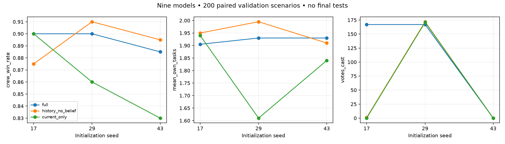

# Phase 6.1: complete nine-model validation study

All nine registered models are trained and validated. The six new models finished within the approved 6.42-hour ceiling. **Phase 6.1 is not accepted; final familiar/patient evaluation remains unopened.** No learned impostor, population expansion, concurrency benchmark, dashboard or self-play was started. Production and PRs #3/#4/#5 are unchanged. Integration with main remains a separate review.

Original pilot source: `cd48b65a8de9de0cab33894ddb2558057487847d` (preserved on PR #4). Continuation source: `874e0390a7a34cd96e62ecf0c795f51e20ccd52c`. The strict checkpoint loader remains in place; original checkpoint metadata was not rewritten. All scientific sources outside the reviewed initialization/driver extension match the pilot; AST checks establish unchanged trainer behavior at seed 17, match execution and checkpoint ranking.

## Every model: 200 paired ID validation scenarios

| Condition | Init | Selected step | Crew wins (Wilson 95%) | Own tasks/match | Correct/cast votes (accuracy) | Incorrect votes | Skips | Own reports |
|---|---:|---:|---|---:|---|---:|---:|---:|
| full | 17 | 6144 | 90.0% (85.1–93.4) | 1.905 | 159/167 (95.2%) | 8 | 0 | 0 |
| history_no_belief | 17 | 4096 | 87.5% (82.2–91.4) | 1.950 | 1/1 (100.0%) | 0 | 178 | 0 |
| current_only | 17 | 2048 | 90.0% (85.1–93.4) | 1.940 | 0/0 (n/a) | 0 | 179 | 0 |
| full | 29 | 8192 | 90.0% (85.1–93.4) | 1.930 | 149/167 (89.2%) | 18 | 0 | 0 |
| history_no_belief | 29 | 6144 | 91.0% (86.2–94.2) | 1.995 | 158/172 (91.9%) | 14 | 0 | 0 |
| current_only | 29 | 4096 | 86.0% (80.5–90.1) | 1.610 | 66/171 (38.6%) | 105 | 0 | 0 |
| full | 43 | 4096 | 88.5% (83.3–92.2) | 1.930 | 0/0 (n/a) | 0 | 177 | 0 |
| history_no_belief | 43 | 4096 | 89.5% (84.5–93.0) | 1.910 | 0/0 (n/a) | 0 | 175 | 0 |
| current_only | 43 | 8192 | 83.0% (77.2–87.6) | 1.840 | 0/0 (n/a) | 0 | 184 | 0 |

Incorrect accusations are measured here as **votes targeting innocent crew**. Structured-claim truthfulness is not separately scored by this protocol. Zero cast votes means accuracy is undefined, not zero or perfect. Reports are the focal agent's own valid body reports. Team ejections below are not solely attributable to that agent.

| Condition | Init | Matches with a cast vote | Cast share of vote/skip decisions | Correct/innocent team ejections | Mean survival seconds |
|---|---:|---:|---:|---:|---:|
| full | 17 | 64.0% | 100.0% | 13/5 | 48.32 |
| history_no_belief | 17 | 0.5% | 0.6% | 3/2 | 51.62 |
| current_only | 17 | 0.0% | 0.0% | 6/1 | 50.98 |
| full | 29 | 61.0% | 100.0% | 8/4 | 48.16 |
| history_no_belief | 29 | 64.0% | 100.0% | 12/6 | 48.99 |
| current_only | 29 | 61.0% | 100.0% | 6/10 | 48.07 |
| full | 43 | 0.0% | 0.0% | 7/2 | 51.03 |
| history_no_belief | 43 | 0.0% | 0.0% | 7/1 | 50.77 |
| current_only | 43 | 0.0% | 0.0% | 4/2 | 54.30 |

## Across initialization seeds

| Condition | Mean wins ± sample SD (range) | Mean tasks ± sample SD | Correct/cast votes pooled | Incorrect votes | Skips |
|---|---|---|---:|---:|---:|
| full | 89.50% ± 0.87 pp (88.5–90.0%) | 1.922 ± 0.014 | 308/334 | 26 | 177 |
| history_no_belief | 89.33% ± 1.76 pp (87.5–91.0%) | 1.952 ± 0.043 | 159/173 | 14 | 353 |
| current_only | 86.33% ± 3.51 pp (83.0–90.0%) | 1.797 ± 0.169 | 66/171 | 105 | 363 |

These are three independent initializations evaluated on the **same 200 scenarios**. Do not treat them as 600 independent match seeds or infer precise training-population confidence intervals. SD/range describe the observed three runs. Pooled vote accuracy weights cast votes and must be read alongside participation.

## Controls under identical Phase 6 rules

| Control | Crew wins | Own tasks/match | Correct/cast votes | Skips | Own reports | Innocent team ejections |
|---|---:|---:|---:|---:|---:|---:|
| scripted | 91.0% | 1.890 | 11/14 | 146 | 2 | 0 |
| phase5_release_transfer | 87.0% | 1.745 | 195/211 | 0 | 0 | 4 |
| idle | 55.5% | 0.000 | 0/0 | 185 | 0 | 1 |
| random | 46.5% | 0.440 | 57/201 | 50 | 0 | 16 |

Controls were reused without new inference. These are fresh Phase 6 ID validation results under crew/impostor sight 4.5/6.75, not a direct comparison with historical Phase 5 final-test percentages under legacy rules.

## Paired uncertainty

Each aggregate contrast averages the three matched-initialization differences for each scenario, then resamples 200 paired scenario differences (5,000 bootstrap draws, RNG seed 606). Intervals condition on these models; initialization spread is reported separately. They are approximate, developmental match intervals, not final-test evidence or multiplicity-adjusted claims.

| Contrast | Crew-win delta (95% paired scenario interval) | Own-task delta (95% paired scenario interval) |
|---|---|---|
| full − scripted | -1.50 pp (-5.00, +2.00) | +0.032 (-0.042, +0.108) |
| full − idle | +34.00 pp (+27.50, +40.67) | +1.922 (+1.833, +2.008) |
| full − random | +43.00 pp (+36.00, +50.17) | +1.482 (+1.362, +1.600) |
| full − phase5_release_transfer | +2.50 pp (-2.00, +7.00) | +0.177 (+0.040, +0.313) |
| full − history_no_belief | +0.17 pp (-1.33, +1.83) | -0.030 (-0.070, +0.012) |
| full − current_only | +3.17 pp (+0.00, +6.00) | +0.125 (+0.058, +0.193) |
| history_no_belief − current_only | +3.00 pp (+0.33, +5.67) | +0.155 (+0.088, +0.220) |

Near-zero bootstrap endpoints are sensitive to finite-draw noise and contrast direction; the full/current-only win interval touching zero is borderline. Do not infer a robust memory win-rate benefit from that boundary. Per-initialization paired differences and individual-model intervals are retained in [results.json](results.json).

## Findings and unresolved gates

- All conditions contribute useful tasks and outperform idle/random on these validation scenarios. Full and history without belief are competitive with scripted, but superiority is not established. The full/scripted lower interval endpoint is −5.0 pp, so the proposed strict noninferiority gate is not demonstrated here.
- The full condition is more stable in task contribution and wins than current-only across these three seeds. History without belief also completes more tasks than current-only. Full versus history without belief shows no clear win/task advantage; this does not establish additional benefit from learned suspicion.
- Voting is strongly initialization-dependent. Full seeds 17/29 vote without skipping, but full seed 43 never casts a vote. History without belief votes substantially only at seed 29. Current-only seed 29 makes 105 wrong votes out of 171; its other two seeds never vote. High pooled accuracy does not resolve these participation failures.
- Every learned model makes zero own reports; scripted makes two. Reporting competence is not demonstrated. Opportunity counts were not logged, so zero reports alone does not establish missed opportunities.
- There are no recorded illegal actions, navigation failures or timeouts in the required validation rows. Mechanical safety is distinct from the voting/reporting weaknesses.
- Screening reused the first 20 of 200 validation seeds; no patient-family evaluation occurred. No untrained control was registered, so useful behavior versus idle/random alone does not quantify improvement over initialization. No architecture/reward/PPO tuning or reselection was performed.

**Phase 6.1 is not accepted.** Review voting instability before committing to expensive final evaluation or considering a learned impostor. The final partitions remain closed.

## Measured compute and experience

| Model | Training minutes | Simulated hours | Completed training matches |
|---|---:|---:|---:|
| full-17 | 28.78 | 5.490 | 221 |
| history_no_belief-17 | 26.12 | 5.507 | 222 |
| current_only-17 | 36.67 | 5.386 | 215 |
| full-29 | 23.30 | 5.361 | 222 |
| history_no_belief-29 | 23.37 | 5.390 | 221 |
| current_only-29 | 25.05 | 5.606 | 230 |
| full-43 | 17.29 | 5.465 | 219 |
| history_no_belief-43 | 19.20 | 5.465 | 219 |
| current_only-43 | 30.22 | 5.452 | 218 |

Continuation stage: **3.644 hours** against estimate 4.28 and ceiling 6.42. Serial training 138.44 minutes; screening 25.76 minutes; extended validation 52.21 minutes. Stage preflight/check overhead is included; subsequent report curation is separate. No forecast/deadline stop fired.
Six new models: **49,152 decisions / 32.740 simulated hours**. Complete study: **73,728 decisions / 49.122 simulated hours**. Training exposure includes partial last episodes. Old seed-17 training was reused, never repeated. The 1,680 new executions plus 1,640 pilot executions total 3,320; smoke/probe matches are separate diagnostics, not performance evidence.

## Integrity and retained artifacts

50 targeted tests passed, including new-seed PPO/inference reproduction, source/AST equivalence, guards, metadata/partition rejection, budget stopping, immutable outputs, six-run orchestration and report aggregation. Existing pilot test results are historical and were not relabeled as a new full-suite run.

Reproduction was verified on the recorded Windows CPU runtime and dependency
versions; cross-platform reproduction was not tested. Raw evidence byte hashes
retain the original checkout's line-ending representation.

Preflight for each new seed reproduced training tensors/traces and saved-policy development inference. All **120** selected screening rows repeated exactly during extended validation. Initial tensors match across input conditions at each seed and differ across seeds. All **30** new checkpoint copies load under their pinned source revision, match SHA-256 digests and retain metadata; the 15 pilot checkpoints and **419** original research files are unchanged. [Integrity audit](integrity-audit.json) and [runner verification](runner-verification.json) record the evidence.

All four checkpoints plus final weights per run are preserved under [remaining-six artifacts](../../../../artifacts/phase6/remaining-six/). Raw local runs and failed infrastructure-test setup records remain retained under ignored run directories. Initial fixture setup encountered a sandbox temporary-directory restriction; a subsequent test caught an in-development source edit as designed. The final tests ran with fixed sources and passed. No scientific full-model run failed or retried.

Final familiar seeds 1230000–1230499 and patient seeds 1240000–1240499 were not executed. No main/production updates or integration merges occurred. The [published roadmap](https://github.com/Hadisovic/social-deduction-ai/blob/main/docs/phase6_roadmap.md) remains authoritative; this report adds research evidence only.

## Separate final-evaluation approval

See the [unapproved final-evaluation proposal](final-evaluation-proposal.md). Its candidate list preserves the nine validation-selected checkpoints; it does not open tests, authorize compute or implement a final runner. Review the behavioral weaknesses first. Separate explicit approval is required before final familiar/patient evaluation.

[Machine-readable results](results.json) · [Locked selection](selection.json) · [Raw screening](screening/) · [Raw validation](validation/) · [CSV](nine-model-metrics.csv)
