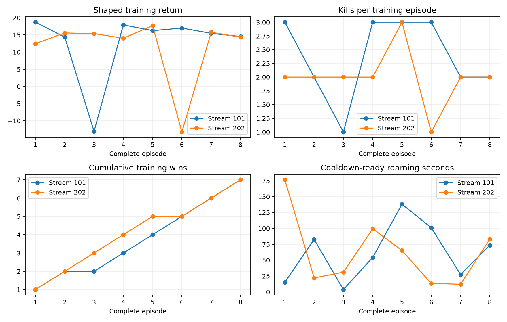
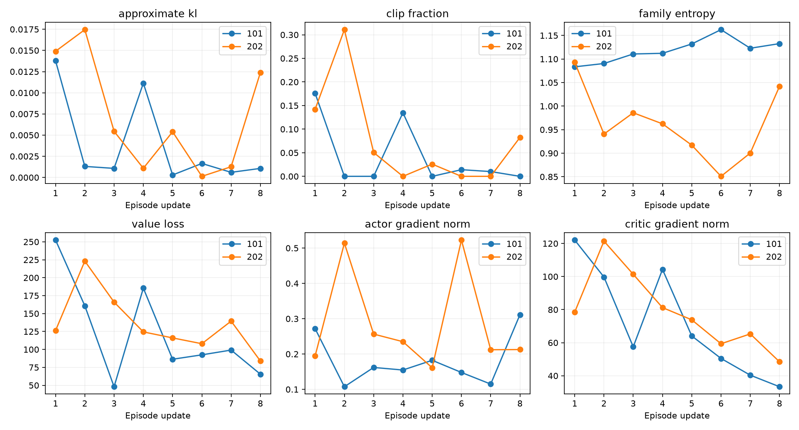
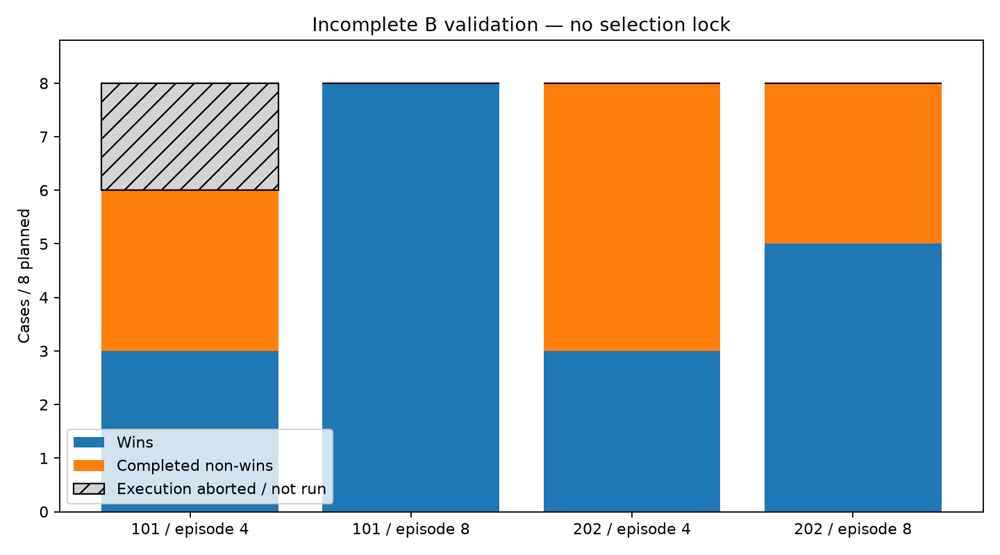
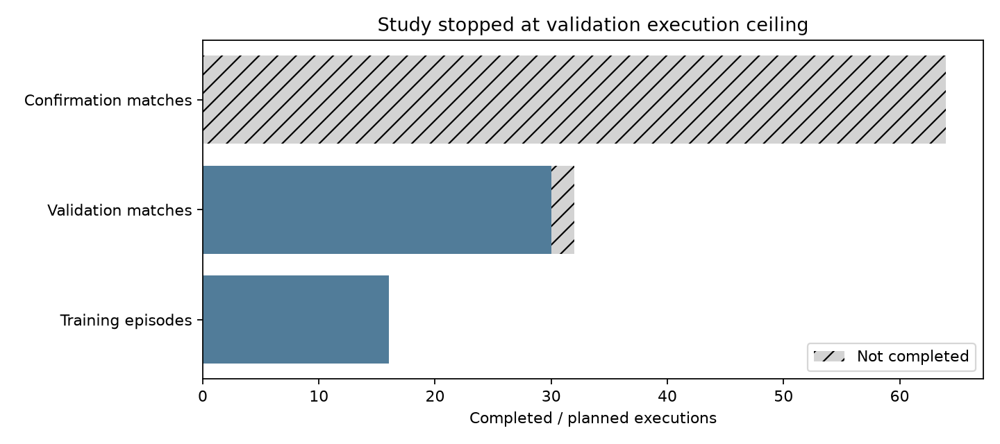

# Shared impostor pilot: training complete, validation incomplete

**No model is selected or promoted. Improvement over the untouched reference is not established.**

The pilot ran for 39.17 minutes on two one-thread CPU workers.
Both streams completed eight episodes. Stream 101 won 7/8 training matches with 19 kills; stream 202 won 7/8 with 16 kills.
These are stochastic training outcomes. The streams share starting tensors and are not independent parameter initializations.

## Validation outcome

| Stream / checkpoint | Wins | Completed | Planned |
|---|---:|---:|---:|
| 101 / episode 4 | 3 | 6 | 8 |
| 101 / episode 8 | 8 | 8 | 8 |
| 202 / episode 4 | 3 | 8 | 8 |
| 202 / episode 8 | 5 | 8 | 8 |

Stream 101 / episode 4 hit the 600-second wall execution limit on seed 3610006. Seed 3610007 was not started.
This is a computational abort, not a game TIMEOUT or an impostor loss. The three other validation blocks completed.
Stream 101 / episode 8 won all eight B validation cases, but this small, selection-used result has no paired untouched-reference comparison.
The fixed protocol requires all candidates to finish. No lock was written; all 64 planned A/B confirmation executions remain unrun. Historical final-test partitions stayed sealed.


Returns include kill rewards and ready-cooldown costs. Training wins and returns do not measure held-out accuracy.


KL and clipping show policy movement; entropy describes exploration. Value loss and pre-clipping gradient norms describe the optimizer. Actor/critic clipping limits were .5/1.0.


Gray cases are missing, not losses. Comparing fractions with unequal completion can be biased.


Confirmation is absent; there is no confirmation win-rate graph to show.

## What the behavior shows

The 16 training episodes recorded 35 kills, 20 accepted self-reports and 74
witness events (several witnesses can observe one kill). There were 51 fake-task
starts and no recorded completions. The episode-8 stream-101 validation block
recorded 15 kills, 9 self-reports and 32 witness events across its eight wins.
These counts show that winning against this frozen B population does not establish
stealth, careful reporting, or successful deception. The crewmate population can
be exploitable; hardcoded anti-report or anti-witness rules were not added.

Value loss generally decreased but remained noisy. Critic gradient norms are
shown before clipping; large values were limited by the existing 1.0 threshold.
The two streams produced different greedy validation behavior despite similar
training win counts. More evidence and a broader checked opponent pool matter
before changing the network size or claiming that more training is unnecessary.

## Files and verification
All 16 local episode checkpoints remain intact. Four strict-load candidate snapshots are published in `artifacts/impostor-shared-pilot-20261029/`; they are unselected research artifacts.
Source signatures, frozen crew/belief hashes, zero illegal actions and private actor memories passed on all 46 completed study executions.
Seventeen targeted tests passed in 19.87 seconds. A separate 40.43-second preflight match plus .37-second optimizer update passed checkpoint/RNG reload; its learned weights were discarded.
See aggregate.json for runtime, processor, completed-match CPU accounting, exact counts and checkpoint hashes; registration.json preserves settings/seeds. CPU totals exclude some failure/loading overhead.

## Watch a completed learned-policy match
Run from the isolated integration checkout:
```powershell
.\.venv\Scripts\python.exe run_impostor_shared.py --replay local-runs/shared-pilot-20261029/selection-101-ep8/seed-3610000.jsonl
```
This is recorded playback of the episode-8 candidate, not live training or a selected release. Private replays stay local.

## Recommended next step
Diagnose the slow validation path using per-case progress/timing and profiling before approving a separately documented continuation. Preserve the same checkpoint bytes and comparison cases; do not retrain merely to work around this execution failure.
A future evaluation-only amendment could retain the overall wall cap while budgeting long matches explicitly. Its source/runtime/checkpoint contract must be handled without weakening historical locks.
Only after complete paired A/B evidence should we consider more PPO, a preregistered A/B/mixed-crew pool, separate sabotage mechanics and both-role adaptation, larger lobbies, or self-play.
High training wins can reflect exploitable frozen opponents. Self-reports, witnessed kills and claims remain observed behavior; no causal deception or escape competence is established.
