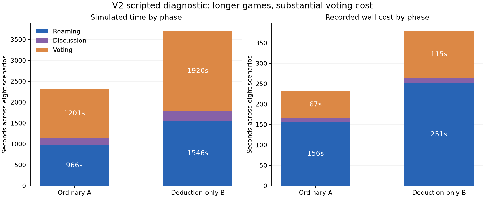

# V2 pre-training diagnostic — development-only, exploratory

**Decision: keep V2 available, but validate a more diverse opponent/reporting fixture
before approving neural training.** Ordinary games provide time for murders, meetings
and votes; informative crew evidence is much rarer. Disabling task victory extends play
without fixing that scarcity. No engine defect or checkpoint change was detected.
Phase 6.1 acceptance remains **pending**.

## Scope and reproducibility

Run completed 2026-10-27 in **750.36 seconds (12m 30s)** against the registered
900-second diagnostic limit. Eight newly registered scenarios, 2,630,000–2,630,007,
were each executed in ordinary A and deduction-only B. Four conditional reporter-probe
executions reused the first two scenarios; one ordinary replay verified determinism.
That is **21 executions, eight distinct scenarios**, not 21 independent samples.

Canonical implementation: PR #9, `e62ba0b6c33ffd0317f78e18b4289d778cd5af2b`.
Frozen diagnostic runner: `ef09a1e6eb3f2588b1818c59132e48f5dd95107d`.
Canonical source digest remains
`78312533e6e29be6a8346496e581fde2ec92869f946fee2caaae73bf31531f82`.
See [protocol](PROTOCOL.md), [aggregate metrics](aggregate.json),
[post-hoc descriptive supplement](supplement.json) and [validation](validation.json).

All five participants used existing scripts; no neural policy or belief predictor was
evaluated in the diagnostic. Historical selected checkpoint hashes were verified before
and after. The shared frozen Phase 4 predictor is not nine independently trained belief
models, and this report makes no new belief-calibration claim. No models/rewards/lobby
settings changed, no final-test games ran, and no PR was changed or merged.

## 1. Ordinary versus deduction-only

Counts below sum over the eight matched scenarios in each column. Pair/window counts
are exposure measures, not independent statistical trials.

| Measure | A: ordinary | B: deduction-only |
|---|---:|---:|
| Crew wins by tasks | 8/8 | Disabled |
| Crew wins by impostor ejection | 0/8 | 1/8 |
| Impostor wins by parity | 0/8 | 7/8 |
| Timeouts | 0 | 0 |
| Median simulated duration | 260.4s | 459.6s |
| Kills | 11 | 23 |
| Physical surviving-crew witness–victim pairs | 2 | 5 |
| Witness pairs delivered to a living decision | 2 | 3 |
| Crew body-observer–victim pairs | 2 | 3 |
| Games with a crew body discovery | 2/8 | 2/8 |
| Legal crew report actor-body pairs / windows | 2 / 2 | 2 / 2 |
| Crew report submissions / accepted | 2 / 1 | 2 / 1 |
| Accepted impostor reports | 10 | 15 |
| Meetings started / reaching voting / resolved | 11 / 11 / 10 | 16 / 16 / 16 |
| Unique legal crew actor-meeting ballot opportunities | 30 | 40 |
| Crew correct / incorrect non-skip votes | 3 / 0 | 5 / 0 |
| Crew explicit / automatic skips | 27 / 0 | 35 / 0 |
| Crew non-skip participation | 3/30 (10.0%) | 5/40 (12.5%) |
| Crew-evidence → report → legal-ballot sequences | 2 meetings in 2/8 games | 3 meetings in 2/8 games |

Every ordinary game contained a kill, a meeting and a crew ballot opportunity. The
problem is **informative** opportunity: six of eight ordinary scenarios supplied no
surviving crew body sighting or witnessed kill. B adds a median **198.4s paired**
continuation (mean 171.6s), but does not expand the set of scenarios with delivered
crew evidence beyond those same two. Two additional physical witness pairs in B occur
at terminal parity kills, leaving no subsequent policy decision in which to use them.

All 3/3 A and 5/5 B cast crew accusations are correct, but this tiny selective sample
must be read alongside 90.0%/87.5% skipping. All three correct A votes and four of five
correct B votes come from actors with direct witnessed-elimination memory. These are
explicit hand-written script rules, not learned reasoning. No neural identification or
action-selection limitation can be diagnosed from this scripted study alone.

Task termination interrupts one ordinary meeting: voting opens at 271.8s and the game
ends through tasks at 273.2s. It does **not** generally prevent the first vote: the other
ten ordinary meetings resolve. Longer play is useful for exposure, but is not sufficient
to create good evidence or correct collective ejections.

## 2. Reporter identity remains a shortcut

Existing crew scripts already approach/report visible bodies. Hunter and self-report
impostors also pursue observed bodies while cooling down. In the baseline, bodies are
reported **0.6s after death at the median**, range 0.6–1.2s, in both conditions. Rapid
self-reporting leaves little time for another actor to discover a corpse.

Impostors generate **10/11 A reports (90.9%) and 15/16 B reports (93.8%)**. Across both
conditions, 25/27 accepted reports are from impostors; paired repeats are correlated.
The reporter-pattern confound remains strong. This is a sampled role cue, not a belief
model's identification accuracy or a generalization estimate.

Crew attempt reports at both of their two unique legal actor-body opportunities per
condition. One is accepted; the other loses same-tick arbitration to the impostor.
Thus accepted reporting is 1/2, not evidence that crew refuse half their opportunities.
Zero reports in most games reflects absent discovery/proximity opportunities. A visible
body at a distance is distinguished from a legal REPORT action.

The isolated probe gates the original report helper with a **role-independent 0-or-18s
personal sight delay**. It receives only the actor packet and private behavior seed;
there is no hidden-world input or learned-action override. Its two paired scenarios yield:

| Probe result, two scenarios | A | B |
|---|---:|---:|
| Outcomes | 2 task wins | 2 parity losses |
| Crew body-observer pairs | 1 | 2 |
| Legal crew report pairs / accepted crew reports | 0 / 0 | 1 / 1 |
| Accepted impostor reports | 1 | 2 |
| Surviving crew witnessed kills | 0 | 0 |
| Correct / incorrect / skipped crew ballots | 0 / 0 / 3 | 0 / 0 / 8 |

One probe scenario is unchanged. In the other, a kill at 99.0s remains unreported until
a crew report at 142.8s. Ordinary tasks finish at 132.0s, before that report can happen;
deduction-only permits it, but still ends in parity at 339.0s. The corresponding baseline
ordinary game lasts 267.0s: immediate reporting pauses living task work during a meeting,
whereas delayed reporting lets tasks finish earlier. Delay therefore does not monotonically
improve deduction exposure. This probe demonstrates legal crew reporting, **not** a
balanced reporter population or a successful curriculum. Two scenarios are insufficient
to choose reporting probabilities or a training mixture.

## 3. Cooldown, task pace and ghosts

First legal kill availability is observed in all eight primary scenarios: median
**54.0s**, range 50.0–67.6s. First scheduled legal availability and actual first kill
both have median **66.9s**, range 52.8–99.0s. The median paired lag from first physical
availability to actual kill is 6.3s; a brief opportunity between 0.6s decision instants
can be missed. Movement, proximity and action cadence therefore matter alongside the
45s cooldown. The scripts attack when a scheduled legal opportunity is available.

The cooldown is not too long to permit murders: every ordinary game has one or two.
However, task completion plus meeting-induced kill pauses routinely produces task wins
before a decisive ejection. This sample does **not** establish an optimal timer or
justify shortening the canonical cooldown. No timeout occurs, so an increased timeout
rate from deduction-only is a risk to test, not an observed result here.

Task progress is identical between A/B while both games continue. At the times below
all eight scenarios remain observed in both modes; later survivor-only means must not
be compared as if they represented unchanged cohorts.

| Simulated time | Mean whole assignments complete / 16 | Mean completed by ghosts |
|---|---:|---:|
| 30s | 3.250 | 0 |
| 60s | 7.625 | 0 |
| 90s | 9.625 | 1.000 |
| 120s | 10.125 | 1.500 |
| 180s | 10.250 | 1.625 |
| 210s | 11.250 | 1.625 |

Each primary condition eventually completes 128 assignments: **111 living and 17 ghost
(13.3%)**. Seven of eight ordinary task wins include ghost work. Removing those completed
assignments from the same fixed living trajectory leaves the bar unfinished at that
time, so ghosts materially enable these victories. This is not a causal estimate of
seconds saved: no no-ghost ablation was run, and living behavior might change under
different rules. The eighth task win needs no ghost completion. Ghosts are not the sole
explanation for task-dominated outcomes.

## 4. Decisions and meeting computation

| Scheduled living actor-windows | A | B |
|---|---:|---:|
| Total | 15,929 | 22,987 |
| No legal action: forced waiting | 8,511 (53.4%) | 12,432 (54.1%) |
| At least one non-WAIT legal action | 7,418 | 10,555 |
| Script selects WAIT despite available actions | 6,390 | 9,168 |
| Actual non-WAIT submissions | 1,028 | 1,387 |

An actionable window is not necessarily a meaningful deduction decision: navigation
destinations and continuing an interaction can inflate choices. The evidence/ballot
denominators above are more informative than treating every action row as reasoning.
No wait-only windows occur; the forced count means an empty action set.

**99.8% of simulated voting time occurs after every participant has submitted a ballot.**
Voting accounts for 67.0s A and 114.9s B of measured wall cost, approximately 28.9% and
30.3% of recorded phase costs. These include instrumentation/projection/hashing and do
not predict PPO throughput or prove that all that work can safely be skipped.



The figure charges transition ticks to the pre-step phase, so a report-transition tick
is attributed to roaming; canonical discussion remains 15s. Ghost work and task victory
can occur while ballots await resolution. Future safe coalescing must preserve those
deadlines, reward timing, observation history and private ballot targets. No acceleration
fix or lobby-timer change was implemented in this diagnostic.

## 5. Recommendation and next approval gate

Before neural training, register a small, fully crossed **opponent/reporting diagnostic**:
reuse these eight development scenarios under baseline and deliberately varied legal
search/reporting styles, with both victory conditions. Include impostors that leave
bodies as well as self-report, and crew search styles that use only legitimate sightings.
Preselect styles without inspecting hidden match roles; evaluate actual role-specific
opportunities/report rates rather than forcing equal counts through hidden truth.
Budget that extension separately; the present two-scenario delay probe is not enough.

Also address the actor-feature and execution questions before committing a long budget:
the current scripts ignore new V2 confirmed-role/visual channels, and the frozen belief
predictor does not understand them; that is a fixture/interface limitation, not a tested
failure of those public evidence mechanisms. Long forced windows require a separate
equivalence/throughput study before claiming an efficient neural decision budget.
Preserve canonical timers, task ownership, ghost privacy and existing model provenance.

After those gates, the first controlled learning pilot should compare **V2 ordinary
versus V2 deduction-only**, two fresh initialization seeds each, identical architecture,
full independent memory, evidence channels, original reward coefficients and diverse
opponent pool. Register fixed sources, fresh train/validation seeds, checkpoint selection,
actionable-decision and simulated-experience accounting, and a measured wall ceiling.
Use a common independent validation pool; report identification separately from reports,
conditional justified votes, errors, skips, survival, timeouts and team win reasons.
Score the shared frozen predictor separately rather than calling four evaluations four
belief models. Do not select a mixture percentage yet.

Compare legacy versus V2 only in a later explicitly controlled arm: four rather than
two tasks changes available task reward despite unchanged coefficients, and the input
contracts differ. Neither reward tuning nor an automatic report/vote override is an
approved remedy. **Do not begin that pilot from this report; wait for separate approval.**

## Verification and local reproduction

51 tests passed: 11 diagnostic measurement/boundary fixtures and 40 existing V2
mechanics/privacy tests. The same-mode replay matches actor, public-extra, truth and
metric records (wall counters excluded); all ten A/B pairs match every recorded
pre-terminal actor/action/public-extra prefix. All executions have zero illegal actions
and navigation failures. Canonical sources/frozen releases and all nine selected policy
hashes remain unchanged. Raw observation/event records, role-attributed match records,
prefix hashes and test logs remain local in the ignored output directory.

Original local evidence is in `temp_v2_pretraining_run/`; its
`private-file-hashes.json` pins all 22 private replay/result files. The raw test log is
`temp_pretraining_tests_final.xml`. Preserve these ignored files when switching or
cleaning worktrees; they are intentionally absent from Git.

```powershell
python -m pytest tests/test_crewmate_v2_diagnostic.py tests/test_crewmate_v2.py tests/test_crewmate_v2_privacy.py --basetemp=temp_diagnostic_checks -q
python tools/diagnose_crewmate_v2.py --output temp_fresh_v2_diagnostic
python tools/summarize_crewmate_v2_diagnostic.py --source temp_fresh_v2_diagnostic --output temp_fresh_v2_summary
```

Use fresh paths: the runner rejects existing output directories. It enforces the fixed
900s ceiling and saves any incomplete match separately without including it in completed
ratios. Exact trajectories are reproducible; wall measurements depend on hardware/load.
The supplement and figure are post-hoc descriptions of this completed registered sample,
not additional games or selection. Small samples, repeated paired exposures, current
five-player/one-impostor scope and scripted behavior limit generalization. No fixes,
training, final-test evaluation, merge, publication or deployment followed this report.
