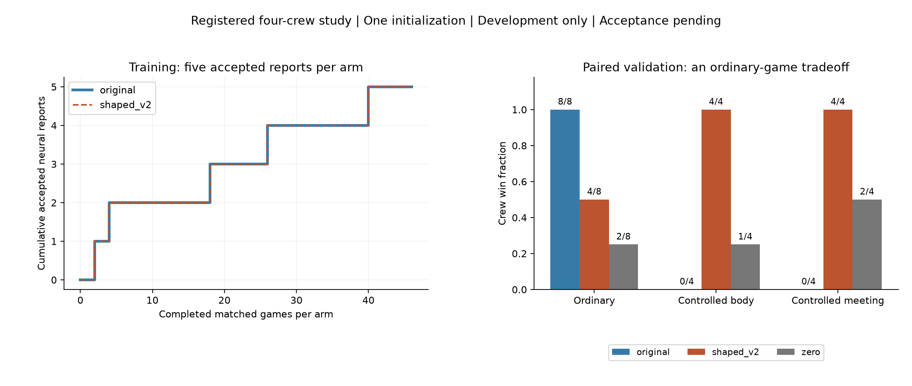

# Registered four-crewmate experiment — development results

2026-10-28. **Exploratory; Phase 6.1 acceptance pending.** The owner-authorized experiment completed normally. No reward, architecture, mechanics, seed schedule or checkpoint rule changed during execution. No further experiment is authorized by these results.

Shaped-v2 learned useful reporting and ballot behavior in the registered controlled scenarios, while the original reward control concentrated on tasks and skipping. The shaped policy won fewer ordinary games than the original. This is an encouraging behavioral change with a material ordinary-game tradeoff, not demonstrated general social deduction.

## Registered comparison and actual budget

The [frozen specification](../../registration/SPECIFICATION.md), [machine plan](../../registration/plan.json) and [activation record](../../registration/ACTIVATION.md) define the experiment. Four living crewmates share PPO weights but retain independent private observations, memories, action sampling and trajectories. One impostor uses the registered script. Ordinary games begin with four living learners; controlled games have a legal scripted prefix and one inactive prefix ghost. Prefix actions earn no learning credit. No learned actor was forced to report or vote.

A is the original four-crew reward profile. B is shaped-v2: +1.5 accepted reports and +2/-1 correct/incorrect ballots, with all registered coefficients unchanged. This comparison tests the **shaping bundle**, not the isolated causal effect of +1.5 reporting. Both models started freshly at initialization 17; a separate zero-update policy remained frozen. The historical focal pilot and nine Phase 6 checkpoints were not reused or overwritten.

| Measured quantity | Original | Shaped-v2 |
|---|---:|---:|
| Accepted individual actor decisions | 2,058 | 2,092 |
| Complete matched training games | 46 | 46 |
| Ordinary / controlled body training games | 23 / 23 | 23 / 23 |
| PPO updates / immutable trained checkpoints | 23 / 23 | 23 / 23 |
| Training wins | 4/46 | 4/46 |
| Accepted neural training reports | 5 | 5 |
| Training game-clock seconds, including prefixes | 7,179.2 | 7,265.4 |
| Seconds under neural control, excluding prefixes | 5,454.2 | 5,540.4 |
| Living own-task completions / automatic ghost completions | 91 / 180 | 94 / 184 |
| Correct / incorrect training ballots / skips | 33 / 79 / 32 | 35 / 78 / 32 |

The first common stopping batch was batch 23. Both arms accepted exactly seeds **2780000–2780045**; registered training slots 2780046–2780063 were unused. All 92 collected training games were accepted; no batch was rejected or repeated. Overshoots of 10 and 44 decisions remained below the registered 3,072 ceiling. Within-match crew-rank decision totals were A: 456/555/479/568 and B: 470/552/479/591. These are exposure slots across matches, not four independently trained models or equally exposed fixed identities.

Selected checkpoints are `original/checkpoint-batch-23-choices-2058.pt` and `shaped_v2/checkpoint-batch-23-choices-2092.pt` under the private experiment directory. Selection used the common budget rule, never validation performance. The zero policy received no updates.

Validation used exactly **2790000–2790007**, ordinary plus one controlled context per seed, for **16 games per policy / 48 executions / eight seed clusters**. The controlled subset comprises four body scenarios and four meetings, with two innocent and two impostor setup reporters. These are eight scenario clusters with correlated contexts and agents, not 48 independent scenarios.

Driver-measured total wall time was **2,072.45 seconds / 34.54 minutes**, within the 14,400-second hard stop. Training through the last saved update took approximately **25.24 minutes**; the remaining validation and result-writing phase approximately **9.30 minutes**. The split uses file timestamps; the total uses the driver's monotonic timer. No timeout, restart, coverage reduction or automatic continuation occurred. The measured total was below the conservative 99–137-minute readiness projection; this single execution does not establish a new speedup benchmark. CPU/RAM usage was not instrumented. Game-clock experience above is not CPU time and is not multiplied by four agents.

## Validation behavior, separated by context

| Policy / context | Wins | Win reason(s) | Neural reports | Correct / wrong ballots | Skips | Living / ghost tasks | Meetings |
|---|---:|---|---:|---:|---:|---:|---:|
| Original / ordinary | 8/8 | 8 tasks | 0 | 0 / 0 | 16 | 106 / 22 | 6 |
| Shaped-v2 / ordinary | 4/8 | 3 ejections, 1 tasks | 4 | 12 / 8 | 0 | 71 / 21 | 7 |
| Zero / ordinary | 2/8 | 2 ejections | 0 | 6 / 4 | 0 | 0 / 42 | 4 |
| Original / body | 0/4 | 4 parity losses | 0 | 0 / 0 | 10 | 26 / 23 | 4 |
| Shaped-v2 / body | 4/4 | 4 ejections | 4 | 11 / 1 | 0 | 0 / 0 | 4 |
| Zero / body | 1/4 | 1 ejection, 3 parity losses | 0 | 2 / 3 | 0 | 0 / 17 | 2 |
| Original / meeting | 0/4 | 4 parity losses | 0 | 0 / 0 | 16 | 25 / 20 | 6 |
| Shaped-v2 / meeting | 4/4 | 4 ejections | 0 | 12 / 0 | 0 | 0 / 0 | 4 |
| Zero / meeting | 2/4 | 2 ejections, 2 parity losses | 0 | 4 / 6 | 0 | 0 / 3 | 4 |

Task and ballot entries are individual event counts; wins and meetings are match-level counts. All automatic ghost tasks earned **zero personal task reward**. Controlled-prefix completions are excluded from learning ledgers; task entries follow the saved post-handoff ledgers. Setup reports in the meeting contexts are excluded from neural report counts. No policy selected an incorrect suspect claim in validation, but B cast **nine incorrect ballots**; these are distinct outcomes. Original cast no non-skip ballots, so its ballot accuracy is unavailable, not zero percent.

Ordinary B ballot accuracy was 12/20 = 60%; controlled B accuracy was 23/24 = 95.8%. Original's task-only ordinary wins and controlled losses must both be retained. Pooling the constructed contexts into a single headline win rate would obscure that tradeoff.

## Reporting opportunities and primary endpoint

Training had **94 legal actor/body pairs per arm**, including **77 within the 23 controlled body matches**. The minimum quotas of eight body matches, 24 legal pairs and two accepted neural reports per arm were satisfied. Initial handoffs provide three real actor opportunities per corpse; additional later corpses can add pairs. Actor/body pairs are correlated and are not independent bodies or games.

| Validation policy | Ordinary legal pairs / accepted reports | Body legal pairs / selected / submitted / accepted | Body games with any neural report | Controlled initial actor-meetings |
|---|---:|---:|---:|---:|
| Original | 7 / 0 | 14 / 0 / 0 / 0 | 0/4 | 12 |
| Shaped-v2 | 4 / 4 | 12 / 12 / 12 / 4 | 4/4 | 12 |
| Zero | 30 / 0 | 16 / 0 / 0 / 0 | 0/4 | 12 |

B's three surviving learners all selected legal reports at body handoff, but only one report per corpse was accepted. The eight competing submissions were not credited as eight extra reports. Thus its body actor-pair acceptance conversion is 4/12, while its primary game-level report endpoint is 4/4. Visibility, range, legal, held-option and choice counters are separately retained in [metrics.json](metrics.json). All validation coverage checks passed; no registered inconclusive flag was raised. Passing coverage is not Phase 6.1 acceptance.

Primary paired B-A and B-zero differences were **+100 percentage points**, across four body scenario clusters; A-zero was zero. The registered descriptive percentile bootstrap intervals were [+100,+100], [+100,+100] and [0,0] respectively. These degenerate resampling intervals reflect four unanimously aligned cases, not certainty about a population effect. Ordinary paired B-A wins were **-50 points**, descriptive interval [-87.5,-12.5]; controlled B-A wins were **+100 points**, interval [+100,+100], across eight clusters in each stratum. No multiple-comparison or generalization claim follows.

## Reporter identity and remaining shortcuts

Actual ordinary reports were A: **0 crew / 6 impostor**, B: **4 crew / 3 impostor**, zero: **0 crew / 4 impostor**. In controlled body games they were A: 0/4, B: 4/0, zero: 0/2. Meeting prefixes contribute two crew and two impostor setup reports per policy; A additionally had two later impostor reports. These shares describe events, not opportunity-adjusted role propensities: there are four crew actors, one impostor, endogenous trajectories and no impostor-opportunity denominator in this study.

For the **initial balanced meeting challenge**, score only nonreporter neural observers, first aggregate within each game, then average games equally. There are two games per reporter role: four nonreporter actor-meetings under innocent reporters and six under impostor reporters, per policy.

| Initial reporter role | Original policy top-1 | Shaped-v2 policy top-1 | Zero policy top-1 | Accuse reporter | Avoid reporter | Uniform |
|---|---:|---:|---:|---:|---:|---:|
| Innocent crew | 50% | 100% | 0% | 0% | 50% | 33.3% |
| Impostor | 100% | 100% | 66.7% | 100% | 0% | 33.3% |

B's balanced macro top-1 is 100%, against 50% for always accusing the reporter, 25% for avoiding and 33.3% for uniform. It therefore exceeds the simple accuse-reporter explanation on these four constructed cases. The **reporter-pattern confound is not eliminated**: scripts, choreography, private observation histories, public claims, role-correlated behavior and tiny coverage can supply other shortcuts. B's initial controlled audits contain no direct witnessed-elimination events; strong performance there is not evidence of broad natural-game deduction. Natural report patterns remain policy-dependent, and reporter share alone cannot diagnose biased scripted choices.

## Identification scores versus action selection

The Phase 4 belief predictor is **one shared frozen model**, evaluated on different policy-generated observations. The two trained PPO policies and zero-update policy are action policies, not three newly trained belief predictors. Differences below reflect visited evidence and eligible candidates, not retraining of that predictor. Scores are the registered first eligible pre-ballot audit per actor/meeting, not full roaming trajectories.

| Policy / context | Actor-meeting audits | Frozen belief top-1 | NLL | Multiclass Brier | Ten-bin ECE | Wrong at >=90% confidence | Conditional policy vote-ranking top-1 |
|---|---:|---:|---:|---:|---:|---:|---:|
| Original / ordinary | 16 | 100% | 0.026 | 0.007 | 0.024 | 0 | 100% |
| Original / body | 10 | 100% | 0.002 | <0.001 | 0.002 | 0 | 100% |
| Original / meeting | 16 | 93.8% | 0.134 | 0.085 | 0.078 | 0 | 87.5% |
| Shaped-v2 / ordinary | 21 | 57.1% | 1.402 | 0.719 | 0.369 | 5 | 57.1% |
| Shaped-v2 / body | 12 | 83.3% | 0.386 | 0.204 | 0.114 | 1 | 91.7% |
| Shaped-v2 / meeting | 12 | 83.3% | 0.212 | 0.141 | 0.108 | 0 | 100% |
| Zero / ordinary | 12 | 100% | 0.001 | <0.001 | 0.001 | 0 | 66.7% |
| Zero / body | 6 | 100% | 0.003 | <0.001 | 0.003 | 0 | 33.3% |
| Zero / meeting | 12 | 91.7% | 0.177 | 0.113 | 0.103 | 0 | 33.3% |

The original policy's correct conditional ranking often coexists with an actual skip, exposing an action-selection limitation. B acts on evidence more often, but its different trajectories include six high-confidence frozen-predictor mistakes and ordinary wrong ballots. **Policy vote-target preferences are not calibrated identity beliefs**; near-uniform target probabilities can still produce a correct greedy ordering. Full bins, conditional-ranking scores, witness strata and unavailable-data indications remain in the aggregate metrics/private summaries. Audits within the same scenario/meeting are correlated.

## Integrity, reproducibility and limitations

Read-only post-run verification strictly loaded all selected policies, confirmed the unchanged zero tensor, matched all 48 seed/context records, verified the first common stopping point, checked finite optimization and zero illegal actions/ghost task rewards, and **exactly reproduced the registered aggregate** from saved summaries. All eight preservation manifests passed: 234 protected historical files, 53 focal-pilot entries, 25 earlier diagnostic entries, 19 reporting-diversity entries, 25 learning-smoke entries, nine four-crew engineering entries, 19 readiness entries and all nine historical selected checkpoints. These manifest counts overlap; they are not 393 distinct artifacts. Protected branches/main remained unchanged. No final familiar/patient test was opened. No full training rerun was performed or claimed.

Offline replay verification passed for all 48 validation recordings: matching outcomes and decision counts, normalized real neural probabilities, no neural decisions before legal handoff, no dead neural/ballot/claim actions, and no meeting task/position updates across **3,051 consecutive meeting frame pairs**. The independent spectator is left open with 96 completed recordings: 48 sampled training replays plus all 48 validations. Playback does not run training or stream unfinished games.

Source commit: `723c8d4774a25af6ccb6a863e141c68ae3966a38`; spectator: `e8a815f83bc98cab5c99c862f280bbdbffc509b2`. Plan SHA-256: `bc449451df3a83bdf5a38c83f7be0cb36e616895f34d9bdca2400c5d0d732fd1`; runtime: `2875af6f30f25f588ec0cd52c8a14d5ac6313053c995fe3ef1ac117b2df51bca`; fresh/frozen tensor: `1a572645635edf2bb6a802a5572892b6321747452176abd4755fe5e5cfedc3d2`. Selected tensor/file hashes are in metrics.json. Historical checkpoints remain source-compatible only in their preserved regimes; no loader was bypassed.

Principal limits: one initialization; eight seed clusters with only four primary-reporting cases; controlled choreography and scripted opposition; different stochastic training versus greedy evaluation; behavior-dependent evidence availability; no isolated reporting-coefficient test; no independent final test; and no natural-game generalization or causal shortcut-removal claim. The original and shaped policies trade task completion against reporting/voting rather than showing uniformly better play.

## Recommendation and stop boundary

Preserve these policies and the frozen protocol. First review the existing ordinary wrong-ballot/high-confidence-error recordings, then separately preregister a replication with fresh development scenarios and additional initializations before considering reward changes or scaling. Carry the ordinary-performance regression and balanced reporter challenge forward as separate outcomes. This report does not authorize more training, final-test access, impostor work, larger lobbies, self-play, deployment, publication or PR merging. **Phase 6.1 acceptance remains pending.**

The report, aggregate JSON and figures are local research documents. Complete raw observations, post-game role labels, checkpoints, full replays and verification helpers remain unchanged in ignored local storage; none has been pushed to GitHub.
