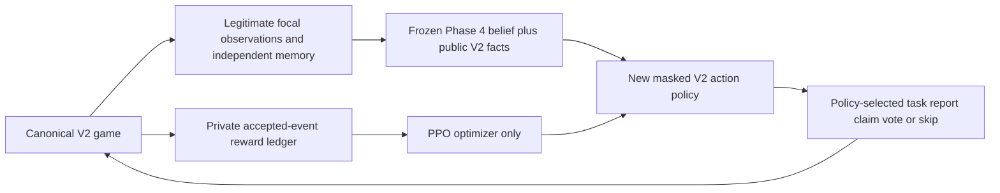

# V2 reward comparison — ready for owner approval, not started

2026-10-27. Implementation continues from `7468ba8`; final tested learning runtime is
`a4e117b`. Canonical V2/PR #9 files and all previous studies remain unchanged.

**Next stage is actual crewmate training, after approval. No further standalone
reporting diagnostic is proposed.** This first stage is deliberately small and cannot
complete Phase 6.1 acceptance.

## Implemented experimental rewards

| Focal event | A: original V2 rewards | B: shaped hypothesis |
|---|---:|---:|
| Own assignment completed while alive | +1 | +1 |
| Own assignment completed automatically by ghost | +1 | **0** |
| Accepted legal body report | 0 | **+1.25** |
| Submitted correct vote | 0 | **+2** |
| Submitted incorrect vote, including self-vote | 0 | **−1** |
| Explicit or automatic skip | 0 | 0 |
| Death/ejection | −5 once | −5 once |
| Crew team win / impostor team win | +10 / −10 | +10 / −10 |
| Timeout draw | −5 | −5 (retained explicitly) |
| Time | −.005 per .6 simulated seconds | Same |

Profiles: [original](../../configs/crewmate-v2-learning/original-rewards.json) and
[shaped](../../configs/crewmate-v2-learning/shaped-rewards.json). `RewardConfig.from_file`
loads versioned finite coefficients; disabling with `LearningEnv(rewards=None)` preserves
the original reward calculation. Default opponents and execution also preserve original
V2 behavior; the pilot explicitly opts into varied opponents and forced-wait coalescing.

Only engine-accepted focal reports earn credit. Approaches, invalid/repeated submissions,
losing simultaneous submissions and other actors' reports earn none. A legal submitted
ballot is credited once per meeting; deadline-default skips never earn vote shaping.
Task IDs, bodies, ballots, death and terminal rewards are deduplicated/reset per game.
Event order distinguishes a living completion from later ghost work in the same tick.
Ghost tasks still advance the public bar and can produce a team victory.

A trainer-only tap records each actual physics step. It composes raw and discounted
reward components across extended options, including terminal kills whose clock does
not advance. Gamma remains **.99 per .6 seconds** and physical-time lambda remains .95.
Reward labels/components, hidden roles, source hashes and mode/config flags never enter
the actor packet or memory. Only PPO's optimizer uses the scalar training return; frozen
evaluation never consumes reward feedback. The policy has no previous-reward input.



No witnessed-kill reporting/voting override was added. Tests explicitly preserve chosen
skip behavior and credit only accepted actions. Other actors use observation-only scripts;
the focal is excluded from every scripted controller callback.

## Exact first-stage plan

| Item | Registered proposal |
|---|---|
| Models | **Two fresh models**, A/B, both initialization seed **17** |
| Budget | **512 actionable policy choices/model**, 1,024 total |
| Initialization | Identical initial tensor hash in the pair; never resume a historical checkpoint |
| Training context | Canonical five-player V2, **deduction-only frequency 1.0 in both arms** |
| Match mixture | Held fixed; no simultaneous curriculum/mix comparison and no final mixture selected |
| Rollout / update | 128 transitions; 4 PPO epochs; minibatch64 |
| Optimizer | Adam lr.0003; clip.2; value coefficient.5; entropy.02; max gradient norm.5 |
| Discount / GAE | Physical-time gamma.99 and lambda.95 per .6 seconds |
| Checkpoints | Immutable128/256/384/512; **512 only** is the candidate; no best-of-validation selection |
| Execution | One CPU process, one Torch thread, deterministic algorithms; no parallel benchmark |
| Hard wall ceiling | **10,800 seconds / three hours**, training and validation combined |
| Replication | Seed29 is planned **after review and separate approval**, not in stage one |

The initial four-model/1,024-choice design exceeded the provisional compute forecast.
Only smoke was run; the first-stage scope was reduced before any pilot training. The
single initialization limits inference. Replication is required before claiming a stable
reward effect or Phase 6.1 acceptance.

The new policy has **51,778 trainable parameters**. Global42, candidate4×29, task4×8
and action96×23 tensors feed shared candidate29→32→32 and task8→16→16 encoders.
Their means join globals in context90→128→128. The action scorer199→64→1 receives
context plus the relevant candidate/task embedding and action descriptor; critic128→64→1
uses the same actor-only context. All hidden layers use ReLU. Task choices carry a new
actor-only row index into sorted personal tasks; there are no raw ID/role embeddings.
Legal padding is masked before categorical sampling. This intentionally rejects historical
policy schemas/checkpoints. Phase 4 belief weights remain frozen and separate.

Forced-wait coalescing executes the same physics ticks, observations, memory updates and
reward frames, returning to PPO only when a strategic choice exists. It never forces a
report/vote, changes a timer or skips witnessing opportunities. Both arms use the same
execution protocol. These actionable choices are not directly comparable to old Phase 6
decision counts; simulated seconds and forced windows are recorded alongside them.

### Fresh development partitions and opponents

| Partition | Match seeds |
|---|---|
| Training | 2,700,000–2,709,999 |
| Validation | 2,710,000–2,710,003 |
| Infrastructure smoke | 2,720,000–2,720,003 |
| Unit fixtures | 2,730,000–2,730,099 |

These are disjoint from historical/research/final partitions, diagnostic2,630,000 and
engineering2,610,000 ranges. No familiar/patient final partition is opened or created.
Episode index j selects training seed start+floor(j/3), report-style rotation j mod3.
Thus each scenario cycles every scripted actor through prompt/inspect/bypass without
consulting hidden role truth. Scripted task styles, meeting styles and hunter/patient/
self-report behavior vary through independent private streams. The two arms use the
same ordered episode contexts; different learned behavior can change how many contexts
they reach, so used contexts and simulated experience are reported.

Validation is **20 games/model, 40 model-games across four distinct scenarios**:

- Four seeds × three reporting rotations, deduction-only: 12 varied-opponent games.
- Four seeds, deduction-only: 4 original-opponent controls.
- Four seeds, ordinary mode, varied rotation0: 4 task-victory generalization checks.

All contexts are matched across reward arms. Style assignment is counterbalanced by
role without reading roles; accepted reporter identities are **not guaranteed balanced**.
Per-game results provide offline reporter-role strata for balanced analysis only when
both strata occur. Original controls test a reporting-distribution shift, not a novel
behavior family. Never select seeds/rotations afterward to make outcomes look balanced.

## Metrics and review criteria

The prepared runner records accepted reports versus unique legal focal actor-body pairs
at policy boundaries. It separately records physical visibility/range and scheduled legal
windows, so a fleeting opportunity inside a held option is not mislabeled a policy refusal.
It records correct/incorrect/self votes, explicit/default skips, unsubmitted interrupted
ballots, living/ghost tasks, death, win reasons, raw/discounted reward components, simulated
experience, forced windows, optimizer entropy/KL/clipping/gradients and wall cost.

At the first legal pre-vote opportunity, evaluate the **unchanged shared Phase 4 predictor**
and the new policy's conditional non-self vote-ranking distribution separately: tie-averaged
top1, NLL, multiclass Brier and 10-bin ECE. Conditional vote ranking is an action-preference
proxy, not a separately trained identity head. Report actual vote/skip/self-vote probability
beside it. Do not call two policies two newly trained belief models.

Reporter-only accuse/avoid/uniform baselines use the same public candidates. Report results
by reporter-role and opponent regime, not only aggregate wins. The inference-only probe
zeroes the raw report-counter feature without changing the actual game/action. It is a
**partial channel probe**: frozen belief and other evidence may still encode reporting,
so low sensitivity cannot establish reporter independence.

First-stage review asks whether B produces at least one accepted focal report and improves
reporting per legal opportunity, with adequate opportunities (proposed minimum8 per arm;
otherwise inconclusive). Examine non-skip participation and wrong votes per legal ballot,
not cast accuracy alone. Win-rate gains explained by reporter-only ranking or task rewards
do not establish deduction. Compare all four scenario clusters and both opponent regimes;
the paired percentile bootstrap clusters rotations/modes by scenario and is conditional
on one initialization. Four clusters are exploratory, not powered acceptance evidence.

### Incentive risks and justified alternatives, before training

- With +2/−1, voting has positive immediate expectation when p(correct)>1/3. Two-candidate
  random guessing is rewarded. Changing the wrong-vote coefficient to **−2** would make
  50% guessing neutral, but would not eliminate the reporter shortcut. It is an available
  versioned hypothesis, **not silently substituted into this pilot**. The prepared B uses
  the exact requested +2/−1 profile so the owner can approve it explicitly.
- Correct-vote rewards can repeat across different meetings targeting the same impostor.
  Report that count; do not mistake repeated local credit without ejection for team benefit.
  Bodies cannot be farmed repeatedly because accepted reporting is deduplicated.
- Gamma.99 discounts a 120s-delayed outcome by about .134; a 135s meeting by about .104.
  Immediate report/vote bonuses can dominate delayed team outcomes. Inspect raw and
  discounted components, stalling, repeated meetings, timeouts and survival; gamma and
  timers remain unchanged in this first comparison.
- Removing ghost individual reward can change survival/task incentives, and the A/B reward
  contrast is a **bundle**, not an attribution to any single coefficient. Team/ghost mechanics
  remain identical. The frozen predictor may still retain its historical reporter bias.

If reporting opportunities remain insufficient, propose a separately registered curriculum
within training, not another standalone reporting round: actor-safe scripted prefixes from
training seeds can reach a real visible-body/witness state; replay the focal's legitimate
history, preserve cooldown/tasks/ownership and begin reward credit only after handover.
Eligibility must use focal-visible evidence, not secret target labels. No body/evidence
fabrication or focal report/vote override. Such a curriculum is **not implemented or enabled
in this pilot**, and may not be added midway without approval.

## Measured compute and stopping rules

Three minimal source-specific smoke passes used 32 choices/arm each, **192 choices total**,
279.37 wall seconds combined. The first sized the proposal; subsequent passes confirmed
version locks and durable logging. The final 86.02s pass verifies the frozen runtime.
Each arm simulated **528.2 seconds**,
coalesced **446 forced windows**, completed one episode and round-tripped its checkpoint.
Initial/actor-action traces match within each pair; tensor updates and traces reproduce
across passes. Frozen Phase 4 weights stayed unchanged. One chance-correct vote occurred;
the shaped raw component is exactly +2. No focal report occurred in smoke; +1.25 reports,
ghost exclusion and arbitration are validated by controlled integration tests. This is
infrastructure verification, **not successful learning**.

Measured scaling for the first pair: **22.9min training +58.8min validation** assuming
every validation game reaches the canonical900s limit. Baseline projection81.7min; 2×
margin gives **163.4min**, below the hard180min ceiling. This is approximate, workload/
hardware-dependent and not an authorization to spend that time. Preflight recomputes
the forecast from the matching smoke record and refuses if it exceeds the ceiling.

Stop and preserve checkpoints on wall ceiling, source/core-library/config drift, illegal or
masked actions, navigation failure, nonfinite rewards/weights/optimizer diagnostics,
approximate KL>.10, clip fraction>.80, pre-clipping gradient norm>100, or frozen-belief
mutation. Failed/incomplete runs are not replaced by earlier checkpoints or quietly
extended. Episode, optimizer and validation JSONL records are flushed incrementally,
so completed evidence survives a stopped run. Revised scope, curriculum, rewards or
compute requires owner approval.

## Files, reproduction and explicit approval gate

[Smoke results](smoke-results.json) and [validation](validation.json) record **96 passing
tests**: 29 new learning tests and 67 existing V2/diagnostic tests. All original source
hashes, nine selected checkpoints and prior raw archives are verified unchanged. Minimal
new checkpoints/RNG/optimizer state remain in ignored `temp_v2_learning_smoke/`,
`temp_v2_learning_smoke_final/` and `temp_v2_learning_smoke_verified/`; they are smoke-only,
not candidates. Source-specific
guards intentionally prevent loading an older smoke under a changed runtime. No exact
mid-episode training-resume API is claimed; rerun from the registered initialization.

```powershell
python -m pytest tests/test_v2_learning_rewards.py tests/test_v2_learning_pipeline.py --basetemp=temp_fresh_learning_checks -q
python -m crewmate_v2.learning.train smoke --output temp_fresh_learning_smoke
```

The actual pilot entry is guarded. [Approval-required.json](../../configs/crewmate-v2-learning/approval-required.json)
is deliberately **approved:false** and binds the final plan/runtime hashes. Do not
turn it into an approved record without the owner's explicit authorization.

```powershell
# AFTER separate owner approval, using a fresh directory and an approved hash-bound record:
python -m crewmate_v2.learning.train pilot --output temp_v2_reward_pilot_stage1 --approval owner-approved-v2-pilot.json --smoke-record temp_v2_learning_smoke_verified/smoke.json
```

No full pilot, historical checkpoint overwrite, final-test evaluation, merge, publication,
learned impostor work, population expansion, parallel benchmark or deployment was performed.
Approve this seed17 pair explicitly before the next stage begins.
