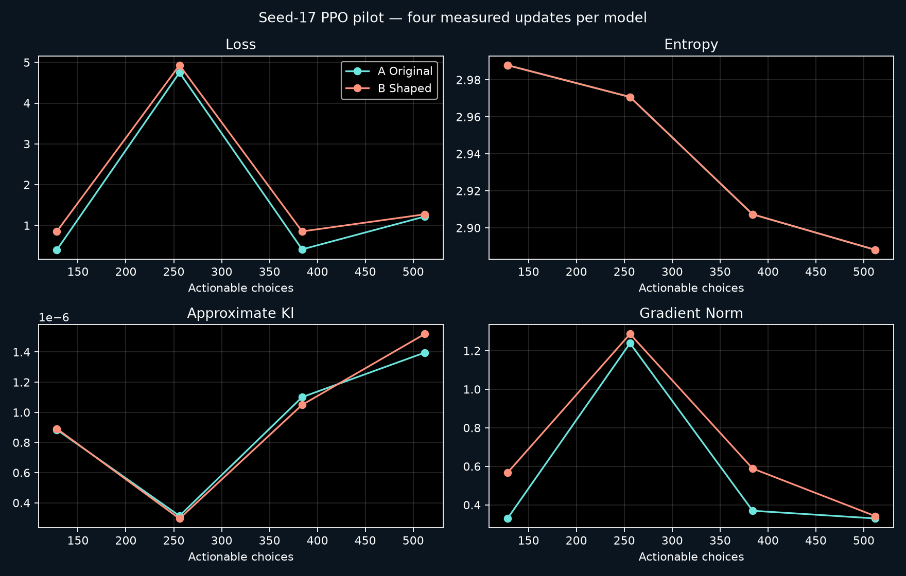
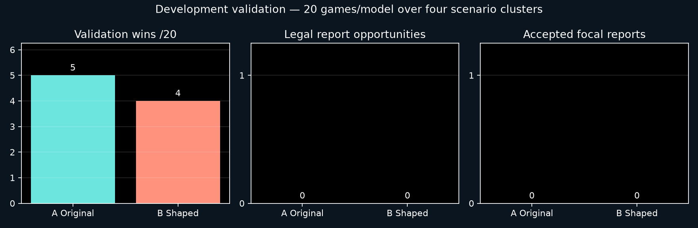

# Crewmate V2 seed-17 pilot: measured results and review

**Development only, exploratory. Both arms finished. Phase 6.1 acceptance remains pending.**

The spectator integration worked, and the paired PPO experiment completed within its cap. This small experiment does **not** demonstrate a benefit from reward shaping. Reporting exposure was too scarce to test the reporting incentive, and the apparent voting competence remains consistent with the existing reporter-pattern shortcut.

## Experiment and compute

Model A used original rewards; Model B used the previously implemented shaped rewards. Each started independently from the same seed-17 initialization and received exactly **512 actionable choices**, in four updates of 128 choices. Four headless workers managed eight independent streams, giving 16-choice stream segments per update. Existing masking, PPO, time-aware GAE and episode-boundary handling were reused without changes. The lobby remained four crew plus one impostor.

The shaped configuration retained living own-task +1, legal accepted report +1.25, correct vote +2, incorrect vote -1, death -5, team win +10, team loss -10 and the existing time penalty. Automatic ghost work earns no shaped task bonus; the original configuration credits it. No coefficient was adjusted during or after this run.

Training seeds came from the registered development training partition beginning at 2700000. Validation used scenarios **2710000–2710003**, each with three varied-reporter deduction rotations, one original-opponent deduction control and one ordinary game: **20 games per arm, 40 executions, four distinct scenario clusters**. These are not 40 independent scenarios. The fixed 512-choice checkpoint was selected by registration, without searching validation outcomes.

| Training measure | A Original | B Shaped |
|---|---:|---:|
| Actionable choices / updates | 512 / 4 | 512 / 4 |
| Completed episodes / retained partial streams | 20 / 8 | 20 / 8 |
| Aggregate simulated seconds | 11,632.4 | 11,632.4 |
| Aggregate simulated hours | 3.231 | 3.231 |
| Actual training minutes | 10.210 | 10.892 |
| Living tasks / automatic ghost tasks | 34 / 41 | 34 / 41 |
| Correct / incorrect training ballots | 6 / 17 | 6 / 17 |
| Explicit skips | 6 | 6 |
| Legal reporting pairs at policy choices | 2 | 2 |
| Accepted reports | 0 | 0 |

Total train-and-validation wall time was **2,904.55 seconds (48.41 minutes)**, below the 10,800-second hard stop. The 21.10 minutes of training leaves approximately 27.31 minutes for validation and runner overhead. Simulated experience sums independent streams; it is not elapsed time in one match. Training counts include completed episodes and the preserved partial streams. Training action counts and simulated experience were identical between arms despite different final parameters.

## Validation behavior

| Measure | A Original | B Shaped |
|---|---:|---:|
| Wins / losses | 5 / 15 | 4 / 16 |
| Ordinary task wins / ordinary games | 4 / 4 | 4 / 4 |
| Deduction ejection wins / deduction games | 1 / 16 | 0 / 16 |
| Parity losses | 15 | 16 |
| Living own tasks / automatic ghost tasks | 80 / 0 | 80 / 0 |
| Visible body pairs at policy choices | 2 | 0 |
| Legal reporting pairs at policy choices | 0 | 0 |
| Physical legal reporting pairs during options | 2 | 0 |
| Accepted reports | 0 | 0 |
| Correct / incorrect ballots | 24 / 3 | 24 / 5 |
| Cast-ballot accuracy | 88.89% | 82.76% |
| Participation in legal ballot opportunities | 27 / 27 | 29 / 29 |
| Explicit / default skips | 0 / 0 | 0 / 0 |
| Survived / games | 8 / 20 | 9 / 20 |
| Mean focal survival seconds | 341.93 | 368.21 |
| Mean common original-reward return | -7.358 | -8.127 |
| Counterfactual shaped return, mean | -5.108 | -5.977 |

The only paired outcome difference was scenario 2710001, varied-reporter deduction rotation 1: A won by impostor ejection, B lost by parity. Both lost all four original-opponent deduction controls. All 20 paired endings are listed in [the aggregate report](REPORT.md). Full validation replays were not exported, so the specific sequence causing the one outcome difference cannot be reconstructed from the stored aggregates.

The scenario-cluster bootstrap gives B minus A win rate **-5 percentage points**, with a descriptive 95% percentile interval **[-15, 0] points**. Four clusters and one initialization cannot establish a reliable disadvantage or improvement. Modes and rotations remained within clusters. There is no estimable reporting-rate difference because both validation denominators are zero.

| Validation action choices | A | B |
|---|---:|---:|
| Task | 109 | 107 |
| Wait | 1,366 | 2,673 |
| Continue option | 296 | 0 |
| Emergency travel | 113 | 5 |
| Follow | 76 | 21 |
| Flee | 20 | 4 |
| Claim sighting | 27 | 0 |
| Claim location | 0 | 17 |
| Claim suspect | 0 | 12 |
| Vote | 27 | 29 |
| All actionable choices | 2,034 | 2,868 |

Wait choices were **67.16% versus 93.20%**. Forced windows are separate (6,021 versus 6,467); a selectable continue action is not automatically a forced window. Action shares measure decisions rather than time, so the larger wait share alone does not prove an equivalent increase in waiting duration. Nevertheless, the shaped arm shows no observed improvement in task contribution, reports or deduction wins. Its twelve suspect claims and two additional incorrect ballots warrant attention. Their evidence support and claim-target correctness cannot be determined from the validation aggregates.

## Evidence and the reporter confound

Reporting opportunities distinguish a unique episode/body pair visible and legally reportable **at a policy choice** from a physical opportunity occurring inside a held option. Training had only **0 accepted reports / 2 legal pairs** in each arm; validation had **0 / 0**, so its conditional reporting rate is **unavailable**, not 0%. A's two physical validation opportunities were inside options, not two demonstrated refusals at policy choices. The shaped report bonus never fired in training. This pilot therefore gives almost no evidence about learning to report.

There were no retained direct elimination witnesses at validation ballot decisions. Direct-witness accuracy is unavailable; the no-direct-witness stratum contains all 24/3 and 24/5 ballots above. **No direct witness does not mean no legitimate evidence:** body sightings, reports, public claims and task proof may still matter. General evidence sufficiency was not independently annotated.

The **same frozen Phase 4 belief predictor** was used in both arms. It was not retrained. Its different measured scores reflect different observed trajectories.

| Identification at ballot decisions | A trajectories | B trajectories |
|---|---:|---:|
| Decisions scored | 27 | 29 |
| Shared frozen-belief top-1 accuracy | 88.89% | 82.76% |
| Frozen-belief NLL | 0.379 | 0.600 |
| Frozen-belief Brier score | 0.193 | 0.311 |
| Frozen-belief 10-bin ECE | 0.092 | 0.154 |
| Frozen-belief incorrect predictions at confidence >=0.9 | 1 | 5 |
| Policy's nonself vote-target ranking accuracy | 88.89% | 82.76% |
| Reporter-only accuse baseline | 88.89% | 82.76% |
| Uniform-candidate baseline | 38.89% | 39.08% |
| Policy ranking when reporter was crew | 0 / 3 | 0 / 5 |
| Policy ranking when reporter was impostor | 24 / 24 | 24 / 24 |
| Equal-weight reporter-role accuracy | 50% | 50% |

A reporter-identity-only heuristic fully matches aggregate target accuracy. This leaves the historical shortcut unresolved; it does not establish the exact target of every actual ballot. The role-balanced 50% is not a chance baseline because candidate counts vary. Meetings/ballots repeat within games and these calibration estimates are descriptive, not independent-trial confidence estimates.

Policy probabilities normalized over nonself vote candidates were close to uniform (winning probabilities about 0.3334 or 0.5002). Greedy ranking can amplify tiny differences; this distribution is an action preference, **not** a calibrated impostor-identity belief. Its NLL/Brier scores were 0.963/0.611 and 0.958/0.609. Ablating only the raw report-counter feature channel changed action probabilities by mean TV about 1.46e-6 and 1.59e-6. That does not establish reporter independence: the frozen belief and other history can already encode reporting information.

Twenty-four correct ballots produced only one versus zero deduction wins. Team coordination, other players' votes and timing can separate correct individual votes from ejection; the saved validation data cannot isolate the cause here.

## Rewards, learning and possible shortcuts

| Actual training reward component | A | B |
|---|---:|---:|
| Existing time penalty | -96.937 | -96.937 |
| Living task contribution | +34 | +34 |
| Automatic ghost task contribution | +41 | 0 |
| Correct ballot contribution | 0 | +12 |
| Incorrect ballot contribution | 0 | -17 |
| Accepted report contribution | 0 | 0 |
| Death | -90 | -90 |
| Team wins / losses | +10 / -190 | +10 / -190 |
| Total, completed plus partial streams | -291.937 | -337.937 |

The 46-point return difference consists of 41 removed ghost-task points and a net -5 ballot adjustment. It is an objective-scale difference, not evidence of worse behavior. Validation used the common original reward; its counterfactual shaped scores were calculated offline, not paid as training rewards.

No repeated-body report farming was observed; no reports were made. Correct-ballot +2/incorrect -1 has positive expected immediate credit above one-third accuracy, so guessing can be locally attractive. Each arm had nine repeated correct ballots beyond the first correct ballot in a validation game, illustrating that local ballot credit need not translate into ejection. This is a structural risk, not proof the policy learned to exploit it. Both arms made the same 6 correct and 17 incorrect training votes.

Each arm produced eleven completed replays from streams selected before outcomes. In those samples, the focal agent made ten claims including two suspect claims: one targeted an impostor and one a crewmate. Hidden roles were used only for this offline aggregate scoring. These are not complete claim counts for training or validation, and evidence support was not exported, so an incorrect claim cannot automatically be called a random accusation.

All four PPO updates were finite; no illegal actions or navigation failures were recorded. Approximate KL stayed around 0.3e-6–1.5e-6, clipping was zero, gradients were finite, and explained variance stayed near zero (about 0.0006–0.0052). The policies changed very little. The plots show **four measured updates**, not a mature learning curve. There was no zero-update policy evaluation control, so absolute task and voting competence cannot be attributed to these updates.

## Spectator and reproducibility

The original spectator at `3fd3601` was recovered and preserved. Follow-up `6dd8a1b` is published on its separate spectator branch in **draft [PR #11](https://github.com/Hadisovic/social-deduction-ai/pull/11)**, unmerged. Real training export remains on the local crewmate branch. The viewer displays completed PPO matches with actual neural distributions, values, rewards and model/stream labels; it does not stream unfinished frames.

Before the pilot, a paired 72-choice engineering run with recording off/on preserved exact actions, rewards, episode boundaries, final observations and updated weights. Four real completed PPO recordings were produced. Wall time was **87.28 / 87.61 seconds**, ratio **1.00387**: about 0.4% observed difference in one short pair, subject to timing noise. Independent GUI overhead was not isolated in a controlled benchmark.

The native spectator window was discovered, a real PPO frame rendered, and the owner confirmed the visible Skeld replay and neural panel before training. Native screenshot permission timed out; owner confirmation resolved that check. The independent app heartbeat stayed live during the experiment and automatically discovered **22 completed pilot recordings** (eleven per arm), in addition to four engineering recordings. User-selected manual inspection intentionally pauses automatic advance; M returns to auto-next. Partial `.writing` files remain unpublished to the library. The GUI remained open; there was no observed restart or crash.

A final process snapshot recorded approximately **32 MiB resident / 255 MiB peak resident** for the viewer and 2,444.48 cumulative CPU seconds. This is a process snapshot, not average CPU utilization. Whole-experiment trainer/worker CPU and peak RAM were not continuously instrumented; no such measured series is claimed.

Verification passed **31 spectator tests and 178 crewmate tests**. The final audit rechecked 234 protected source/asset/checkpoint files, 25 pre-training artifacts, 19 reporting-private artifacts, 25 earlier smoke artifacts and all nine historical selected checkpoints. All eight new pilot checkpoints loaded under strict source/schema compatibility, and both selected final tensor hashes matched the runner's recorded hashes. Main, the original spectator branch and the impostor reference stayed unchanged.

The initial tensor hash matched across arms; the 64 recorded choices in the sampled first-update prefix also matched exactly in actions, probabilities, values and entropy. The bounded recording-on/off smoke passed. The complete 512-choice experiment was not rerun for an additional deterministic replication. The private artifact manifest pins 53 pilot files. Aggregate verification and final hashes are in [verification.json](verification.json).

Raw logs, privileged spectator recordings, partial episodes and checkpoints remain local and unchanged. No final partitions, seed-29 replication, architecture/reward tuning, impostor changes, merges, deployments or crewmate publication occurred.

## Recommended next training experiment — requires approval

Run a separately registered **small learning pilot with an observation-based evidence curriculum**, rather than extending this sparse experiment blindly. Keep canonical mechanics and the original/shaped reward definitions fixed, preserve actor privacy and independent memory, and use legitimate simulated histories in which the focal crew actually encounters evidence. Any curriculum sampling must depend on observable opportunities, never whether a candidate is truly an impostor; no fabricated evidence or automatic focal reporting/voting should be introduced.

Include a zero-update policy and a legitimate scripted reference in the same evaluation. Prospectively require enough reportable-body choices and meetings from both reporter roles to make the comparison informative; record evidence support and actual claim/vote targets for offline analysis. Use fresh development validation scenarios and report ordinary-game performance separately from the curriculum. Register a modest larger choice budget and wall ceiling only after approval, with the same budget in both reward arms.

The immediate obstacles are **scarce useful evidence exposure, the unresolved reporter shortcut, and action selection/coordination**, with too few PPO updates to distinguish their learning effects. This pilot establishes a functioning, observable training pipeline. It does not establish learned deduction or a reward-shaping improvement. Do not launch the next experiment automatically.

## Local artifact index

Paths below are relative to the crewmate research worktree; all remain local.

- `local-runs/seed17-live-pilot-20261027/`: registration, complete comparison and pilot record.
- `original-17/` and `shaped-17/` beneath it: immutable checkpoints at 128/256/384/512 choices, update/episode logs and validation records.
- `local-runs/live-watch/pilot/{original,shaped}/`: real completed training replays plus preserved incomplete `.writing` files.
- `local-runs/live-watch/engineering-smoke/proof.json`: recording noninterference and bounded overhead comparison.
- `local-runs/seed17-live-pilot-artifact-hashes.json`: private raw-file integrity manifest.
- [metrics.json](metrics.json): aggregate behavior, reward components, uncertainty, calibration and sampled-claim counts.
- [REPORT.md](REPORT.md): generated numeric summary and each paired match ending.
- [../HANDOFF.md](../HANDOFF.md): branch state and exact viewer restart instructions. The pilot command must not be repeated.
