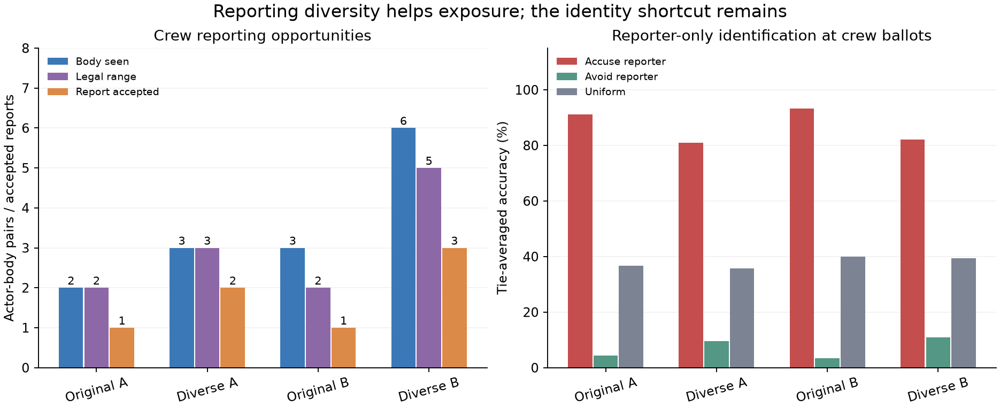

# Reporting-diversity diagnostic — development-only

**Reporting can be diversified legally, but this population is not yet a clean basis
for a deduction-learning claim.** Crew discovery/reporting improves; the reporter-only
shortcut falls from 92.4% to 81.6% identification accuracy, still far above its matched
37.9% uniform control. Do not begin neural training from these results. Prepare a
counterbalanced opponent validation fixture before approving the small pilot below.
Phase 6.1 acceptance remains **pending**.

## Design, runtime and safeguards

Completed 2026-10-27 in **277.45 seconds (4m 37s)** under the 900-second execution
ceiling. Eight development scenarios, **2,630,000–2,630,007**, each received ordinary A
and deduction-only B with the diverse scripts: **16 new primary games**. One archived
baseline B rerun and one diverse A replay bring new executions to **18**. The original
16 baseline games were reused, not rerun or counted as independent new scenarios.

Start: `cad6c34`; frozen runner: `0d9b920417a62d9abde274689f3718b8f25ea9d0`.
See [registered protocol](PROTOCOL.md), [aggregate metrics](aggregate.json),
[style/exposure supplement](supplement.json), [validation](validation.json), and the
[previous report](../crewmate-v2-diagnostic/REPORT.md).

Each actor privately draws prompt, inspect-six-seconds, or bypass reporting with equal
construction probability, independently of role, before receiving observations. Both
roles use all three styles. Inspection approaches only a visible body and uses legal
cancel/wait actions before reporting; bypass leaves normal task/hunting behavior intact.
Killing, claims, voting, tasks, ghosts, rewards and lobby values are unchanged. These
are isolated diagnostic scripts, **not rules added to the trainable crewmate**.

The controllers receive immutable legitimate actor packets, never role rosters, world
truth, scoring counters or another actor's memory. Hidden roles are used for offline
attribution and heuristic scoring. No new evidence or claims are generated by the
wrapper; existing impostor deception remains unverified structured hearsay. All A/B
pre-terminal input/action/public-extra prefixes match. The original baseline rerun
matches the preserved actor/public-extra/truth hashes and metrics. There are zero
illegal actions or navigation failures. Canonical sources, all nine checkpoint hashes,
PR #9 and previous results remain unchanged. No neural model was trained or changed.

## Opportunities and reporting choices

Counts are per condition across eight scenarios. Visibility/range counts are unique
actor-body pairs; windows count repeated scheduled opportunities, not independent trials.

| Measure | Original A | Diverse A | Original B | Diverse B |
|---|---:|---:|---:|---:|
| Crew body-visible pairs | 2 | 3 | 3 | 6 |
| Crew legal-range pairs | 2 | 3 | 2 | 5 |
| Crew legal actor-windows | 2 | 21 | 2 | 24 |
| Crew submitted / accepted reports | 2 / 1 | 2 / 2 | 2 / 1 | 3 / 3 |
| Impostor body-visible pairs | 11 | 10 | 16 | 15 |
| Impostor legal-range pairs | 10 | 10 | 15 | 15 |
| Impostor legal actor-windows | 10 | 40 | 15 | 55 |
| Impostor submitted / accepted reports | 10 / 10 | 8 / 8 | 15 / 15 | 12 / 12 |
| Accepted reports from impostors | 90.9% | 80.0% | 93.8% | 80.0% |

**The original crew did not refuse available reports:** crew and impostors submit at
100% of their recorded legal windows. Crew have far fewer body/range opportunities.
One crew submission per condition loses simultaneous arbitration to an impostor; this
is why accepted crew reporting is 1/2, not because half the opportunities were ignored.
The killer's immediate proximity to its victim is a major opportunity advantage.

In the diverse population, crew submit at 2/3 A and 3/5 B distinct legal pairs; impostors
at 8/10 and 12/15. All submissions are accepted, so arbitration loss disappears here.
Per-window rates are 2/21 and 3/24 for crew, 8/40 and 12/55 for impostors. These lower
rates largely reflect deliberate waiting/bypass and repeated windows, not poorer action
competence. A reporting rate without its opportunity/style denominator is misleading.

Pooled A/B style audit (paired repeats, not independent samples): prompt crew submit at
1/1 legal pair and prompt impostors at 13/13; inspect crew at 4/5 and inspect impostors
at 7/7; bypass crew at 0/2 and bypass impostors at 0/5. The inspector's missed crew
opportunity is cut off by another report after 0.6s. These observations do not establish
a role-dependent preference once opportunity, style and censoring are considered.

### Timing and censoring

| Latency, simulated seconds | Original crew A/B | Diverse crew A | Diverse crew B |
|---|---:|---:|---:|
| First visibility → first legal range, median | Not fully recorded | 0.0 (3 pairs) | 1.2 (5 pairs) |
| First legal range → submission, median | 0.0 (2 attempts each) | 5.4 (2 attempts) | 4.8 (3 attempts) |
| First visibility → accepted report, median | 0.0 (1 accepted each) | 6.0 (2 accepted) | 6.0 (3 accepted) |

Original zero scheduled range-to-submission latency is inferred from equality of unique
legal pairs, legal windows and submissions, not reconstructed sub-tick precision. Fine
baseline visibility-to-range timing is unavailable. New records distinguish never reaching
range from never submitting; competing reports/death/match termination censor an opportunity
rather than assigning a zero latency. No unaccepted new submission occurred. Submitting
impostors have median range-to-submit latency 0.0s in both new conditions, range 0–6s.
Tiny negative roundoff near zero in raw clock differences is below 1e-12s.

## Evidence, meetings and outcomes

| Measure | Original A | Diverse A | Original B | Diverse B |
|---|---:|---:|---:|---:|
| Crew task / ejection wins | 8 / 0 | 7 / 1 | Disabled / 1 | Disabled / 2 |
| Impostor parity wins | 0 | 0 | 7 | 6 |
| Median duration, simulated seconds | 260.4 | 251.5 | 459.6 | 463.5 |
| Kills | 11 | 10 | 23 | 21 |
| Crew body-discovery games | 2/8 | 3/8 | 2/8 | 4/8 |
| Surviving crew witness pairs delivered to decisions | 2 | 2 | 3 | 3 |
| Meetings / resolved | 11 / 10 | 10 / 9 | 16 / 16 | 15 / 15 |
| Evidence → report → ballot meetings | 2 | 3 | 3 | 6 |
| Games containing such a sequence | 2/8 | 3/8 | 2/8 | 4/8 |
| Unique crew ballot opportunities | 30 | 28 | 40 | 38 |
| Crew correct / incorrect / explicit skips | 3 / 0 / 27 | 4 / 0 / 24 | 5 / 0 / 35 | 7 / 0 / 31 |

There are no timeouts or automatic crew skips. Direct kill/body information precedes
3/28 new A crew ballots and 6/38 new B ballots; specific accusatory hearsay is available
at 4/28 and 7/38 respectively, with overlap. Body discovery alone does not identify a
killer. Most ballot opportunities still lack direct crime evidence. Additional meetings
are therefore not automatically meaningful deduction opportunities. These are hand-written
controllers, not demonstrations of learned reasoning.

Two sanitized examples illustrate the improvement and its limits:

- In scenario 2,630,001, a kill at 99.0s is followed by a legitimate crew report at
  110.4s. Crew see a body but not the kill and skip. Deduction-only permits a second
  crew report at 313.8s, but still ends in parity at 511.2s. Reporting alone supplies
  no reliable culprit identification.
- In scenario 2,630,005, a crew report at 59.4s follows the 52.8s kill. Existing witness
  and claim rules produce an ejection at 194.4s in both conditions. Its original ordinary
  game instead won by tasks at 405.2s. Delaying body cleanup can make existing legitimate
  evidence actionable without changing voting rules or injecting a target label.

## Has the reporter shortcut weakened enough?

At each crew actor's first legal ballot, the assay uses only current public reporter
identity and public candidates, excluding the focal actor. Accuse chooses the reporter;
avoid excludes the reporter; uniform is the identical-candidate-set control. Missing or
self reporters use the specified uniform fallback. Scores average ties instead of drawing
lucky random guesses. Hidden role truth is read only after predictions to score them.

| Top-1 identification assay | Original, 70 crew ballots | Diverse, 66 crew ballots |
|---|---:|---:|
| Accuse reporter | 92.4% | **81.6%** |
| Avoid reporter | 3.8% | 10.4% |
| Uniform control | 38.6% | **37.9%** |
| Scenario-balanced accuse reporter | 91.7% | 78.2% |

Leave-one-scenario-out direction selection keeps both A/B games of a scenario in one
fold. All eight folds choose accuse in both populations, yielding the same 92.4%/81.6%
held-out accuracy. This assay uses no sighting, claim, vote target, color or geometry.
The shortcut weakens by 10.8 percentage points but remains about **43.7 points above
uniform** in the new pool. Avoiding reporters has not become a successful reverse
shortcut in aggregate, although some individual scenarios contain only crew reporters.
It would be incorrect to declare the confound solved from a reduced impostor report count.
Reporter identity is legitimate public information; its strong statistical association
in this fixture simply means that exploiting it would not establish general deduction.



Role-independent construction does not guarantee a balanced realized sample. Across
eight unique scenarios, the 32 crew draws are prompt/inspect/bypass **11/15/6**, while
the eight impostor draws are **4/2/2**. Inspectors and prompt actors also have different
exposure to bodies. This imbalance, killer proximity and the fixed six-second script
signature are remaining fixture limitations. Do not tune the sample after seeing it.
The leave-one-scenario-out result is exploratory evidence on eight reused development
scenarios, not a fresh generalization or significance claim.

## Task pace, cooldown and recommendation

First physical kill opportunity remains median **54.0s** and actual first kill **66.9s**
in every paired population/condition. Reporting changes occur after the first kill;
they do not solve the movement/decision-cadence versus 45s cooldown relationship. The
cooldown does permit murders in all games and is not justified as a tuning target here.

Seven ordinary games still finish through tasks. In new B, only three of six first crew
body sightings and three of five first legal report opportunities occur while the task
bar is incomplete. Only **three of six** direct-crime-informed ballot opportunities occur
before a full bar; A has three such opportunities as well. Deduction-only adds late exposure,
but part of its gain arrives after ordinary task victory. New completions total 119 per
condition, 103 living and 16 ghost; the ejection-winning game stops with seven tasks done.
No causal ghost ablation or change to individual ownership was performed.

Post-ballot waiting still occupies about 99.8% of simulated voting time, and roughly
27–30% of recorded new phase wall cost is voting. These include instrumentation; no PPO
throughput claim follows. The identical baseline rerun takes 19.77s versus its earlier
40.70s, so differences in absolute runtime across studies must not be attributed to the
new reporting behavior. No timers, step sizes or canonical mechanics were changed.

**Recommendation: no unconditional neural-training approval yet.** Register one small
counterbalanced opponent check: rotate every actor through all three reporting styles
across three fixed population schedules, independently of hidden roles. Across the same
eight scenarios this gives 24 deduction-only executions; approve its wall ceiling separately.
That removes accidental marginal style imbalance by construction, without hand-assigning
styles to known impostors. It does not remove the killer's intrinsic proximity advantage;
the same shortcut assay must still judge the resulting population. Do not choose a final
training mixture or artificially force equal reporting outcomes.

Then the first learning pilot can be four fresh policies: two initialization seeds for
V2 ordinary and two for deduction-only, with identical architecture, memory, legitimate
evidence channels and reward coefficients. Lock independent development validation seeds
and include held-out reporting populations so reporter-only success cannot pass as deduction.
Report evidence-conditioned actions, errors, skips, task contribution, identity accuracy
separately from team wins, actionable versus forced decisions and a measured compute ceiling.
Audit the unchanged Phase 4 belief predictor on the new reporting distribution, or explicitly
control its input in the pilot: its old reporter bias must not be silently treated as
calibrated evidence. Neither that audit nor any model change has been run here.

This is enough to prepare a small, controlled pilot protocol; it is insufficient to
justify a long run or claim that V2 now teaches deduction. **Stop here for approval.**

## Reproduction and preservation

16 new reporting tests pass; the 51 existing diagnostic/V2 mechanics/privacy tests also
pass (67 distinct tests across the validation runs). The initial unit check exposed that
CANCEL_NAVIGATION is legal even when idle; the inspector was refined to cancel only when
moving/interacting, before freezing the runner and before any experimental execution.
No policy parameters or results were tuned after seeing data.

```powershell
python -m pytest tests/test_reporting_diversity_v2.py tests/test_crewmate_v2_diagnostic.py tests/test_crewmate_v2.py tests/test_crewmate_v2_privacy.py --basetemp=temp_fresh_reporting_checks -q
python tools/reporting_diversity_v2.py --previous temp_v2_pretraining_run --output temp_fresh_reporting_study
python tools/summarize_reporting_diversity_v2.py --source temp_fresh_reporting_study --output temp_fresh_reporting_summary
```

Requires the preserved local baseline archive; use fresh output paths. New raw records
are in ignored `temp_v2_reporting_diversity_run/`, with a private-file hash manifest.
The previous archive's 25 files, including its 22 raw replay/result files, retain their
hashes. Preserve both ignored directories when cleaning or switching worktrees. Only
sanitized aggregates, the figure, protocol, report and diagnostic code are committed
locally. No raw actor/role-label records, publication, final-test evaluation, merge or
deployment accompanies this report. Existing scripts ignore V2 visual/confirmed-role
channels; results concern crime-reporting exposure, not the full potential of those
additional legitimate observations.
