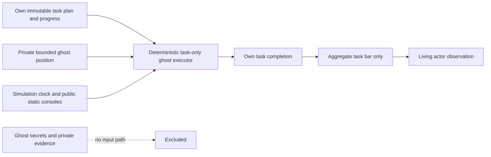

# Crewmate environment V2 — opt-in engineering implementation

**Environment implementation and bounded engineering validation only. No learning run,
final-test evaluation, integration merge or deployment is authorized by these results.
Historical Phase 6.1 acceptance remains pending.**

The independent branch starts at verified research commit
`2baa5dbc1b36b047ed97934d69526573b510c280` (PR #7). V2 is additive; the historical
engine, actor API, frozen belief/strategic models, nine selected checkpoints, selection
locks and source-compatibility loaders are unchanged. The earlier diagnostic's raw data
is not part of this branch. This PR must be reviewed separately from research integration.

## Canonical lobby and fidelity

Load [the versioned public profile](../../configs/crewmate-v2-lobby.json) with
`LobbySettings.from_file(...)`, then explicitly construct `CrewmateV2Game` or
`CrewmateV2Env`. Existing constructors retain historical rules. The V2 replay and policy
compatibility schemas are distinct; passing mapped numeric settings to the old engine
does not activate ghosts or V2 evidence.

| Requested setting | V2 behavior / fidelity |
|---|---|
| Speed 1.0× | 2.5 simulator units/second, including bounded ghost travel; approximate native-map calibration |
| Crew vision 1.0× / impostor 1.5× | 4.5 / 6.75 units with existing native wall/prop LOS; no new role disclosure |
| Medium kill distance, about two widths | Two collision diameters: `4 × player_radius`, 0.88 units at radius 0.22; approximation |
| Kill cooldown 45 seconds | Initial and subsequent cooldown 45; decreases in roaming and pauses in meetings |
| Confirm Ejects ON | Exact role publicly delivered only for the resolved ejected player, at results |
| Anonymous Votes OFF | During voting: public has-voted markers only. At resolution: voter/target pairs become public together |
| Task Bar ALWAYS | Aggregate completed personal tasks / fixed assigned total, updated each physics tick; no worker/ghost attribution |
| One emergency per player; cooldown zero | Living players each retain one allowance; another eligible player can call immediately after a meeting |
| Discussion 15 seconds | Public scheduled speaking turns over 15 simulated seconds; existing structured-claim system |
| Voting 120 seconds | Full fixed voting window, one ballot per living participant; timeout defaults recorded as skips |
| 1 common / 1 long / 2 short | Native metadata categories, separate personal plans/progress; distinct short types |
| Visual Tasks ON | Direct LOS completion proofs for supported real living visual tasks; fake/ghost work never creates proof |

The map explicitly labels radius/speed as configurable approximations, not measured retail
client physics. Character sprite width is not inferred from artwork; the kill mapping uses
the actual collision diameter. Changing the map's collision radius changes the mapped
kill range. Kill/report distances remain separate. Sight remains the existing simplified
360-degree projection, not a recreation of client lighting or animation.

There is a separate configurable **900-second engineering timeout**. It is not an Among Us
lobby timer and does not compress the requested discussion/voting/cooldown values.
Cooldown reset behavior after meetings is not extended beyond the existing pause semantics;
exact retail animation/reset timing is not claimed. Anonymous votes and non-ALWAYS task-bar
profiles are explicitly rejected rather than accepted with misleading behavior. Confirmed
ejections and visual proofs can be disabled for controlled future ablations.

## Permanent personal tasks

Each task has one immutable owner plan and one independent mutable progress state. Common
means a shared **type and stage route**, not shared completion. Completing a crewmate's
common task never advances another's. All four assignments remain with their owner through
death/ejection; neither public absence nor a meeting can trigger reassignment. Engine
invariants check the initial owner of every task.

Task types/categories and existing console geometry come from the repository's map metadata.
Durations and task logic below are explicit authored abstractions; the source contains no
authoritative minigame durations. No new commercial artwork or console coordinates were added.

| Type | Interaction model (simulated seconds) |
|---|---|
| Swipe Card | 4 |
| Fix Wiring | Three existing consoles, 4 per stage; same route for the lobby's common assignment |
| Clear Asteroids / Submit Scan / Start Reactor | 20 / 10 / 15 |
| Align Engine Output | Two engine stages, 8 each |
| Inspect Sample | 3 to start, 60 incubation, 3 to finish; readiness is own-task information |
| Fuel Engines | Storage → lower engine → storage → upper engine, 6 per stage |
| Empty Garbage / Empty Chute | Existing upper console → storage disposal, 5 each |
| Upload Data | Existing download console → upload console, 8 each |
| Divert Power | Electrical → an existing accept console, 5 then 3 |
| Other supported short tasks | Calibrate Distributor, Clean O2 Filter, Unlock Manifolds: 6; Chart Course, Stabilize Steering, Prime Shields: 5 |

Categories follow metadata even where an abstract short task has multiple stages. Waiting
time is not task progress. Completing a stage updates only the next private destination;
the public bar increments only when the **whole assignment** completes. Interrupted work
retains partial abstract progress. Vent Cleaning is deliberately excluded because its
interaction is not modeled. Supplemental/image-estimated console positions retain their
existing map fidelity limitations. Retail swipe/puzzle/failure/animation mechanics are
not implemented.

## Ghost architecture and noninterference

Living motion/body positions stop on death. A separate ghost position travels directly
through walls and props at the configured speed, within the map center-domain bounding
rectangle. This is an explicit world-bound approximation: ghosts may cross outside the
irregular floor while remaining inside that rectangle. They do not participate in living
navigation, collision, vision, kills, reports, meetings, votes or claims.



The executor accepts only its owner's tasks, static console positions, its own position,
speed/bounds and simulation time. It has no world/controller reference, role roster,
killer identity, observations, suspicion, agent memory, social actions or RNG. It cannot
choose to delay work or choose a route based on a secret. Tasks are selected in deterministic
ID order among ready assignments. Ghost-only notes or post-death witness events are never
read. Ghost travel and work continue through meetings; ghost completion can legitimately
finish an ordinary task-victory game during a meeting.

Only the normal aggregate bar reflects ghost task completion. No per-owner completion
event, ghost position, visual indicator or ghost visual-task proof reaches living actors.
The trusted private event log records task completion for trainer bookkeeping, but is not
an actor input. At a simultaneous voting deadline, ejection/parity has priority over task
victory; after a kill, parity resolves before further ghost work.

Noninterference is conditional on identical task plans/progress, start position and death
time. Changing those legitimate physical causes can change normal progress; that is not
a secret-independent behavior guarantee. Tests vary secret killer attribution, post-death
history and attempted ghost commands through full ghost task completion. A second paired
world test changes the **actual hidden killer's role/identity** while holding uninformed
living observers' legitimate histories constant. Their complete V2 packets and task-bar
schedules remain equal. Observers whose own roles legitimately differ are not compared.

## Legal public evidence, memory and future policies

The original actor projection remains unchanged. An exact immutable `V2Observation`
envelope adds only:

- Aggregate task-bar counts.
- Authenticated ejection-role results at their delivery time.
- Per-observer LOS proofs of a living visual-task completion.
- The actor's own task category/stage/readiness details.

New values reject future events, mutable collections, unknown payloads, extra attributes
and back-references. Public and direct provenance remain distinct. There is no global
role mask. Visual proof is local to the observer who could see completion, not automatically
public to everybody. Ghosts never supply such proof; impostor fake interactions change
neither the bar nor proof history.

Each living actor has independent memory; another actor cannot update it, and memory
freezes on death. Controllers retain separate instances and receive only their own
observations. Reset recreates all agent state, including focal identity and script streams.
No witnessed-kill report/vote override was introduced. Existing scripted partner behavior
is retained; the learned focal remains free to navigate, investigate, report, call meetings,
make structured claims, vote or skip.

The future V2 packet has 42 global values, a 4×29 candidate matrix, the existing action
grammar/mask, and 4×8 own-task details. Public candidate flags describe confirmed crew,
confirmed impostor and locally witnessed visual crew proof. The clock is normalized to
the V2 timeout. This intentionally differs from historical network input dimensions;
the separate V2 source/lobby compatibility guard rejects old metadata. No policy was
trained, resized or silently deployed on V2.

Own-task rows are sorted by task ID; task-choice rows enumerate the unfinished subset
in that same order. A future encoder must preserve that correspondence. These are input
contracts, not a new neural architecture.

The **frozen Phase 4 predictor is unchanged** and does not understand the new confirmed-role
or visual-proof event types. Its legacy probabilities may conflict with these new facts.
The facts are separately available to a future V2 policy; V2 belief calibration/deduction
quality has not been validated. Structured claims remain an abstraction, not free-form
human chat or a retail meeting interface.

## Optional deduction-focused mode

Ordinary games can win by tasks or eliminating the impostor. Deduction-only games retain
all tasks, ghost work and public progress, but disable **only** task victory. Ejection,
parity and timeout rules remain. This avoids an impossible/dummy assignment and preserves
ownership and a truthful denominator.

`MatchMixture(deduction_frequency=...)` is a trainer setting. A separate deterministic RNG
domain selects the mode at initialization and records both frequency and selection in
private configuration/replay provenance. Neither value enters actor observations, features
or action masks. Identical initial actor packets are tested across the two modes. Full bar
with a continuing game can later allow an agent to infer the mode; that is an unavoidable
legitimate consequence, not a hidden marker.

The opt-in default is ordinary games (`0`), not a chosen mixed-training curriculum.
**No training mixture percentage has been selected.** Disabling task victory may increase
timeouts or reward avoidance instead of deduction; it must be evaluated rather than assumed
beneficial.

## Rewards and acceleration

The V2 Gym adapter inherits the original option execution and reward calculation: +1
per own completed assignment, one -5 death penalty, original elapsed-time cost and terminal
reward, and the same physical-time discount. There is no reporting/voting shaping or action
override. Automatic ghost completion can earn the owner's existing task reward after death;
there is no additional ghost reward. Four assignments instead of two increases the available
task reward despite identical coefficients—an important future-training confound, not a
reason to tune rewards during this engineering task.

Both execution paths are headless, with no rendering or sleeping. The reference path
projects every player's packet for validation on every tick. The optimized path projects
only actors submitting a non-WAIT action. All submitted actors' observations are still
collected before any same-tick action is applied. Scheduled observations, physics,
visibility events, public bar updates and decision times are unchanged.

This is exact-tick work elimination, not numerical timer compression. The canonical lobby
is identical in both paths. The bounded comparison is in [throughput.json](throughput.json);
it uses three engineering scenarios outside all registered research/final partitions,
two repetitions and both paths. It checks complete scheduled actor inputs, actions, V2
public information, private semantic events and outcomes, excluding wall-clock counters.
The second repetition is the primary timing sample; the first is treated as warmup.

| Primary timing, three paired engineering scenarios | Reference | Optimized |
|---|---:|---:|
| Median wall seconds / match | 26.58 | 16.24 |
| Aggregate speed ratio | 1× | 1.59× |
| Median paired speed ratio | 1× | **1.62×** |

Across both repetitions each method executed **9,024 physics ticks and 1,804.8 simulated
seconds**. Paired actor/action/event/result and extended public-packet hashes all matched;
repeat hashes matched too. Per method: zero illegal actions, zero navigation failures,
eight ghost crewmate instances, 96 task completions, eight reports and 30 submitted ballots.
These are repeated engineering scenarios, not independent learned-policy samples or a
statistical performance claim. The absolute throughput is hardware/workload-specific.

**All six executions per method ended in TASKS_COMPLETED.** The canonical profile alone
therefore does not establish that deduction is necessary or improved. The benchmark also
contained 6,660 living-actor scheduled windows per method with no available action, reinforcing
the need to measure forced-decision cost before approving a future learning budget.

Other candidates were considered and deliberately not shipped:

- Jumping over meetings must preserve speaker turns, uncast ballots, deadlines and ghost
  task-bar changes. A large jump based only on "everybody voted" is not enough.
- Coarser physics ticks risk missing body/kill/visual evidence. No such change is enabled.
- Scaling all timers **and** motion, task rates, dt, decision intervals, observation
  opportunities and discounting consistently leaves the number of ticks unchanged.
  Merely relabeling seconds does not improve throughput. Reducing ticks would need a
  separate equivalence study.
- The inherited option wrapper still has forced continuation observations during long
  voting windows. PPO throughput and safe coalescing of those steps have not been measured
  or promised by this scripted-simulator benchmark.

## Validation and implementation review

See [test-results.json](test-results.json) for aggregate outcomes and retry notes. The V2
tests cover all profile fields, task ownership/categories/stages, incubation, ghost bounds
and work, absence from living controls/vision, secret noninterference, public-bar/visual
evidence timing, private ballots/results, ejection/parity/timeout, independent memory,
replay/reset schemas, unchanged death rewards, and historical source/checkpoint guards.

The final result is **45 V2 tests plus 177 historical tests: 222 passed**. This version
retains the existing five-player population (four crew and one impostor); population
expansion and two-impostor games remain separate future work.

The historical rule/boundary/bot/memory/vision suites were also run, including their fixed
legacy replay expectations. All nine selected policies pass their original strict loaders:
the six continuation policies in this unchanged research runtime and the three seed-17
policies in their preserved compatible pilot runtime. They were loaded only for compatibility,
not evaluated as V2 agents. The map's strict raw-byte checkpoint hash was not normalized or
rewritten to accommodate Git's LF/Windows CRLF checkout differences.

No old source, artifact, checkpoint or research-evidence file is changed in this PR. New
tests/results are engineering evidence, not historical benchmark replacements. Bounded
test/replay generation is not a new trained-policy performance study. Raw observer traces,
individual post-game role datasets and local paths are not published.

Validation retries are disclosed in the aggregate test record: the initial timing attempt
hit a conservative four-minute operational cap after 11/12 completed runs; another timing
attempt was deliberately stopped while correcting early vote-target disclosure. Neither is
used in the final throughput estimate. An initial legacy test setup error was a sandbox
temporary-directory permission issue; the complete 177-test legacy suite then passed with
a workspace-local temporary directory. The final benchmark used the frozen implementation
commit recorded in its JSON and ran without concurrent tests.

Reproduce from a compatible checkout with the repository's existing Python dependencies:

```powershell
python -m pytest tests/test_crewmate_v2.py tests/test_crewmate_v2_privacy.py tests/test_crewmate_v2_integrity.py --basetemp=temp_v2_checks -q
python tools/benchmark_crewmate_v2.py --output temp_v2_benchmark.json --repeats 2
```

Keep the historical reference commit available locally for the integrity tests. Historical
checkpoint loading also requires its matching runtime and original raw map bytes; do not
rewrite the map or relax guards to work around checkout line endings. The benchmark takes
several minutes and should run alone. Its fresh output path keeps the published aggregate
record intact; exact hashes are reproducible, while wall times can vary.

## Proposed future learning experiment — approval required

1. First review the environment, fidelity assumptions and reporting-pattern confound.
   Balance scripted body reporters in a separately registered development study; changing
   lobby/ghost mechanics does not by itself remove the old impostor-reporter shortcut.
2. Propose a small fresh-initialization pilot comparing legacy, V2 ordinary and V2
   deduction-only as separate arms, before selecting any mixture. Two initializations
   and a small fixed decision cap would be a pilot, not acceptance evidence. Approve its
   source locks, seed partitions, reward treatment and compute budget separately.
3. Use a common backbone/action grammar with public V2 channels padded when unavailable
   in the legacy arm. Preserve independent full memory and the same frozen predictor;
   validate any later belief changes separately. Do not resume or overwrite the nine
   historical selected checkpoints. This bundled environment comparison does not identify
   the causal contribution of each new mechanic; use later ablations if warranted.
4. Report both policy decisions and simulated experience, meaningful choices versus
   forced continuation, wall time, task contribution normalized by assigned ownership,
   early/post-evidence top-1/NLL/Brier/calibration, report opportunities/submissions,
   justified votes, wrong accusations, explicit/timeout skips, survival, timeouts and
   team win reasons. Correct identification must remain independent of wins/voting.
5. Investigate whether unchanged +1 task rewards with four assignments amplify task
   preference. Any reward adjustment is a separately approved experiment, never a
   mid-run tuning change. Do not select a mixture because it merely reduces task wins.

**Stop here for approval before training, final-test evaluation, merging or deployment.**
