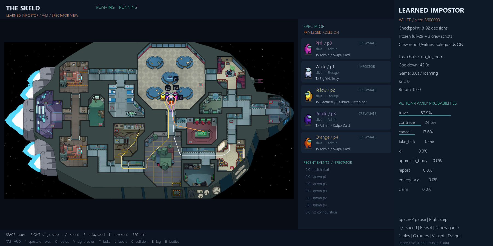
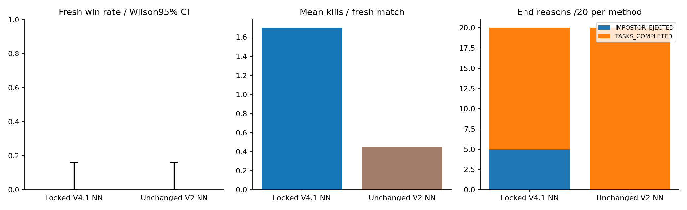
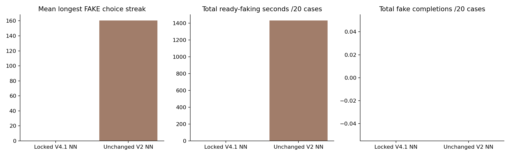
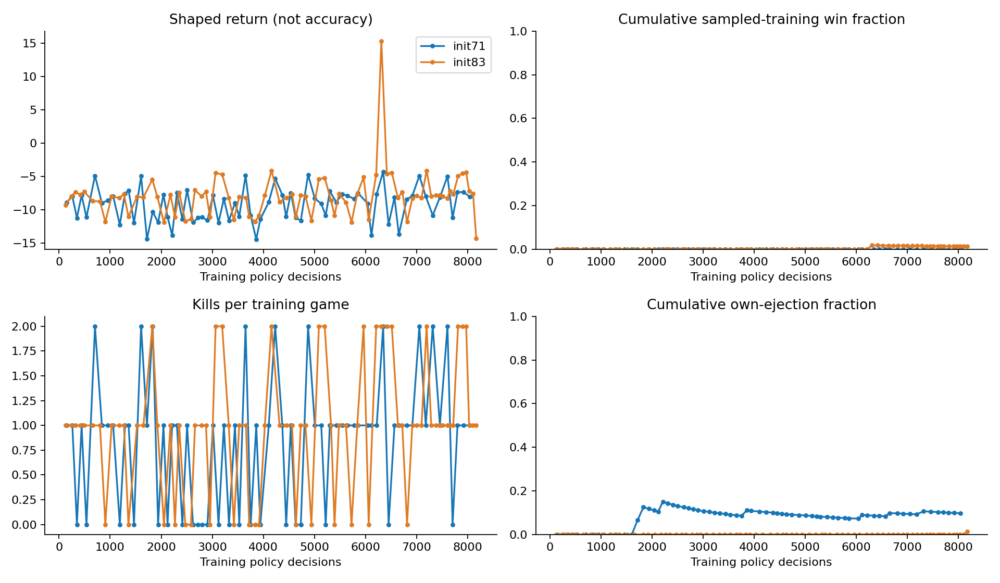

# Impostor V4.1 — teammate summary

**The fake-task stall disappeared in the fresh evaluation. Killing improved.
Winning did not: the selected model lost all 20 fresh matches.**

Training/evaluation finished 27 October 2026 at 23:48:55 Amman. No job is running.
Code remains on `codex/impostor-environment-v2`; no merge/deployment or reserved
final tests. Detailed [NN tables](NN_ARCHITECTURE.md),
[checklist](IMPOSTOR_MASTER_CHECKLIST.md), [research log](RESEARCH_LOG.md) and
[11 graphs with raw results](options-v41-study-20261027/README.md) are retained.

**Owner update, 28 October:** next work is crewmate fixes → sabotage mechanics and
crew responses → a frozen tested crew/environment baseline → impostor development.
Further impostor training waits. This changes the priority of the future proposals
below; it does not change the completed experiment or its results.

## Watch the new model

From the repository root:

```powershell
python run_impostor_v41.py
```

This explicitly loads the locked V4.1 release, not the historical V2 weights.
Space/P pauses; Right steps; +/- changes speed; R replays; N starts another game;
1 toggles spectator roles; G routes; V sight; Esc quits. It never trains.
The actual selected release passed an eight-frame headless launch. The screenshot
is ordinary demo seed 3600000, not a chosen winning match.



`python run_impostor_ai.py` still runs the preserved **old V2 model**.

## What changed and why

| Change | Reason |
|---|---|
| Repeated same-console fake selection continues its four-second activity | Stop the restart exploit; the NN can still finish or abandon it |
| Kill reward +3 instead of +2 | Give successful attacks more feedback |
| Extra own-ejection cost -6 instead of -2 | Make getting exposed more costly |
| Remove unconditional -0.002/s; charge -0.02/s while alive, roaming and cooldown ready | Discourage wasting available attack time, even in an empty room |
| Preserve +10 win, -10 loss, -12 timeout and 45s kill cooldown | Keep actual victory and game timing meaningful |
| Bounded observable pursuit potential, lifetime positive credit at most 0.05 | Give movement feedback without hidden positions, repeated-switch farming or automatic hunting |
| V4.1 arms pursuit geometry after cooldown, not at crowded spawn | Repair the initial V4 study's inactive shaping |

Costs use **simulated elapsed time**, excluding meetings, eliminated actors and
time after termination. Pursuit credit is repaid at terminal; it does not create
extra total episode reward. All previous sources/checkpoints remain reproducible.

The network remains **75,075 parameters**, separate actor/critic and 12 action
families followed by a legal target choice. Three observation slots have versioned
meanings for fake duration and pursuit state. Both V4.1 models trained from scratch.
A* moves toward the NN's chosen destination; it does not decide whom/when to kill,
fake, report, accuse, defend or vote for. No scripted fake limit or forced chase.

## Who it plays against

Five players: **one learned impostor, one frozen full-29 learned crewmate and three
scripted crewmates**. The crew belief NN is also frozen. Living crew have explicit
body-reporting and direct witnessed-kill voting safeguards. Ghost tasks continue,
but ghost observations/social memory do not leak to living actors.

The frozen crew policy uses a checked, lossy V2 adapter; it is not the friend's
future improved model. Private task-stage/readiness/proof fields are not all
represented by that older policy interface. This is a mixed roster, not all-neural
cross-play. Vents, sabotage and free-text persuasion are not functional actions.

## Fresh results — same 20 scenarios per method

| Metric | Locked V4.1 | Unchanged V2 control |
|---|---:|---:|
| Wins | **0/20** | **0/20** |
| Kills |34; mean 1.70 |9; mean 0.45 |
| Matches with a kill |20/20 |8/20 |
| Two-kill matches |14/20 |1/20 |
| Losses to tasks |**15/20 (75%)** |20/20 |
| Own-ejection losses |**5/20 (25%)** |0/20 |
| Fake-task choices |**0** |3,654 |
| Mean longest fake-choice streak |0 |160.35 |
| Simulated cooldown-ready seconds |480.2 |1,432.0 |
| Executed impostor reports |33 |0 |
| Directly witnessed kills |0 |0 |
| Illegal actions / navigation failures |0 / 0 |0 / 0 |

The new model killed in every case and avoided the old fake loop in this sample.
It also self-reported 33 times after 34 kills and made 33 location claims. This
repetitive post-kill behavior is a concern, not proof of useful deception. There
were no innocent crew ejections in its fresh matches. Zero witnessed kills does
not prove it learned witness avoidance; ejection can follow other public evidence
and beliefs. Votes/claims alone do not establish persuasion or causality.



The left bars show true wins, the middle kills, the right loss reasons. Each 0/20
win rate has a Wilson 95% interval of approximately 0%–16.1%. The paired win
difference is0; its all-zero bootstrap interval does **not** establish equal
population skill. 40 executions are 20 paired cases, not 40 independent scenarios.
Different reward versions make shaped returns unsuitable for direct comparison.



Fake completions are zero for both for different reasons: the new greedy policy
never chose FAKE; old V2 repeatedly restarted it. Corrected training did complete
eight fake activities, and completion/interruption tests pass. No-faking everywhere
is not necessarily optimal play.

## Training, selection and time

| V4.1 initialization | Decisions | Complete training games | Kills | Training wins | Worker wall time |
|---|---:|---:|---:|---:|---:|
|71 |8,192 |72 |60 |0 |37.90 min |
|83 |8,192 |78 |76 |1 |42.45 min |

Total: 16,384 decisions, 150 complete games, 136 complete-game kills, one sampled
training win. Training experience also includes each run's unfinished last game;
action totals can therefore differ from complete-game totals. Positive pursuit
credit occurred in 42/72 and 48/78 games; it remained bounded and terminal-cancelled.
This proves activation, not that shaping caused better learning.

Four candidates (two initializations ×4096/8192) played 20 paired selection cases
each. All four won 0/20. The declared kill tie-break locked **83/8192** with 28 kills,
before confirmation. Five sampled diagnostic games reused selection cases
(0 wins/8 kills); they did not select another model or inference method. Fresh
confirmation then used 20 new cases for each of the two methods. Total: 125
evaluation executions; reserved final partitions stayed closed.



The isolated positive-return spike is one training win, not held-out accuracy.
Most returns remain negative. There is no demonstrated learning plateau or robust
winning policy. More capacity is not justified by these data alone.

- Corrected study: 22:21:54–23:48:55 Amman, **87.03 min**, including IO recovery.
- Original envelope: 21:03:50–23:48:55, **165.09 min** including interrupted V4/repair;
  finished before the original 01:03:50 deadline. No extra four hours were added.
- Parallel training overlap span: 42.45 min; worker times overlap and must not be
  added as elapsed study time. Total simulated training experience: 36,180.4s
  (10.05 simulated hours, including unfinished episodes).
- Windows 11 CPU: Intel64 Family 6 Model 183 Stepping 1, 32 logical CPUs. Two isolated
  training workers, up to two evaluation workers, one Torch thread per worker;
  CPU-only. Most cost is simulator/frozen-model inference, not PPO optimization.
- A transient Windows progress-file replacement error interrupted evaluation.
  Logging-only retries reused 80 selection, 5 diagnostics and 6 saved confirmation
  cases. No training reran; unfinished cases alone resumed with the same lock,
  seeds, weights and deadline. [Recovery provenance](options-v41-study-20261027/io-recovery-summary.json).

## Failures retained for the paper

| Attempt | Complete games | Training kills /wins | Outcome |
|---|---:|---:|---|
| V1 initialization 71, 4096 decisions |18 |0 /0 |0/20 validation wins |
| V1 initialization 83, 4096 decisions |18 |1 /0 |0/20 validation wins |
| V2 initialization 71, 8192 decisions |82 |68 /0 |Selected 2/20; fresh 0/20 |
| V2 initialization 83, 8192 decisions |78 |57 /1 |Best checkpoint 1/20 selection wins |
| V4 initialization 71, 8192 decisions |75 |68 /0 |Pursuit inactive; study stopped before validation |
| V4 initialization 83, partial 1792 durable decisions |15 |16 /0 |Interrupted with owner approval; not a completed run |
| V4.1 initialization 71, 8192 decisions |72 |60 /0 |Best candidate 0/20 selection wins |
| V4.1 initialization 83, 8192 decisions |78 |76 /1 |Selected 0/20; fresh 0/20 |

Eight initialization attempts:seven complete,one partial. Thirty preserved policy
snapshot files are not thirty independently trained models. Historical controls,
timings, failed graphs and all checkpoints remain linked from the research log.

## What to do next — approval required for another full study

First follow the owner's crew/sabotage sequence above. The raw frozen crew NN can
ignore a legal report in an existing controlled test, but the studied environment
overrides such choices with approach/report safeguards. Its zero crew reports in
the new confirmation therefore do not prove task greed caused the losses; the
impostor also self-reported 33 times. Measure visible-body opportunities, approach/
report delay and raw-versus-guarded decisions in the crew work. The following
impostor recommendations wait until that improved baseline is ready.

1. Integrate the tested zero-duration **terminal** GAE correction into a new
   versioned learner. Instant terminal kills can take 0 simulated seconds; inherited
   GAE rejects that case. The standalone tested helper is **not wired into frozen
   V4.1**. These runs did not hit it; inference/evaluation are unaffected.
2. Keep the architecture initially. Measure immediate-own-kill report frequency
   and controlled leave/stay/report consequences before adding a report cost.
   Self-reporting remains a legitimate neural choice. Audit learned room targeting,
   cooldown use and meeting/claim choices. Compare greedy versus
   sampled play on new development cases; never select using this confirmation.
3. Preregister a longer, replicated study with staged learning goals and clear
   graduation checks. If using easier development curricula, keep ordinary
   task-enabled evaluation and the 45s canonical cooldown; do not report curriculum
   wins as canonical wins. Test action/reward components separately where feasible.
4. Treat sabotage as a hypothesis. It may delay tasks and change encounters, but
   one training win already shows winning without it is possible. Implement a
   versioned mechanic plus legitimate observation/actions for both sides, train
   crew repairs as well as impostor timing, and compare against a frozen
   no-sabotage baseline. Existing crew are not trained to functional sabotage.
5. Pin the friend's compatible crew model for new cross-play. Only after individual
   learned players work, expand to configurable lobbies up to 15 total players and
   1–3 impostors, coordination, adapting opponents and self-play. Normally share
   one crew policy, one impostor policy and the existing belief predictor, with
   independent private state per seat. [Full future list](FUTURE_LOBBIES.md).

The release is a reproducible **research checkpoint**, not an accepted strong AI.
No silent training extension, model replacement, merge or deployment is included.
