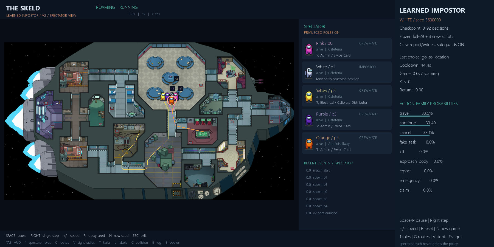

# Impostor AI — where we stopped

**Latest continuation:** [V4.1 teammate summary](CURRENT_RESULTS.md) and
[11 new graphs/results](options-v41-study-20261027/README.md). New model:
`python run_impostor_v41.py`; fresh0/20wins,34kills,0fake choices. Two corrected
runs completed within the original4h envelope. The V2 summary below is historical;
its checkpoints, viewer and unsuccessful results remain intact.

**The training/evaluation pipeline works, but the impostor is not yet a good winning AI.**
Yes, learned models won: one training game and three selection-match executions
across two checkpoints (two with the chosen model, one with another). The chosen
model then won zero of20 fresh games. Those are different stages, not one combined win rate.
Training and evaluation are finished. No further training is running. The prepared
pursuit version was not given a full training study, following the owner's request
to summarize, push and stop for today.

## Watch it

From the repository root on `codex/impostor-environment-v2`:

```powershell
python run_impostor_ai.py
```

Space/P pauses; Right steps; +/- changes speed; R replays; N starts another game.
The right panel shows the impostor's neural choices. `--stochastic` samples its
probabilities; the recorded evaluation used greedy choices. The default checkpoint
is the evaluated research model, not a scripted replacement.



This is demo seed3600000, not a selected winning example. Default launch was checked
with the actual release checkpoint and exited successfully after eight headless frames.

## All four training runs — failures included

“71” and “83” are random initialization IDs, not numbers of runs.

| Training run | Decisions | Completed games | Training wins | Kills | Training time |
|---|---:|---:|---:|---:|---:|
| First-trial AI, 71 | 4,096 | 18 | 0 | 0 | 7.73 min |
| First-trial AI, 83 | 4,096 | 18 | 0 | 1 | 6.67 min |
| Improved AI, 71 | 8,192 | 82 | 0 | 68 | 35.94 min |
| Improved AI, 83 | 8,192 | 78 | 1 | 57 | 26.35 min |

The first trial is called **pilot** in older files: it simply means an initial trial.
Both first-trial models then won **0/20 validation games**, with zero validation kills.
Those failed models remain preserved.

For the improved version, four checkpoints each played 20 selection games:
71/4096 won0, 71/8192 won2, 83/4096 won1, 83/8192 won0. The fixed ranking selected
**71/8192** before opening 20 fresh confirmation scenarios.

| Impostor used in fresh comparison | Wins | Mean kills/game |
|---|---:|---:|
| Selected improved AI | **0/20** | 0.20 |
| Older first-trial AI, initialization83 | 0/20 | 0.00 |
| Scripted attacker — no NN | 1/20 | 1.55 |
| Untrained NN with random initial weights | 0/20 | 0.00 |

The scripted attacker is called **hunter** in code/graphs. It follows visible players
and kills when legal. It is a handwritten comparison controller, not another player
role. Each row is a separate set of matches against the same crew setup.

The selected AI's fresh win-rate interval is 0–16.1% (Wilson95%). This small sample
does not establish strong play or superiority. Reserved final tests remain unopened.

## Who plays against the impostor?

Every game has **one impostor and four crewmates**:

- **One learned crewmate:** frozen `full-29/checkpoint-8192.pt`, with its frozen
  Phase4 suspicion/belief network. Neither model learns during this work.
- **Three scripted crewmates:** task/movement/meeting rules, not neural networks.
  Task styles are nearest/shuffled/social. Votes use evidence and public accusations,
  thresholds and skips; they are not simply uniform random votes.
- **All four living crew have safety overrides:** approach/report visible bodies;
  remember directly witnessed killers and vote for them when legal. Discovering a
  body alone does not reveal its killer. These overrides are rules, not newly learned skills.

The learned crew first builds its own observation memory and suspicion estimates.
Its PPO policy then chooses tasks, movement, follow/flee, reports, meetings, structured
claims and voting. A* executes movement. The old network is adapted to V2 without
changing its input sizes; some new V2 task/proof fields are omitted. This is assisted
legacy transfer, not a newly trained V2 crewmate. The friend's newer crew is not loaded.

Ghost task completion stays engine-managed and isolated. Dead crew cannot report or
vote. Whole-team wins do not prove that the one learned crewmate carried the team;
the current logs do not isolate its individual task contribution.

## What the impostor NN actually learns

It starts separately from the crew model. The improved policy has75,075 parameters
and chooses an **action family, then its target**: move, follow a visible position,
continue/cancel, fake a task, kill, approach/report a body, call a meeting, make a
structured accusation/defence/location claim, vote or skip.

There is no hard-coded “never report,” “always accuse someone,” or “only kill alone.”
It must learn useful choices from consequences. It sees legitimate observations,
own memory and public evidence, not hidden positions or private crew beliefs.
Claims are game templates, not free-text conversation. Good deception, alibis and
witness avoidance have **not** been demonstrated. Vents and sabotage are unsupported.

Rewards: **+10 win, -10 loss, -12 timeout, +2 successful kill, extra -2 ejection,
-0.002 per simulated second**. No reward for faking, moving, reporting or lying.
PPO uses lr0.0003, rollout256, minibatch64, four epochs, ratio clip0.2 and separate
actor/critic encoders and gradient clipping. The detailed report records every setting.

## Why it still loses

In fresh confirmation the selected AI chose **FAKE_TASK3,560 times**. That action
restarts a four-second activity, but the current wrapper re-decides every0.6s.
Repeated greedy choices therefore keep restarting it. This is legal, unproductive
behavior, not a wall/collision or disabled-kill problem.

Only four of20 games offered a legal kill window; it killed in all four. All20
games ended with crew task completion, with zero impostor ejections. That does not
prove clever caution. The one training win involved two kills and an innocent crew
ejection; it does not prove a learned lie caused the vote.

Sampling during training can escape a loop that greedy evaluation repeats. Sparse
delayed outcomes and weak pursuit experience may also contribute; their individual
causal effects have not been isolated. More training alone is not a proven fix.

## Next time, in order

1. Test a finishable, interruptible fake-task option or suppress mechanically redundant
   restarts in a new interface version. Keep the choice to fake/leave neural; preserve
   the canonical engine and historical checkpoints.
2. Test the prepared separate pursuit family. Its tiny gradient/resume/viewer checks
   passed, but **no registered pursuit training/performance study ran**. It would
   still choose targets neurally, not automatically chase or kill.
3. Use fresh validation scenarios; measure fake loops, useful pursuit, legal kill
   windows and true wins. Compare sampled/greedy behavior before extending training
   or tuning entropy/learning rate. Avoid hidden-truth reward shaping.
4. Pin the friend's best compatible crewmate and run paired cross-play. Only after
   useful single learned agents work should we explore adapting opponents/self-play.

## Evidence and time

The first trial took25.37min including validation. The improved study took117.24min:
62.30min training,31.06min selection,23.75min confirmation, plus overhead. One CPU
worker/one Torch thread,32 logical CPUs available, no GPU. Exact processor/runtime
details are in the report. Different movement options collected different simulated
experience, so decision counts alone do not isolate architecture improvements.

78 improved preflight tests,2 end-screen tests and3 pursuit checks passed. Earlier
engineering passed239 regression tests and10 matches; suites overlap. All160 improved
selection/confirmation executions had zero illegal actions/navigation failures.
All16 research policy snapshots, frozen weights, failures, logs and graphs remain.
The actual default viewer loaded the released checkpoint successfully. No merge or deployment.
Code, checkpoints, graphs and these reports are pushed to `codex/impostor-environment-v2`;
[draft PR10](https://github.com/Hadisovic/social-deduction-ai/pull/10) remains unmerged.

- [Full teammate guide](final-20261027/README.md)
- [Improved study: eight graphs, controls, settings, hashes and timings](strategic-v2-20261027/README.md)
- [Failed first trial: six graphs and all results](pilot-20261027/README.md)


“Old pilot83” means the older trained AI; “Hunter script” means the scripted attacker.
Whiskers show uncertainty. More kills without wins is not a successful strategy.
