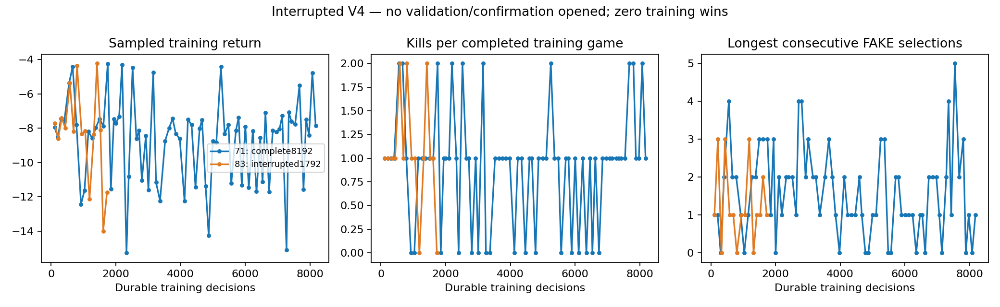
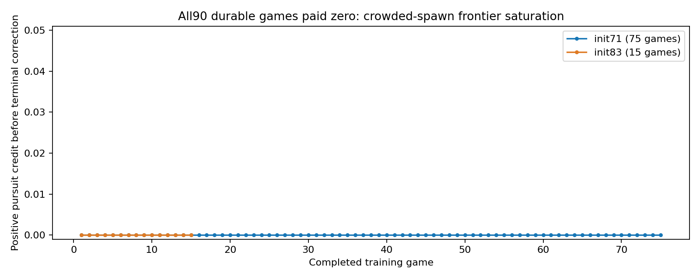

# Interrupted V4 experiment — preserve as a failed integration finding

Owner explicitly stopped this study after discovering pursuit shaping was inactive.
Nearby spawn players saturated its lifetime proximity frontier during the45s initial
cooldown. Synthetic approach tests missed this real integration condition.

| Initialization | Durable decisions | Completed training games | Kills | Wins | Status |
|---|---:|---:|---:|---:|---|
|71|8192|75|68|0|Training finished; never validated|
|83|1792|15|16|0|Interrupted; partial model, never selected|

All90 durable games had zero positive pursuit credit. The other reward/action
changes were active. No selection/confirmation/reserved final case opened. No
claim about held-out performance is possible. In-flight work after the last durable
snapshot is not counted. Original source commitb59ab8a and raw resume journals stay
preserved; six policy-only snapshots were strict-loaded and retained separately.

The replacement V4.1 experiment starts from scratch with new scenarios/RNG streams
and a distinct schema. It inherits the ORIGINAL01:03:50 Amman deadline on28October;
the failed run and repair consume that same4h envelope, not extra training time.
See ../options-v41/TRAINING_PROTOCOL.md and the research log. No release was selected
from this interrupted experiment and no historical checkpoint was overwritten.

## Recorded failed-run graphs

These are sampled training diagnostics, not accuracy or held-out results. The83 curve is partial.

The following plot shows the integration defect: no positive shaping credit in any durable game. This is not a controlled learning-benefit comparison.

