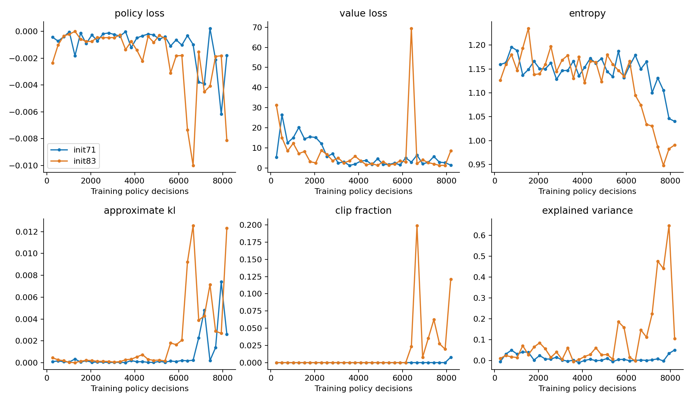
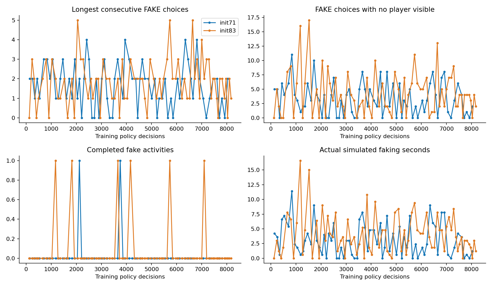
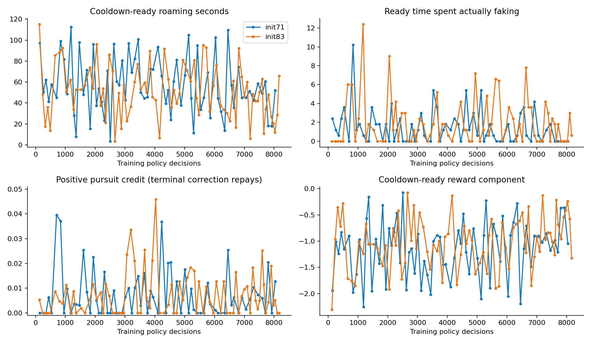
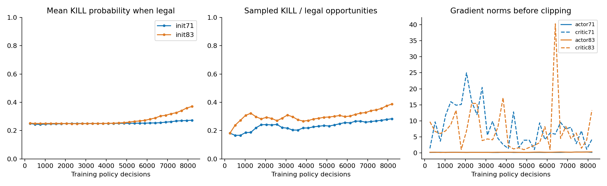
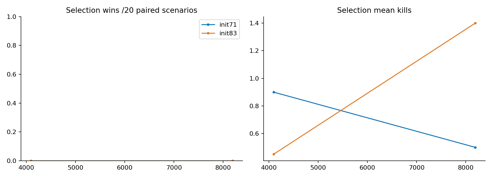
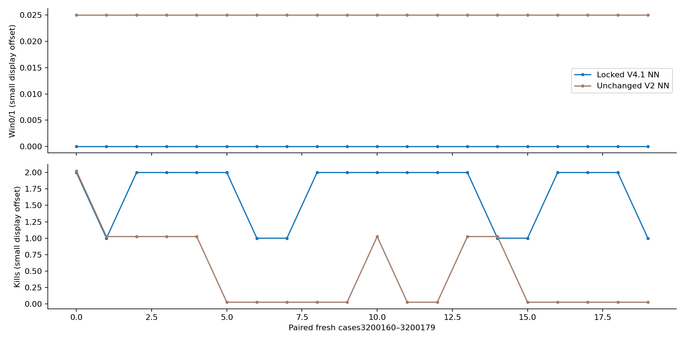
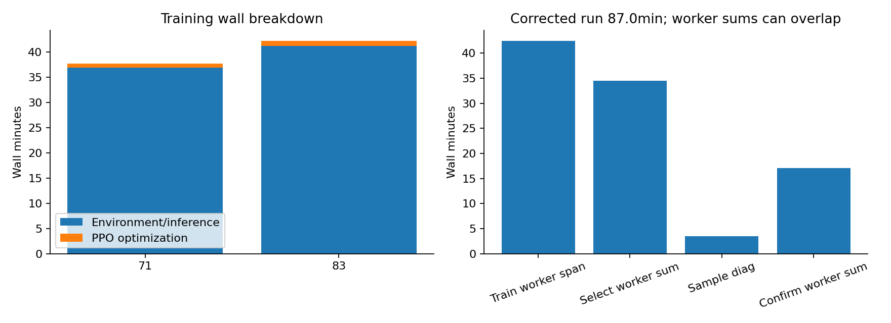
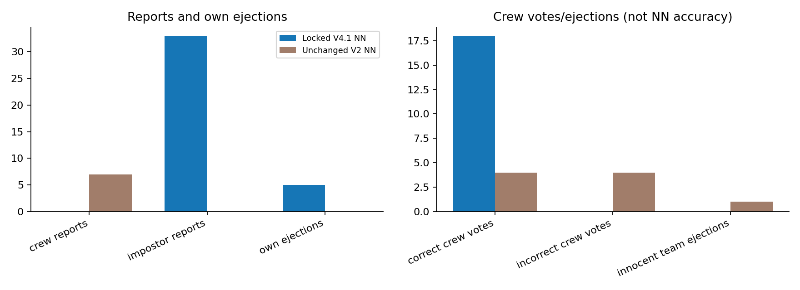

# V4.1 learned impostor — study results

For a short explanation of changes, failures, gameplay and next steps, read the
[teammate summary](../CURRENT_RESULTS.md). The easy viewer command is
`python run_impostor_v41.py`; its actual locked release passed an eight-frame
headless launch. [Viewer evidence](viewer/verification.json).

Fresh behavior:34 kills versus9 for unchanged V2;0 fake choices versus3654.
Both won0/20. New losses were15 task victories (75%) and5 own ejections (25%).
The new policy made33 executed self-reports after34 kills; its post-kill strategy
needs investigation. There is no evidence here that banning reports or merely
adding sabotage would solve winning. Current crew have no trained functional
sabotage response. No extra training was started from these outcomes.

The selected model has no fresh confirmation wins; useful winning strategy is still unproven.

Run `python run_impostor_options_v41.py --checkpoint artifacts/impostor-options-v41/release/policy.pt` after curation.

Immutable selection: initialization83, 8192 decisions. Do not choose another using confirmation.

| Fresh method | Wins | Wilson95% interval | Mean kills | Mean longest FAKE streak |
|---|---:|---:|---:|---:|
| Locked V4.1 NN | 0/20 | 0.0%–16.1% | 1.70 | 0.0 |
| Unchanged V2 NN | 0/20 | 0.0%–16.1% | 0.45 | 160.3 |

Shaped returns differ between versions; true wins are the comparison.40 executions are20 paired cases.
Paired win difference: +0.0%; descriptive bootstrap interval [0.0, 0.0].

## Training and timing

| Initialization | Decisions | Complete games | Training wins | Kills | Wall min |
|---|---:|---:|---:|---:|---:|
| 71 | 8192 | 72 | 0 | 60 | 37.90 |
| 83 | 8192 | 78 | 1 | 76 | 42.45 |

Corrected run started 2026-10-27 22:21:54 +03; finished 2026-10-27 23:48:55 +03; wall87.03min.
Original envelope started 2026-10-27 21:03:50 +03; combined elapsed including interrupted run/repair 165.09min; absolute deadline 2026-10-28 01:03:50 +03.
Frozen runtime commit `83f75c4dc7c6c6e72cd553192e63d48dc5f32237`. Up to two isolated CPU workers, one Torch thread each; worker wall sums overlap. Details in study.json.
Training overlap span from durable start/end records: 42.45min (excludes pool startup). Logging-only recoveries: 1. Total corrected wall time includes downtime/recovery; existing matches and model identity were preserved.
Positive pursuit credit occurred in 42/72 and 48/78 training games. All complete-game shaping cancels at terminal.

## How to read the graphs

Sampled training progress; returns and training wins are not held-out accuracy.

Loss, entropy, KL, clipping and value estimates; stable optimization alone does not imply good play.

Whether learned fake streaks/empty-visibility faking decline, beyond merely fixing activity completion.

Idle-ready cost and bounded pursuit credit; terminal correction removes net pursuit payment.

Learned kill probability/opportunity use and gradient norms.

Selection cases only; these picked the immutable checkpoint before confirmation.

Fresh wins, kills and actual loss reasons; whiskers show uncertainty.

Behavioral fake-loop comparison under each original version, across the same20 cases.

Match-by-match outcomes under identical scenario IDs; display offsets separate overlapping lines.

Environment/frozen inference versus optimization and study phase wall times.

Reports, crew votes and ejections. This is not a natural-language deception score.

## Limits and next decision

- Bundled reward/action changes; no isolated causal ablation.
- Two training initializations; only one selected checkpoint on20 fresh cases.
- Old V2 control uses original feature/reward/action semantics; shaped returns are not comparable.
- Five sampled diagnostics reuse selection cases; not confirmation or an unbiased greedy/sampled estimate.
- Mixed crew: frozen full-29 NN and3 scripts with explicit reporting/witness safeguards.
- No reserved final tests, new lobby size or model identity changes using confirmation.

Five sampled diagnostics are in results.json, reuse selection cases, and did not change the lock.
If an IO-only resume reports near-zero training_wall_seconds, it means no additional training ran during resume. The graph uses durable worker start/end records for the original training span.
If fake loops/wins remain weak, record failure and propose a fresh study; do not silently add steps or tune from confirmation.
Future up-to15-player/1–3-impostor settings and cross-play remain separate. No merge/deployment or historical release overwrite.
