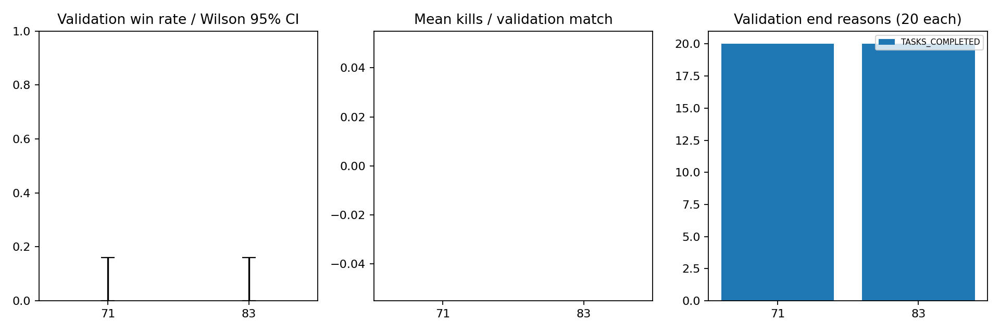
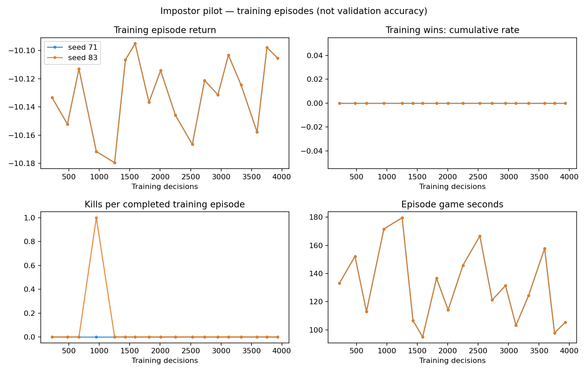

# Impostor pilot — results and next decision

**Completed 27 October 2026. The learning system passed verification, but neither
policy is ready for competitive play.** Both models lost all 20 validation games and
made no validation kills. More training work is needed; these results do not justify
blindly extending the same setup.

## Results

| Measure | Initialization 71 | Initialization 83 |
|---|---:|---:|
| Training decisions | 4,096 | 4,096 |
| Completed training games | 18 | 18 |
| Training wins | 0 | 0 |
| Training kills | 0 | 1 |
| Greedy validation wins | **0/20** | **0/20** |
| Validation win rate / Wilson 95% interval | 0% / 0–16.1% | 0% / 0–16.1% |
| Validation kills | 0 | 0 |
| Validation games with a legal kill opportunity | 20/20 | 19/20 |
| Validation end reason | Tasks, 20/20 | Tasks, 20/20 |
| Illegal actions / navigation failures | 0 / 0 | 0 / 0 |

These are the **same 20 validation scenarios** evaluated with two initializations,
40 executions total. Do not interpret them as 40 independent scenarios. Both final
4,096-step checkpoints were selected before validation; earlier checkpoints were
saved but never searched/evaluated. Reserved impostor and Phase 6.1 final tests remain
unopened. The paired bootstrap difference is zero with a degenerate [0,0] interval
because every recorded outcome is a loss; it does not establish policy equivalence
or an exactly zero population win probability.

Training used sampled actions; validation used greedy actions. The single sampled
training kill cannot establish learned killing. There was no matched untrained or
scripted impostor control on this validation partition in the approved budget, so
no causal improvement over an initial policy is established. Earlier engineering
controls use different scenarios.

## What the neural network learned — and did not learn

Both networks changed parameters and stayed finite. That proves the optimizer works,
not that strategy improved. Value loss fell from roughly 29 to 0.31/0.50, while
returns stayed around -10.1 and training/validation wins stayed zero. The value head
largely learned to predict repeated defeat. Entropy stayed near 4.46; PPO's measured
policy changes were small and no probability-ratio samples hit the .2 clipping bound.

Navigation accounted for **97.6% of training choices** in each run. Across 8,192
decisions, only one KILL was selected. Reporting, meeting claims and voting did not
receive meaningful training experience. The plot's overlapping return/win curves are
real: both initializations had the same recorded returns and zero wins.

Legal kills were available in 39/40 validation executions, yet no kills occurred.
This supports investigating exploration/action selection rather than assuming the
kill interface is absent. The 45-second cooldown and task pressure may also constrain
learning. These results do not prove which factor causes failure or that ordinary
games are impossible to win.

## Graph guide

| Graph | How to read it / finding |
|---|---|
| [Learning curves](figures/learning_curves.png) | Completed training games only. Flat zero wins and stable losing returns show no useful success trend. Two partial episodes at the decision cutoff are excluded from outcome rates. |
| [PPO diagnostics](figures/ppo_diagnostics.png) | Value loss decreases; entropy stays high and KL stays small. Lower prediction loss is not gameplay accuracy. Gradient norms shown are before the .5 clipping limit. |
| [Validation results](figures/validation_results.png) | Both models: zero wins/kills, all losses by tasks. Error bars show uncertainty from 20 scenarios per model. |
| [Action distribution](figures/action_distribution.png) | Sampled training choices are almost all travel. Types absent from the axis were never selected; the numerical journals retain the counts. |
| [Paired scenarios](figures/paired_scenarios.png) | Same scenario index for each model; all validation outcomes coincide at zero wins/kills. This is not evidence of broader equivalence. |
| [Compute](figures/compute.png) | Environment/inference dominates. PPO optimization used only 2.8% of timed collection-plus-update work. |

## Time, machine and experience

| Stage | Measured wall time |
|---|---:|
| Training 71, including initialization/checkpoints | 7 min 44 sec |
| Training 83, including initialization/checkpoints | 6 min 40 sec |
| Validation 71: 20 matches | 5 min 25 sec |
| Validation 83: 20 matches | 5 min 30 sec |
| **Entire learning + validation stage** | **25 min 22 sec** |

Local time: **00:59:06–01:24:28 on 27 October, Asia/Amman**. This finished well below
the approved 3-hour ceiling. No extra runs or automatic extensions were launched.
The first recorded preparation timestamp to study start adds approximately 16 min
24 sec; that excludes earlier engineering and final curation/report writing. The
initial 2–4-hour estimate was conservative because optimizer/runtime cost was unmeasured.

Training covered **4,909.2 simulated seconds**, including two unfinished episodes at
the fixed decision cutoffs; validation covered **5,616.4 simulated seconds**. There
were 36 completed training games, plus those partial episodes. PPO optimization took
23.53 seconds total; environment collection/inference took 819.41 seconds. These are
component timings, not additional wall time to add on top of the stage total.

Execution: one sequential CPU worker, one Torch thread, 32 logical CPUs available;
processor reported as Intel64 Family 6 Model 183 Stepping 1. Windows 11, Python 3.12.3,
Torch 2.9.1+cpu, NumPy 1.26.4. No GPU or two-device training was used. The canonical
45-second cooldown, 15/120-second meetings, personal/ghost tasks and ordinary task
victory were retained.

## Verification and preserved evidence

- **81 distinct targeted preflight tests passed:** the 79-test combined suite plus
  two report tests; seven trainer tests repeated in the final nine-test suite.
- Only impostor parameters were optimized. Frozen crew/belief tensor and file hashes
  stayed unchanged; all nine historical selected checkpoints were retained.
- Replay-based resume reproduced actor/private memories, next sampled action and the
  subsequent PPO update exactly. Duplicate workers, source/config drift, checkpoint
  overwrites, tampered replay and expired budgets are rejected.
- All **eight** curated initial/intermediate/final impostor checkpoints strictly load.
  Raw resume states and action journals remain preserved locally, outside Git tracking.
- No runtime source changed during the study. Implementation commit:
  `2c31f060212bd42a28d92b98e132f5f97d0d2832`.

Files: [study/protocol](study.json), [summary](summary.json), [40 validation records](validation.json),
[full results](full-results.json), [timing/runtime metadata](execution-metadata.json),
[checkpoint catalog and SHA-256s](checkpoints.json), [preflight record](../pilot-preflight.json).
Per-run training metrics and episode aggregates are in [seed 71](seed-71/training.json)
and [seed 83](seed-83/training.json), alongside their update/episode journals.

Final policies: [seed 71](../../../artifacts/impostor-pilot-20261027/seed-71/checkpoint-4096.pt)
and [seed 83](../../../artifacts/impostor-pilot-20261027/seed-83/checkpoint-4096.pt).
These are experimental artifacts; neither is promoted to a viewer/release/default.

## Recommended next experiment — approval required

First test **balanced exploration over action families**, rather than giving numerous
travel destinations most of the initial categorical probability. The network would
still choose whether/whom to kill; no kill/report rule would control the learner.
Keep reward, canonical lobby, frozen opponents and both crew safeguards fixed so the
initial follow-up isolates this exploration change.

Proposed bounded comparison: two fresh 4,096-decision initializations (71/83), then
evaluate their final policies **and these two preserved pilot policies** on the same
20 fresh validation scenarios (3200020–3200039): **80 match executions**, no final tests.
Record legal kill-window counts and action-family probabilities to check the proposed
mechanism. Plan **1–2 hours including preparation, with a 3-hour learning/evaluation
ceiling**; changing behavior may increase match duration. This is a proposal, not an
approved continuation or a guaranteed remedy.

If exploration improves but task victories still dominate, separately compare an
explicit deduction-only training arm. If goal switching remains excessive, test short
travel options that interrupt at legal kill opportunities and report both decisions
and simulated experience. Keep these as separate registered changes. Do not silently
reduce cooldowns, change task speed, add kill bonuses, replace the crew checkpoint or
spend hours extending the unsuccessful configuration.
