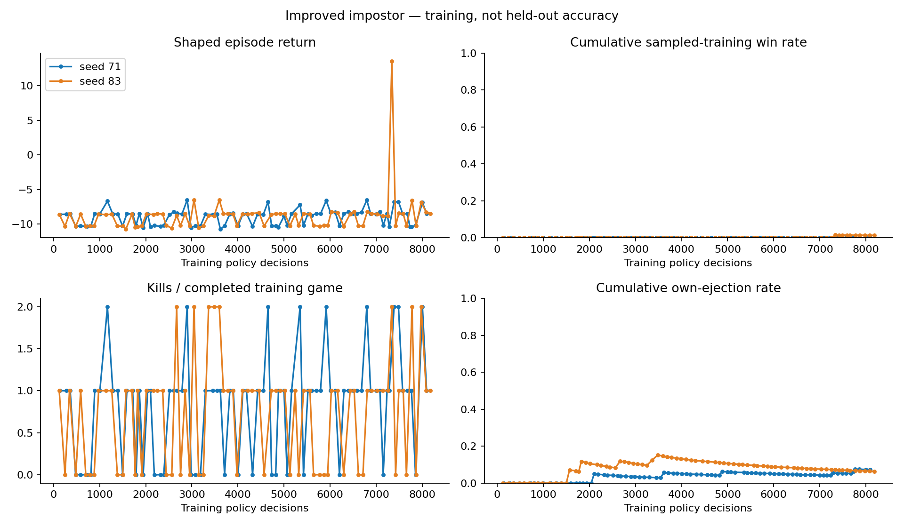
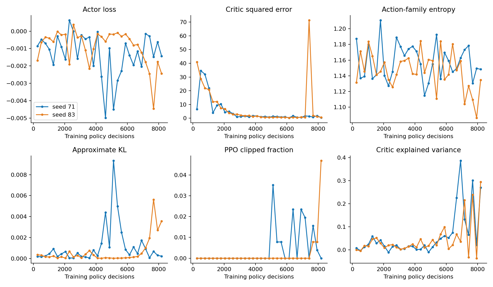
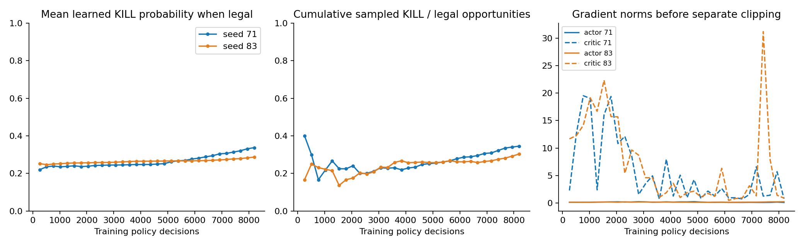
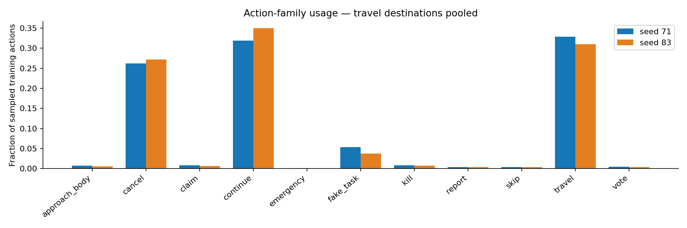
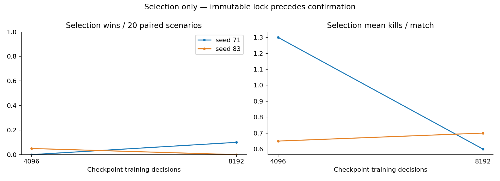
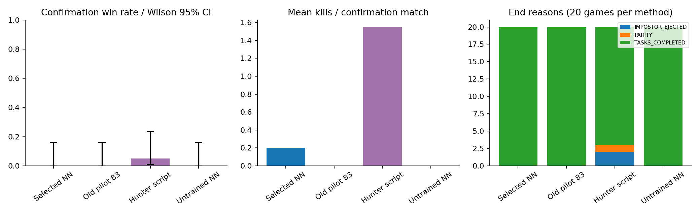
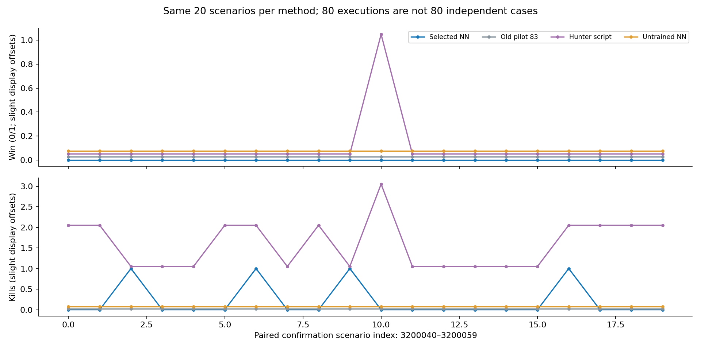
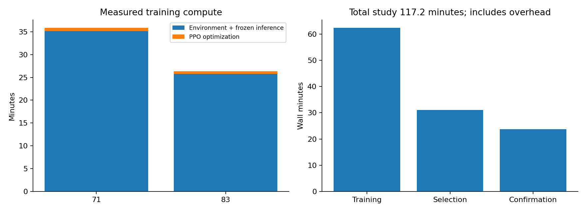

# Learned impostor — results and teammate guide

Run from the repository root on `codex/impostor-environment-v2`:

```powershell
python run_impostor.py
```

This loads the locked selected model: initialization **71**, checkpoint
**8,192 decisions**. It plays against frozen full-29 and three scripted
crewmates under the canonical V2 rules. Space/P pauses; Right steps; +/- changes speed;
R replays the current scenario; N starts another. The side panel shows the learned
action-family probabilities. `1` toggles spectator roles, G routes, V sight, Esc exits.
Use `--stochastic` to sample rather than use the evaluated greedy policy.

**Assessment:** The selected model wins 0/20 fresh confirmation games. Its 0.20 mean kills per game are not a useful winning strategy. This release is an evaluated research checkpoint, not a strong finished opponent. More of the same training is not justified by wins alone.

## What changed and why

- Old pilot: both seeds lost all 20 validation games with zero kills. Its eight
  checkpoints and six graphs remain in [the pilot report](../pilot-20261027/README.md).
- The new NN chooses an action family, then a target. Many travel destinations no
  longer crowd out kill exploration. No script forces the impostor to kill or chase.
- The critic has separate features and gradient clipping. Learning the value of a
  losing state cannot dominate the actor's gradient.
- Own visible geometry and legitimate memory help compare targets. Hidden roles,
  unseen positions, actual witness labels, ghosts and private crew beliefs stay out.
- Travel choices can continue up to 3 simulated seconds. New players/bodies, legal
  kills, arrival and phase changes interrupt them. Physics still ticks every .2s.
- Rewards: **+10 win, -10 loss, -12 timeout, +2 successful kill, -2 own ejection,
  -0.002/second**. No reward for moving, waiting, lying, reporting or fake tasks.
  Every loss remains negative and every win positive. Kill shaping can still change
  the policy's risk preference; it does not mathematically preserve the maximum
  win-rate policy. True wins, not shaped return, determine checkpoint selection.
- Frozen crew and belief tensors, all historical checkpoints, ordinary task victory,
  ghost-task ownership and living-crew report/eyewitness safeguards are preserved.

### Which gameplay logic is learned?

The NN can move toward visible players, choose a kill target, fake a task, report,
call a meeting, accuse, defend, claim a location/sighting/elimination, vote or skip.
There is no hard-coded "never report", "always vote for X" or "only kill alone"
impostor rule. Kill avoidance near witnesses must be learned from the game outcome;
living crew retain direct witnessed-kill evidence and vote for that killer.
The impostor sees legitimate observations and its own memory, never private crew
beliefs or actual hidden-witness labels. Claims use the game's structured vocabulary,
not natural-language chat. Its own location claim can serve as an alibi; the current
DEFEND_PLAYER candidates refer to other players. Sighting candidates use remembered
observations, while location and accusation templates permit false claims. It does
not generate arbitrary sentences, timestamps or multi-step persuasion scripts.
Availability of an accusation/defence action is not proof
of learned deception. Vents and sabotage are not supported in this environment.

## NN and training settings

| Setting | Value |
|---|---|
| New network | 75,075 parameters; 12 legal action families and target scorer |
| Inputs | 35 global + 8 own extras; 4×21 player features; up to 256×51 candidate features |
| Actor | player encoder 32→32; context 128→128; candidate/family heads 64 |
| Critic | independent player encoder and 128→64→1 value head |
| PPO | rollout 256; 4 epochs; minibatch 64; learning rate 0.0003; Adam epsilon 0.00001 |
| Stability | ratio clip .2; actor gradient .5; critic gradient 1; value coefficient .5 |
| Exploration | family entropy .02→.005; normalized conditional entropy .001 |
| Credit assignment | gamma 1; physical-time GAE lambda .995/second |
| Lobby | 5 players; 1 impostor; 45s cooldown; 15s discussion + 120s voting; permanent tasks |

Training scenarios start at 3100100. Initializations use separate random streams;
only impostor parameters enter the optimizer. Checkpoints, optimizer/RNG resume
states and replay journals are preserved. The exact configuration is in
[study.json](study.json); the prior [registered protocol](../strategic-v2-protocol.md)
fixed the budget, candidate set, controls and selection rule before learning.

| Initialization | Decisions | Completed training games | Training wins | Kills | Simulated minutes | Wall time |
|---|---:|---:|---:|---:|---:|---:|
| 71 | 8,192 | 82 | 0 | 68 | 307.13 | 35.94 min |
| 83 | 8,192 | 78 | 1 | 57 | 277.33 | 26.35 min |

These are sampled training outcomes, not held-out accuracy. A partly collected final
episode contributes decisions but is not counted as a completed game.
A win may involve other players' mistakes. It does not, by itself, show that a
particular accusation or alibi caused the win; that requires a separate causal test.
The two V2 runs collected 35067.4
simulated seconds. The original pilot collected 4,909.2 seconds. Longer options and
more decisions substantially increase experience; do not attribute differences to
network/reward changes alone.

## Selection and fresh confirmation

After both runs finished, four candidates (4,096 and 8,192 from each seed) played
20 paired selection scenarios, 3200020–3200039: **80 matches**. The fixed ranking
was wins, kills, fewer timeouts, earlier checkpoint, then lower initialization.
[The immutable selection lock](selection-lock.json) was written before confirmation.

The selected model and three controls then played the same 20 fresh scenarios,
3200040–3200059: **80 confirmation matches**. Selection was not changed afterward.
These are confirmation-validation results; reserved final tests remain unopened.
Win rate is the appropriate outcome metric here, not classification accuracy.

| Method | Wins | Win rate (Wilson 95% interval) | Mean kills | Own ejections |
|---|---:|---|---:|---:|
| Selected learned impostor | 0/20 | 0% (0.0–16.1%) | 0.20 | 0 |
| Preserved old pilot 83 | 0/20 | 0% (0.0–16.1%) | 0.00 | 0 |
| Scripted hunter | 1/20 | 5% (0.9–23.6%) | 1.55 | 2 |
| Untrained family network | 0/20 | 0% (0.0–16.1%) | 0.00 | 0 |

All 160 selection/confirmation executions had zero illegal actions/navigation
failures. Paired win-rate differences versus controls:

- Versus preserved old pilot 83: +0.0 percentage points; paired bootstrap 95% interval +0.0 to +0.0.
- Versus scripted hunter: -5.0 percentage points; paired bootstrap 95% interval -15.0 to +0.0.
- Versus untrained family network: +0.0 percentage points; paired bootstrap 95% interval +0.0 to +0.0.

These are descriptive small-sample comparisons without multiplicity correction.
An all-equal paired sample can produce a collapsed bootstrap interval; that is not
proof of equivalence or zero uncertainty. Use the Wilson intervals above as well.
The 80 executions per partition contain 20 independent scenarios, not 80 independent
cases. Architecture, rewards and travel options changed together; this is not an
ablation attributing improvement to one change. Old pilot/hunter use their original
decision interfaces and rewards; compare true wins/kills, not cross-method return.

## Graphs — how to read them


Higher win rate and more wins matter most. Shaped returns/kills can rise without
winning. The two colors are independent initialization seeds, not extra scenarios.


Actor/critic losses, family entropy, KL and clipping show optimizer behavior. Finite
losses and a good value fit alone do not establish a useful gameplay strategy.


The left plot shows cumulative learned kill probability only when killing is legal.
The middle shows sampled kill frequency in those opportunities. The right shows
unclipped gradient norms; separate clipping is applied before every optimizer step.


Travel destinations are pooled. This reveals whether the policy only travels,
cancels or waits, rather than using effective actions.


These curves were used for selection, not final acceptance. Four candidates were
compared on the same scenarios; their selected maximum can be optimistic.


Whiskers show win-rate uncertainty. Kills and end reasons distinguish useful wins,
reckless ejections and failure to finish before task victory.


Each column is the same scenario for all methods. Small vertical offsets separate
overlapping points; they do not change integer wins/kills.


Environment plus frozen-crew inference and PPO optimization are measured separately.
Travel options change simulated experience per decision; decision counts alone do
not establish a fair speed comparison with the old pilot.

## Time, processor and verification

- Study start: **2026-10-27 02:11:43 +03**.
- Finish: **2026-10-27 04:08:58 +03**.
- Total training/selection/confirmation: **117.24 minutes** (ceiling 180 minutes).
- Training wall: 62.30 min; timed selection: 31.06 min;
  timed confirmation: 23.75 min. Total also includes saves,
  loading, integrity checks and orchestration. Preparation/graphs are outside it.
- Compute: one CPU worker, one Torch thread, 32
  logical CPUs available; no GPU. Processor string:
  `Intel64 Family 6 Model 183 Stepping 1, GenuineIntel`. Exact marketing model was unavailable.
- Runtime: Python 3.12.3, Torch 2.9.1+cpu,
  NumPy 1.26.4; Windows-11-10.0.26200-SP0.
- Improved preflight: **78 tests passed**, including real gradients, private
  observations, exact resumed update/action equality, reward/option semantics and
  headless viewer. Two additional controlled win/loss end-screen tests passed in
  14.76 seconds without changing the running worker's source. The offline report
  also passed synthetic zero/all-win interval and eight-graph checks; those fixtures
  are not gameplay results. Earlier engineering: 239 regression tests and 10 matches passed.
- All eight policy checkpoints were copied byte-for-byte and strictly loaded.
  [Checkpoint hashes](checkpoints.json), [release manifest](release.json),
  [aggregate results](summary.json), [per-match confirmation](confirmation.json).
- Frozen full-29 SHA-256: `238904b7fe303b77e885c4cd6fdf4d9d447a62eb5b463436a391c0b4d6e1cb43`.
  New runtime source: `f96abbe366b5377c4826a874437fd0cd70050586`. Strict source/schema/file
  and tensor guards remain enabled. No merges, deployment or reserved final tests.

## Next research step and future best-crewmate play

1. Inspect whether progress is task-loss, witnessed-kill/ejection or navigation
   limited. More training is useful only if fresh validation supports it.
2. Test one change at a time: richer actor-local temporal memory, pursuit target
   features, longer credit horizons or entropy schedule. Keep legal masks, task
   victory, cooldowns and ghost isolation unchanged. Register fresh validation IDs.
3. If kills rise without wins, reduce reckless-kill shaping or use potential-based
   shaping from legitimate observations. Never reward hidden true witness counts.
4. Freeze this impostor release. When the friend's improved crewmate is ready,
   verify its V2 schema, pin its exact checkpoint/hash, then run a paired cross-play
   matrix including both old and new crew. Do not silently replace full-29.
5. Only after one learned crewmate and one useful learned impostor work, explore
   adapting opponents and self-play with frozen opponent pools and held-out tests.

This release is the best of the registered candidate set by selection, not a claim
of global optimality. The frozen crewmate is an assisted legacy-to-V2 transfer;
results do not prove equal behavior to its original training environment.
