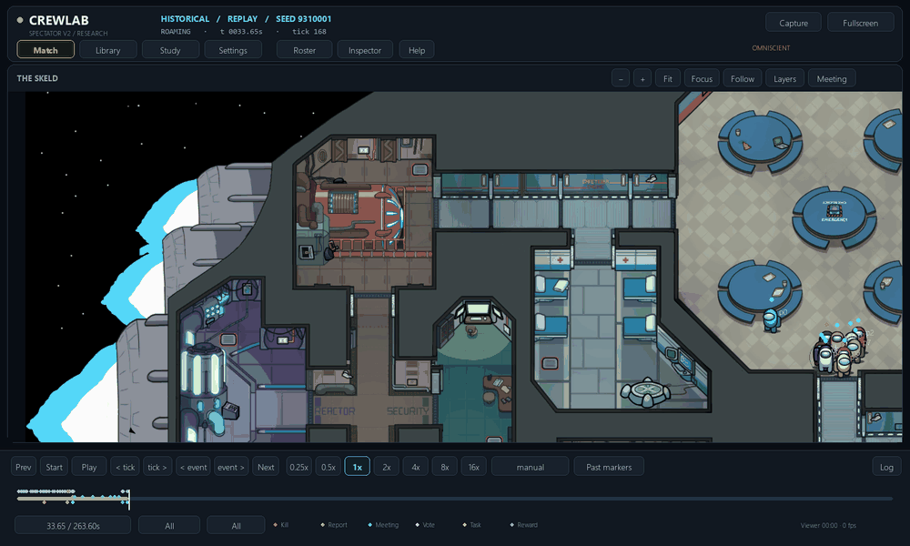

# Original-art door animation in the viewer

30 October2026. Replaces the A2 viewer's solid red debug bars with the original
Skeld door artwork: panels close across the doorway, stay closed and retract
when the recording says they open. Both door orientations have separate frames.



This is the actual native Pygame viewer rendering the preserved seed9310001
baseline recording. Upper Engine first appears closed at33.8 simulated seconds
and reopens at43.6. The close command was at33.6; the physical-state snapshot
follows one0.2s tick later. Transitions are shown at half speed; quiet middle time is sampled and the
header retains actual replay times. No game was simulated or trained for this GIF.

The animation follows **recorded physical state**, not a sabotage request or
countdown guess. A pending door waits for the physical close event. Meeting resets,
timer openings, backward seeking, playback speed and reduced-motion settings work
without restarting animation or revealing future door states. A cropped live
window that starts with a closed door shows it closed immediately.

Selected-player mode uses only that actor's recorded door knowledge. It does not
read global hidden close/open times. The omniscient viewer uses recorded global
state. Timers and solid red fills are removed from ordinary rendering; optional
collision outlines remain under the existing collision overlay.

Both launch paths are covered: the repository's normal spectator imports the
shared DoorLayer; run_lizbon.py uses an adapter around the pinned native spectator.
That adapter paints after map art and before players/bodies. It hides the native
door debug layer through a read-only proxy and leaves all other A2 visibility,
vents, character rendering, camera and UI code intact. The external pinned
checkout and Lizbon's frozen neural/environment modules are not edited.

Artwork and source links: [original atlas provenance](../../assets/skeld/doors/README.md).
The real atlas does not contain clip FPS metadata. Transition length0.25 simulated
seconds is reconstructed, not a claim of verified current-build timing. The sprite
frame windows and cadence can be updated independently of model checkpoints.

## Verification

- Seven dedicated checks: closing/holding/opening and seeking, pending-door delay,
  selected-player privacy, mid-closure live history, rapid reversal/reduced motion,
  original sprite loading/cache bounds, and proxy non-mutation.
- Combined viewer suite:30 passed,5 skipped. The skips require older optional
  recordings that are absent locally; dedicated door checks all passed.
- Native viewer capture and the GIF above use the actual completed replay.
- No neural inference, training, altered physics, collision settings or gameplay
  outcomes. The previous pilot remains stopped on its separately documented
  native invariant bug; this visual change does not fix that engine issue.

## Watch

From this repository in PowerShell:

```powershell
.\local-runs\jane-impostor-v1\runtime\Scripts\python.exe .\run_lizbon.py --replay .\local-runs\jane-impostor-v1\pilot-20261030-seed731\train\match-001.jsonl --seek 33.5 --speed 0.5
```

This opens baseline **playback**, not the updated checkpoint or a new match.
The file remains unchanged; its checksum and capture times are in
[walkthrough.json](door-viewer/walkthrough.json).
