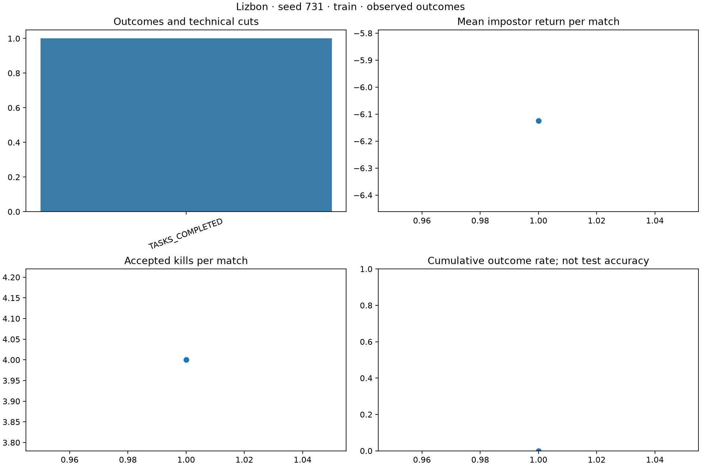
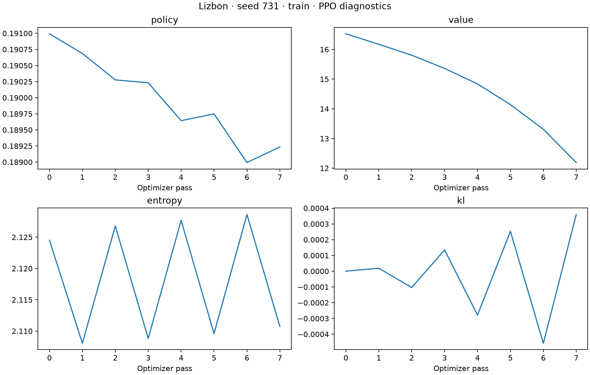
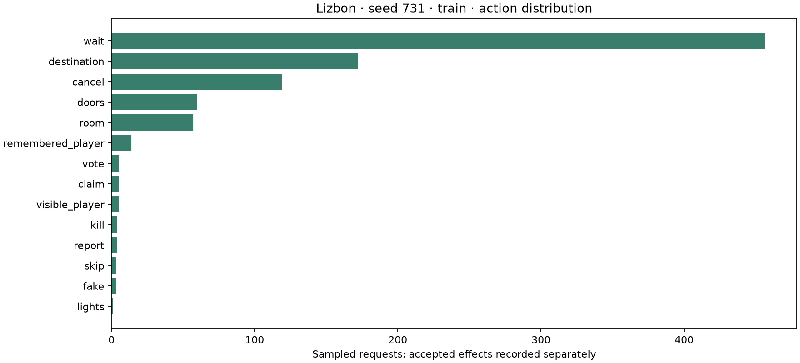
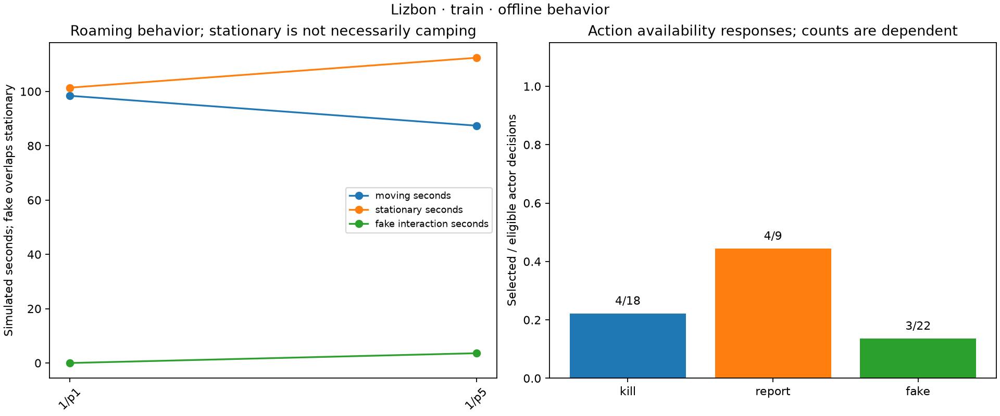
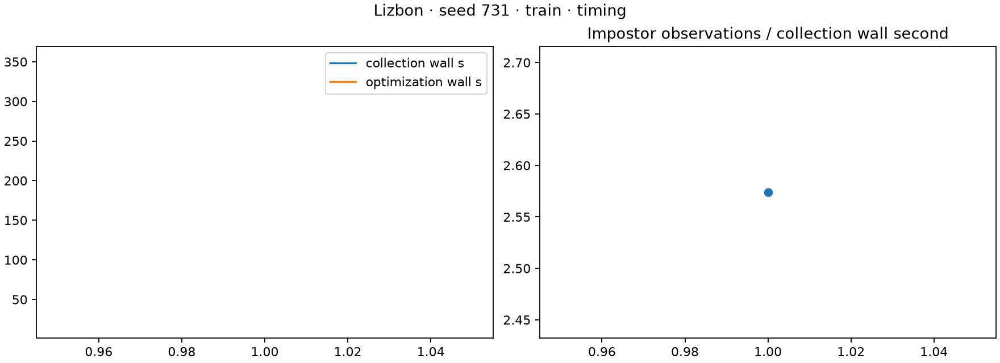
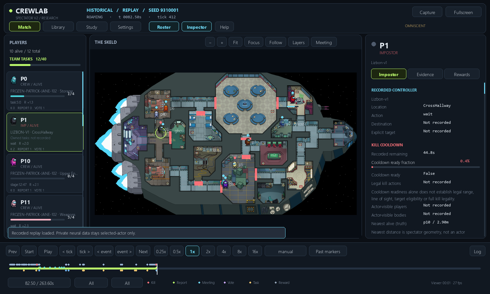

# Lizbon: first pilot, interrupted by an engine bug

**Result: implementation runs and updates weights; playing strength is unproven.**
The pilot stopped after one completed training game and one failed game. It was
not restarted. Development comparisons and all reserved final tests remain unrun.

## What finished

| Item | Observed result |
|---|---|
| Players | 10 frozen learned Patrick Jane crewmates vs2 Lizbon impostors sharing weights |
| Initialization | One fresh model, seed731, 1,036,561 parameters |
| Completed training games | 1; crewmates won by completing40 tasks |
| First game | 263.6 simulated seconds; 4 kills, 4 meetings, zero ejections |
| First collection policy | Initial untrained weights; this game supplied the first PPO update |
| Learning completed | 908 actor observations; 8 optimizer passes across two private trajectories/four epochs |
| Next game | Updated weights; 5 kills before a native geometry assertion at last valid tick1293/258.6s |
| Failed-game outcome | Unknown; excluded from training updates and win/loss denominator |
| Development / final evaluation | 0 /0 matches; no selection lock or final checkpoint generated |

The second game used another scenario and ended with an error. Five kills there
versus four in game1 **does not establish learning improvement**. The saved
checkpoint is a recovery boundary, not the best or a validated policy.

Crew update102 was published for task pursuit, not A2 training. It retains native
engineered task pursuit/commitment. These are learned frozen opponents with
specific limitations, not scripted crews or proven strong A2 opponents.

## Why it stopped

At258.6s, p11 selected a legal Storage door closure. It covered the stored death
position of p8, whose body had already been reported. The native invariant checked
**all stored player positions against current closed-door geometry**, including
dead players. All living players stayed inside valid geometry.

A minimal fixture reconstructed the saved positions, statuses and closed doors.
The legal closure reproduced the assertion with **zero model inference or PPO**.
This establishes a native invariant mismatch; it does not show a living player
walking through a wall. Neither engine nor invariants were disabled or modified.

See [diagnostic evidence](geometry-diagnostic.json) and the
[proposed engine patch](PROPOSED_NATIVE_FIX.patch). The proposal validates inactive
and underground stored positions against base floor, and living surface actors
against current collision geometry. It has not been applied to the pinned engine.
The crew developer should review it and publish a new version before another study.

## Time and processor

| Measurement | Time |
|---|---:|
| Approved maximum | 90 minutes; up to60 training,30 development/reporting |
| Registered start | 30 October2026,20:21:57.768 Amman (UTC+3) |
| Failure recorded | 20:34:49.560 Amman |
| Study elapsed until failure | 12m51.79s, from original timestamps |
| Completed game collection | 352.74 wall seconds |
| Completed game PPO | 18.36 wall seconds |
| Failed game last persisted progress | 373.79 collection wall seconds at233.4 simulated seconds |

The exact failed-game wall total was not persisted. The90-minute budget was a
maximum, not actual training duration. Diagnosis, graphs and documentation took
additional time after the process had stopped; no extra training was run.

Hardware: Intel Core i9-14900HX,24 cores/32 logical processors, about15.71GiB RAM
reported by Windows. Python3.12.10, Torch2.7.1+cpu, one Torch thread. Training used
CPU; the laptop GPU was not used. The spectator ran separately. Frozen crew file
checksum remained unchanged. The final in-memory crew hash check was not reached
because of the assertion; freeze/compatibility tests passed before launch.

## What the behavior means

Game1 had zero illegal actions and zero navigation failures. The initial policy
visited many goals, made119 cancellation requests, used lights once, and generated
54 accepted door sabotages. Three actual self-reports were verified from the
kill/report event pairs. Seven crew witness events led to no ejections across
four meetings: evidence-to-ballot behavior needs attention in the crew work.

There was no long fake-task farming in this completed game: the two impostors
spent about3.6 actor-seconds in fake interaction. They were stationary for about
213.8 of399.6 alive roaming actor-seconds (53.5%). This includes waiting and door
obstructions and is **not proof of deliberate camping**. Ready-time punishment
was small because cooldowns and repeated meetings excluded much of the time.

The initial policy selected a kill on4 of18 decisions where a legal kill was
available. These are dependent decision counts, not18 independent opportunities.
The policy has no established learned searching, witness avoidance, deception or
meeting strategy after this tiny interrupted study.

## Figures



One completed collection game: a task loss, four kills and negative return. This
is a training outcome under **initial weights**, not test accuracy or a score for
the updated checkpoint. The interrupted second game is reported separately above.



Eight optimizer passes changed Lizbon's tensors. Value loss fell from about16.53
to12.19 on the same collected data. Entropy stayed around2.1. This demonstrates
finite optimization, not better gameplay or generalization. Small signed sample
KL estimates can be negative; they are not exact nonnegative KL divergence.



Counts are requested actions, not always accepted effects. WAIT includes mandatory
non-speaker/after-ballot periods. Door/report requests may lose simultaneous
execution precedence. The engine does not insert a hunting strategy.



Movement/stationary/fake times are replay tick approximations, excluding meetings
and eliminated actors. Fake time overlaps stationary time. The right panel shows
selected/eligible decisions, with dependent observations. These diagnostics help
locate future problems; they cannot establish a competent policy here.



This figure covers the one completed game. Failed-game cost is absent from its
curve and is described in the timing table. Raw failures and partial replays stay
preserved locally; none is converted into a fake loss or successful match.



Actual GUI capture of completed game1. **Playback of the initial-policy baseline,
before the first update.** No completed post-update match exists in this pilot.

## Next steps for both developers

1. **Crew/shared engine:** review the proposed door-invariant fix. Add regressions
   for a reported corpse under a closing door, a living surface occupant, vent
   occupancy and meeting resets. Keep collision and invariant checks enabled.
2. **Both:** publish a new immutable engine/settings/checkpoint manifest and rerun
   compatibility gates. Keep separate model branches and frozen releases.
3. **Impostor:** propose another bounded pilot on that fixed release. Either resume
   from the preserved boundary with fully specified optimizer/RNG semantics or
   start a separately named fresh study. Do not silently treat this as a completed
   four-match study. Get approval before restarting training.
4. **Crew:** improve A2 body reports, witnessed evidence, ballots and lights/door
   counterplay. Freeze the improved crew for the next cross-play comparison.
5. **Evaluation:** compare initial and trained policies on paired fresh scenarios,
   then replicate independent initializations. Measure active search, kill timing,
   self-reports, redundant goals and evidence-to-vote behavior. Only then consider
   reward tuning; this interrupted run is too small to justify a bigger network.

Later: oxygen/reactor/comms, devices, exact minigames/Clean Vent, ghost sabotage,
optional roles and larger lobby training. Adaptation/self-play comes after both
base roles work against frozen opponents. See the [full plan](../../../jane/impostor/STUDY_PLAN.md).

## Files and playback

The named research checkpoint and initial reference are in
[the artifact release](../../../artifacts/lizbon-v1/pilot-20261030/manifest.json).
Strict loading verified the model name, settings/source hashes and908 observations/
8 completed optimizer passes. The trained tensors differ from initialization.

From the repository in PowerShell, **completed initial-policy playback**:

```powershell
.\local-runs\jane-impostor-v1\runtime\Scripts\python.exe .\run_lizbon.py --replay .\local-runs\jane-impostor-v1\pilot-20261030-seed731\train\match-001.jsonl
```

This does not train or demonstrate the updated checkpoint. The raw post-update
recording remains `match-002.jsonl.writing` with no fabricated result. Do not
present it as a completed game. The native viewer indexes completed recordings.

The checkpoint is reproducible with the pinned source/runtime in
[the setup guide](../README.md); private raw runs are not required for strict
weight loading. [Results](results.json), [PPO log](ppo.json),
[behavior counters](behavior.json) and [registration](pilot-registration.json)
retain the compact evidence. All historical models and earlier experiments remain intact.
