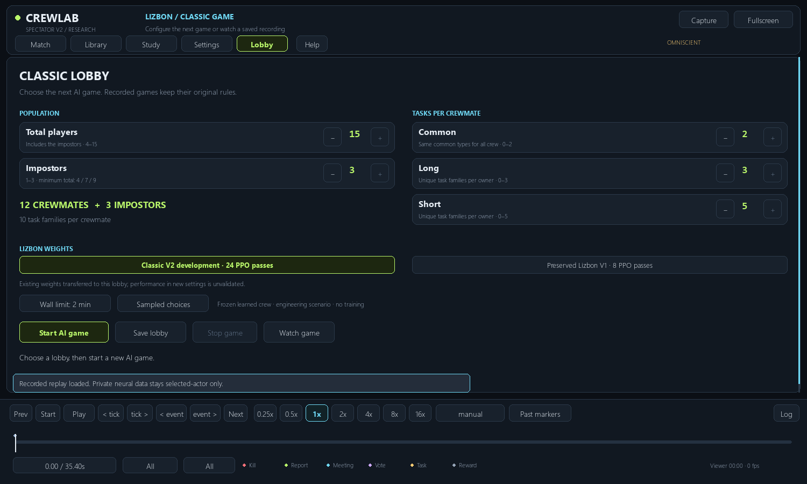
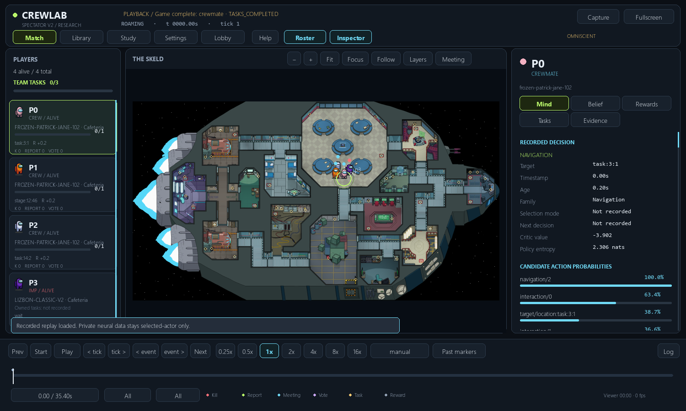

# Configure a Lizbon game in the dashboard

From this branch's repository root:

```powershell
python run_lizbon.py
```

The launcher opens **Lobby**. The native pinned source and dedicated Jane runtime
must already be installed; otherwise provide `--source-root` as in the existing
setup instructions. Restart an already-open older viewer to load the new tab.



1. Use **− / +** for **Total players** (4–15), **Impostors** (1–3), and per-crew
   **Common / Long / Short** counts (0–2 / 0–3 / 0–5).
2. Check the derived crew count. Current validator requires at least 4 / 7 / 9
   total players for 1 / 2 / 3 impostors. An invalid combination blocks launching
   and saving with a reason. All-zero task counts mean one effective Short task.
3. Choose available **Lizbon weights**, **Sampled / Greedy choices** and a
   **wall-time limit**. Current migrated Classic weights are offered locally when
   present; preserved tracked V1 weights provide a named fallback. Missing or
   incompatible weights do not silently become a fresh random policy.
4. **Start AI game** creates a separate profile and starts real neural inference.
   It switches to **Match**, displays bounded live snapshots, then loads the
   completed replay paused at time zero. **Watch game** returns to that game.
5. **Save lobby** writes a profile without starting a game. **Stop game** cancels
   only the process created by this dashboard. Closing its window also stops that
   owned process. Cancelled/failed snapshots are labelled **PARTIAL PLAYBACK**;
   a game that failed before publishing one shows no unrelated old replay.

Saved profiles, draft settings, console logs and raw games live under
`local-runs/lizbon-dashboard/`. Earlier games stay in **Library**. Each game has
its own `profile.json`, `viewer-launch.json`, `console.log` and `match/` output.
No registered study, historical recording or model is overwritten.

This lobby starts **inference only**, using existing weights explicitly transferred
to the chosen profile. It performs no PPO updates, selection, reserved final
testing, merge or deployment. More players/tasks are functioning settings; they
do not imply the policy is trained for them. Other implemented host settings
remain editable in JSON; unsupported mechanics are still disabled/rejected.

Explicit `--replay` and `--watch` launcher behavior is preserved. Every such viewer
also has the Lobby tab. A recording's player/task counts remain immutable.

## Verification, including the failed attempt

- **22 focused checks passed**: lobby configuration/validation/persistence,
  inference command, duplicate Start, failure/cancel/time cap, real Pygame clicks,
  small-window scrolling, completed and partial replay handoff, asynchronous stale
  load invalidation; existing doors and offline comparator regressions included.
- First real UI-started game correctly displayed four players, then failed with
  Windows `WinError 5` replacing producer `status.json`. It is preserved privately.
  The viewer now derives progress from nonfatal observer snapshots and **does not
  open critical producer status/results while that process is running**. The
  immutable engine, runner and checkpoints were not changed for this fix.
- Repeated UI-started custom game: **4 total / 1 impostor / 0 Common / 0 Long /
  1 Short per crew**. Sampled migrated development weights. Scenario 9700203.
- Natural crew task victory: **35.4 simulated seconds**, **29.74s collection**,
  **30.29s runner elapsed**; **41.44s** for the surrounding dashboard check
  including setup/loading. Three tasks completed, zero kills, zero illegal
  actions and zero navigation failures. Seven door requests were selected.
- **Zero optimizer updates**, unchanged saved Lizbon weights, unchanged in-memory
  frozen crew weights. Actual full replay parsing was separately verified:
  correct replay path, no live-snapshot flag, paused at **t=0**. An earlier
  inspection incorrectly accepted a remaining live index after the environment
  flag cleared; the stricter regression now prevents that false-positive check.
- Hardware/runtime unchanged: i9-14900HX, 24 cores/32 logical, one Torch CPU
  thread, Python 3.12.10 / Torch 2.7.1+cpu. This engineering game is **not** an
  evaluation win-rate sample and was not used for reward/model tuning.



See [verification receipt](dashboard/verification.json) and the
[full gameplay/learning checklist](LIZBON_GAMEPLAY_CHECKLIST.md). Raw replays,
partial failed games and runtimes remain ignored in `local-runs/`.
