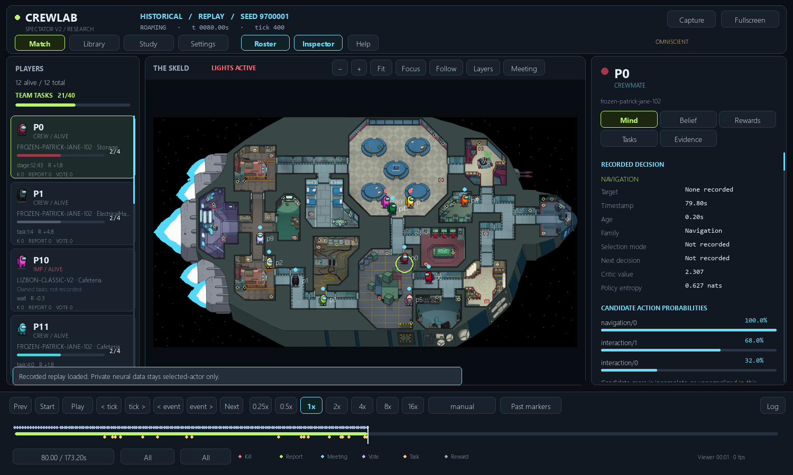

# Engineering evidence before the new pilot

These are functionality checks, not evaluation accuracy or new PPO training.

| Item | Observation |
|---|---|
| Isolated Jane suite | 74 checks passed; includes V1 checkpoint/PPO regressions and new rules/audits |
| Additional maximum-workload check | Actual frozen-crew inference at15 total/1 impostor,2 Common+3 Long+5 Short;140 owned crew tasks |
| Additional metadata/protocol checks | Preserved training-pass ancestry; real sibling-process abort and queued-work suppression |
| Maintained root tests/ | 291 passed,10 skipped,one historical frozen publication-contract failure |
| Bare pytest | Six legacy root-script collection errors: stable_baselines3 missing |

The root failure is
`tests/test_impostor_shared_checkpoints.py::CheckpointTests::test_optimizer_rng_and_next_update_roundtrip`.
The older published manifest rejects `.gitattributes` and the previously changed
`spectator/v2/map_view.py`. Do not rewrite that historical manifest to hide this.
The six root import errors are test_live_watch_cases.py, test_ppo_infrastructure.py,
test_stage1_randomization.py, test_stage2_evaluation_and_ranking.py,
test_stage2_transfer.py and test_stage2_watch.py. None of those sources was changed.

## Longer deterministic gameplay check

Seed9700001; transferred V1 checkpoint001 weights;12 players/2 impostors;1/1/2tasks.
Finished naturally with crew task victory in173.2 simulated seconds.
Collection142.67s; total runner143.18s. CPU i9-14900HX24cores/32logical; one Torch
thread; Python3.12.10/Torch2.7.1+cpu/NumPy2.5.3. No new optimizer updates.

- Zero kills, reports, meetings, illegal actions or navigation failures.
- Both impostors selected wait284/289 times and lights5times.
- Accepted shared lights5times; duplicate teammate resource requests were suppressed.
- Neither chose travel. Each remained stationary for about173 replay seconds.
- p10 had21 kill-available decisions in15 contiguous windows; p7 had2decisions in
  one window. Neither selected kill. These correlated windows are not independent
  statistical trials.
- Both earned about−10.815 total return. Frozen crew completed40tasks.

This is actual rendered replay of the new Classic adapter. It shows the two
impostors still in Cafeteria while crew complete tasks elsewhere. Omniscient view
is presentation/debugging only; it does not feed hidden locations into the NN.

Interpretation: the model is undertrained and greedy selection exposes a strong
idle/lights preference. Winning in sampled training alone would not cure this
evidence. Keep sampled and greedy confirmation separate. A richer architecture
or a scripted hunt is not justified by this one game.

## Problems caught and fixed before training

1. Native engine rejected a zero-second discussion before the adapter could skip
   to voting. Regression reproduced it; construct a valid internal timing config
   and transition directly to voting under the zero host setting.
2. The shared recorder forwards frozen-crew reward callbacks. The first offline
   summary mistakenly listed those crew as impostor actors. Filter actor summaries
   by actual neural decisions; emit only impostor rewards in the own audit.
   Neural learning/reward trajectories were not affected. Preserve the old
   engineering audit/source archive instead of overwriting it.
3. Supervisor originally waited for all futures before inspecting a fatal child
   exit. Replace with tracked processes and immediate sibling cancellation;
   verify with real short-lived Python processes. Reserve setup/finalization time
   within the parent's hard wall budget.

Historical V1 pilot failure, checkpoints and negative results remain in
`docs/jane-impostor-v1/pilot-20261030/`. New study outcomes belong in their own
report. Do not combine historical and new wins into one performance percentage.
