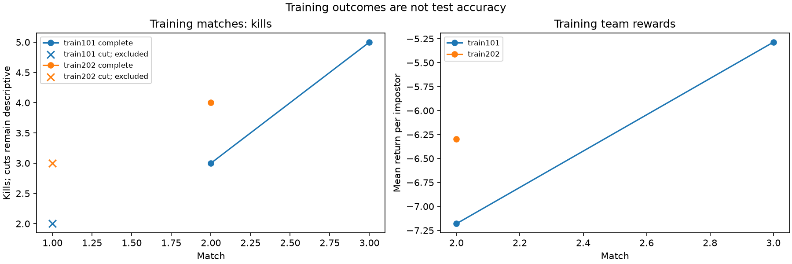
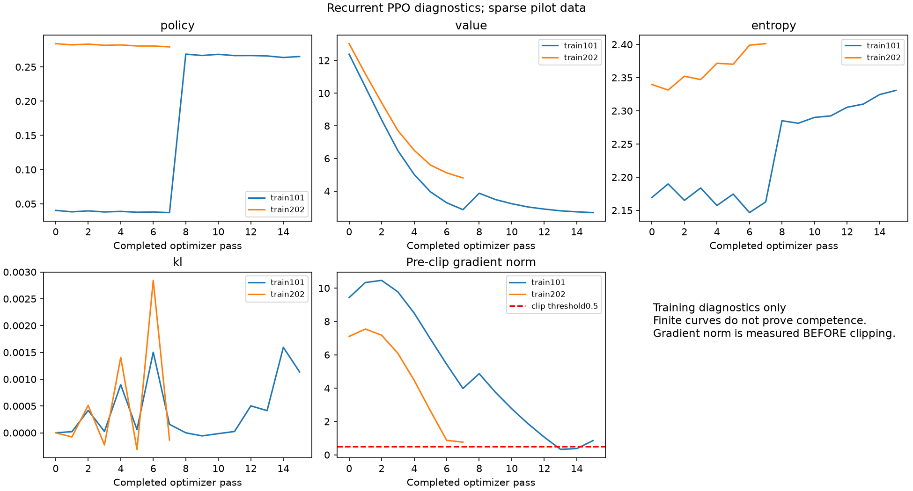
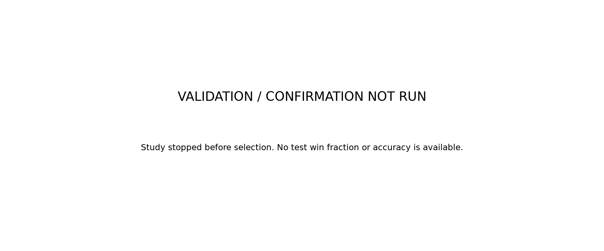
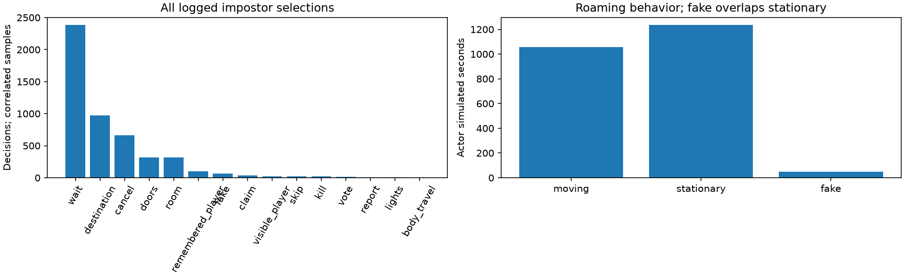
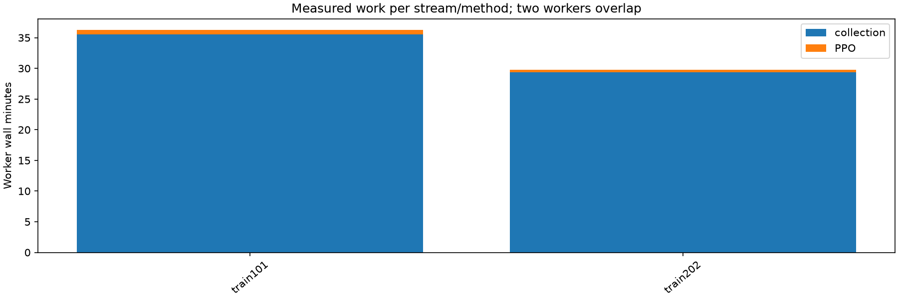
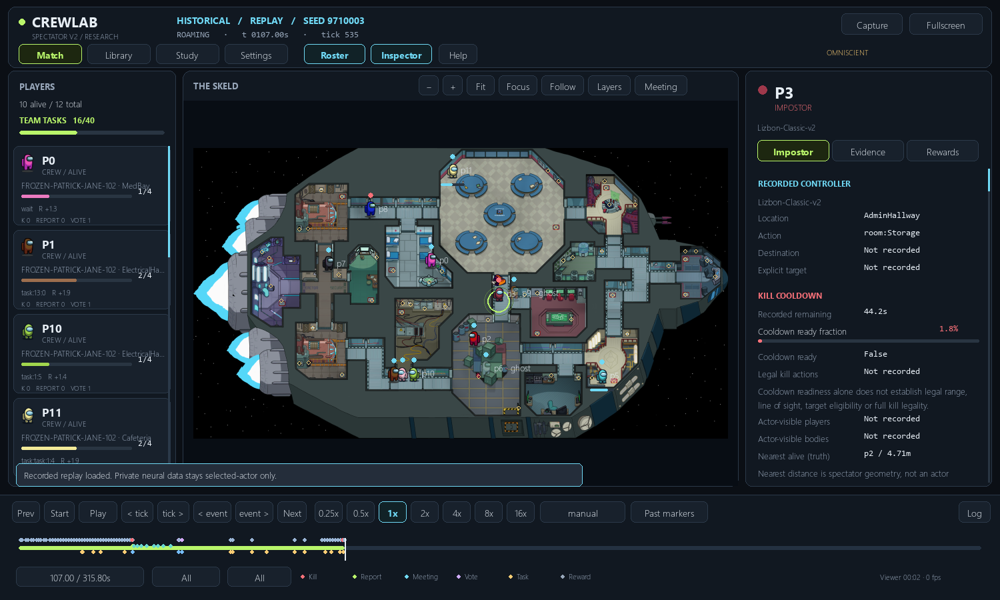

# Lizbon Classic V2 — stopped pilot, 30 October 2026

**Not ready as a competent impostor.** The study stopped on an engine geometry
error after **37m12.5s**. Three training games completed; all were crew task wins.
Two games hit their wall caps. One match failed and its sibling was cancelled.
No validation, selection or confirmation ran. No selected model was released.

## Actual outcomes

Both streams began with identical preserved V1 checkpoint001 weights and a fresh
optimizer. They are different sampling streams, not independent initializations.
Each match contains **two impostors sharing that stream's NN**, with private memory.

| Stream / game | Scenario | Sim seconds | Collection seconds | Kills | Outcome | New PPO passes after game |
|---|---:|---:|---:|---:|---|---:|
| 101 / 1 | 9710001 | 194.4 | 901.73 | 2 | Wall cut; excluded | 0 |
| 101 / 2 | 9710002 | 216.2 | 640.63 | 3 | Crew tasks | 8 |
| 101 / 3 | 9710003 | 315.8 | 591.09 | 5 | Crew tasks | 16 |
| 101 / 4 | 9710004 | Last audit16.2 | Interrupted | 0 logged | Cancelled after sibling failure | 16 |
| 202 / 1 | 9710101 | 170.4 | 918.86 | 3 | Wall cut; excluded | 0 |
| 202 / 2 | 9710102 | 316.6 | 845.16 | 4 | Crew tasks | 8 |
| 202 / 3 | 9710103 | Last valid209.4 | Failed | 2 logged | Geometry exception; excluded | 8 |

The three complete losses ended on **tasks, not ejection**. Actual ejections were
zero across the recorded prefixes. Nineteen `ejection` event envelopes include
`player_id=null`; they are not nineteen players ejected.

The three complete games supplied2,916 actor observations and24 new optimizer
passes across both streams. PPO took18.44s,24.10s and22.83s for those games.
Stream101 saved checkpoint002/003; stream202 saved checkpoint002. All three
strict-loaded and their tensors differ from study-start weights. These are local,
**unselected development checkpoints**, not final models. No worker `final.pt` or
successful final worker `results.json` was fabricated.

## Time and processor

| Item | Measured / registered value |
|---|---|
| Start | 30October2026 19:28:36.513UTC /22:28:36Amman |
| Stop | About20:05:49UTC /23:05:49Amman; failure artifact timestamp |
| Actual supervisor elapsed | 2,232.5s =37m12.5s |
| Approved maximum | 3hours; unused time was not spent or extended |
| CPU | Intel Core i9-14900HX,24cores/32logical processors |
| Runtime | Python3.12.10, Torch2.7.1+cpu, NumPy2.5.3 |
| Parallelism | Two processes, one Torch thread per worker; GPU unused |
| Match cap | 900wall seconds; checks at decision boundaries caused small exit overshoot |
| Training cutoff / hard deadline | 20:58:36UTC /22:28:36UTC; neither was extended |

Per-worker times overlap. Adding them does not give study elapsed time. Frozen
crew file SHA256 still matches the published artifact. The final in-memory crew
hash checks were not reached because the workers did not finish normally.

## What the NN actually did

We analyzed **4,938 readable neural decisions**, including56 recovered from the
cancelled gzip. Original files remain unchanged; separate derived prefix files
contain only readable records. A cancelled process can lose its buffered tail.

| Behavior | Logged evidence | Interpretation |
|---|---|---|
| Goal selection | 970console,314room,119player-location and1body-approach choices | It can select movement; coherent hunting is not established. |
| Goal cancellation | 663cancellations | Frequent switching remains a concern. Examine a route before penalizing a legitimate interruption. |
| Continue/wait | 2,383choices, including919forced meeting waits | Not all waiting is camping.704idle-wait choices were identified after exclusions. |
| Kills | 19selected and accepted;63kill-eligible actor decisions | Availability samples are correlated; this is not accuracy. |
| Witness risk | 8of19kills had another living crew witness in offline truth | Reliable avoidance of witnessed kills was not learned. |
| Reports | 10impostor report choices; all10were actual self-reports | Reporting remains neural; this does not demonstrate useful deception. |
| Doors / lights | 319door choices /294accepted closures;6lights choices /4accepted sabotages | Shared contention can suppress a duplicate ability. Frequent closures also exercise the failing geometry path. |
| Faking | 63starts; about48.2actor seconds | About2.1% of logged roaming time; persistent endless faking was not the main problem here. |
| Social actions | 33claims:16shares,11locations,3suspicions,2defences,1witness claim | Choosing statements is not proof that the NN learned convincing lies or defence. |
| Voting | 17target votes,21skips;1vote for a known ally | Voting strategy remains weak; no one was actually ejected. |
| Vents | Zero selected entries despite2eligible decisions | Interface exists; useful vent strategy is unproven. |

The earlier separate greedy engineering game selected wait284/289 times per
impostor and made zero kills. The training stream samples from the distribution,
so it explores more. There was **no paired greedy-versus-sampled evaluation** here;
do not compare different scenarios as evidence that training improved it.

Actor inputs remain own legitimate observations/history and known teammates.
Offline witness/kill/reward diagnostics never enter the policy. Rules and A-star
handle legal execution; the NN chooses strategic actions. There is no scripted
hunting, forced kill, reporting ban or automatic accusation/defence.

## Why training stopped

Stream202 failed in game3 immediately after the last recorded decisions at
tick1047/209.4s, with:

`Visibility and interaction geometry must share the same public map`

The engine independently caches door geometry and planners in two16-entry LRU
caches. Geometry-only eviction can create an equivalent new map while the planner
still refers to its older cached map. Projection rejects their different object
identities. A controlled cache-eviction reproduction produced the same exception
without NN inference or PPO. Pairing the map with `planner.map` passed that test.

This confirms a failure mechanism consistent with the trace. Exact cache contents
from the crashed process were not recorded, so the minimal reproduction is not
claimed to replay the entire failed training trajectory.

[PROPOSED_CACHE_PAIR_FIX.patch](PROPOSED_CACHE_PAIR_FIX.patch) changes the trusted
door update to take its map from the selected planner. The patch compiles and
passes `git apply --check`. **It is not applied to the pinned engine.**
[geometry-diagnostic.json](geometry-diagnostic.json) records the controlled result.
The new diagnostic regression passed in13.12s. The preflight tests had not covered
independent eviction of these caches.

The supervisor cancelled stream101 as registered. Process checks confirmed no
remaining study workers. The separate guard observed the fatal stop and found no
orphan workers left to terminate. No automatic restart occurred.

## Graphs


Complete-game kills and return; crosses mark excluded wall cuts. Different seeds
are not paired comparisons. Cut rewards omit terminal outcomes and are excluded
from the return curve and PPO.


Policy loss describes the PPO objective; value loss measures return fit; entropy
measures policy spread; KL estimates policy movement. Gradient norm is measured
before clipping (dashed threshold0.5). Finite values/changed weights show an
optimizer ran, not good play.


No validation, confirmation, test win fraction or accuracy is available. No model
selection lock exists. All fresh/historical reserved final partitions remain sealed.


All recoverable choices and motion, mixing starting and updated weights and
complete/incomplete matches. Stationary includes legal waiting and obstruction;
faking overlaps stationary time.


Known per-worker collection and PPO time. Failed/cancelled prefixes are not
complete collection measurements. Collection dominated measured PPO time;
profiling is needed to attribute the remaining cost.


Actual stream101 game3 at107simulated seconds. It used checkpoint002 weights,
after eight new passes. Its two impostors eventually made five kills but lost to
tasks. The screenshot is omniscient playback; that view never feeds the NN.

## Exact next steps

1. **Shared engine first:** review the coherent cache-pair patch with the crew
   developer. Keep visibility and interactions on the same map; do not disable the
   guard. Add cache-pressure, door-expiry, meeting-reset and vent/death regressions
   and publish a new immutable shared engine version.
2. **Runtime:** profile sampled door-heavy games before approving another study.
   Improve caching/recording efficiency while checking identical action/physics
   traces. Measure a full sampled match with meetings, not only idle greedy play.
3. **Impostor developer:** keep the current network. Separate already-arrived goal
   rejection (implemented) from excessive legal goal switching (still weak).
   Measure cancellations before arrival, visible nonally pursuit, kill readiness,
   witness risk and self-report timing. Keep genuine cancellation/waiting neural.
4. **Learning experiments:** after runtime stability, register more complete games
   and versioned option-commitment/reward ablations. Compare actual completed goals
   and kills; avoid movement/novelty rewards that can be farmed. Do not hardcode a
   hunt or forbid reports to manufacture a better-looking replay.
5. **Crew developer:** update102 is learned task-pursuit V1, not A2-trained. Verify
   living body reporting and remembered witnessed-kill voting on the same rules;
   train stronger frozen snapshots for later cross-play.
6. **Together:** frozen cross-play first, then registered4–15-player/task-count
   generalization. Add adaptation/self-play only after one learned policy works.
   Extra roles, all sabotage types and exact minigames stay deferred.

A new training study needs an explicit approved protocol/budget after the engine
fix. No candidate was selected, and these results do not establish an improved,
reliably winning or globally best impostor.

## Watch the completed game

From this worktree on the owner's machine:

```powershell
python run_lizbon.py --replay local-runs/lizbon-classic-v2/study-20261030/train101/match-003.jsonl --selected p3 --speed 1
```

This is **playback**, not live training or a new evaluation. Press Play/Start in
the viewer as needed. `run_lizbon.py` uses the verified Jane runtime. Raw private
replays and development weights stay under ignored `local-runs/`; a fresh clone
does not contain them. Public compact evidence includes
[aggregate.json](aggregate.json), [decision-analysis.json](decision-analysis.json),
[choice-effects.json](choice-effects.json), [checkpoint-manifest.json](checkpoint-manifest.json),
[registration.json](registration.json) and [verification.json](verification.json).
