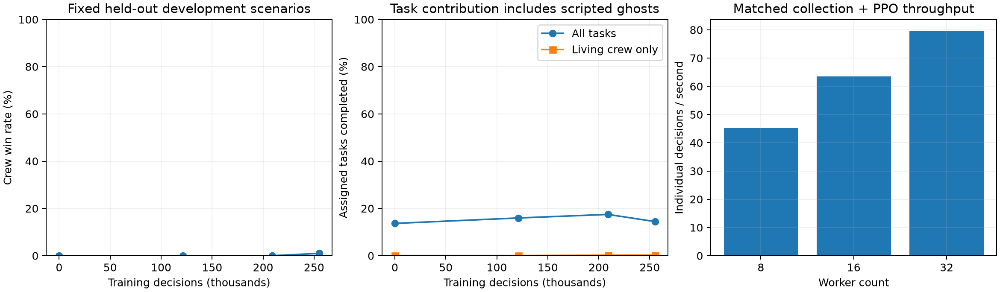

# Patrick Jane — bounded development pilot

Status: **complete**. Acceptance remains **pending**. Source commit `dbbf9ae4073fd81a89725c8b4be4d25f21903eee`.

The approved architecture and rewards are unchanged. This is one initialization against scripted opponents, with repeated paired development validation. Reserved final partitions remain unopened.

**Interpretation:** The runner completed safely and the policy changed its reporting
and voting behavior. Useful overall crewmate competence is not established: the
final policy won once, lost 98 games to critical sabotage, and completed only
10 assigned tasks while alive. Keep Phase 6.1 acceptance pending and review this
result before scaling.

| State | Crew wins | Wilson 95% interval | Tasks / assigned | Living / ghost tasks | Correct / wrong neural votes | Neural skips | Crew / impostor reports |
|---|---:|---:|---:|---:|---:|---:|---:|
| zero · update 0 | 0/100 | 0.0%–3.7% | 547/4000 | 2 / 545 | 237 / 988 | 128 | 93 / 11 |
| interval · update 3 | 0/100 | 0.0%–3.7% | 639/4000 | 2 / 637 | 226 / 873 | 96 | 92 / 15 |
| interval · update 5 | 0/100 | 0.0%–3.7% | 699/4000 | 9 / 690 | 233 / 891 | 198 | 120 / 20 |
| final · update 6 | 1/100 | 0.2%–5.4% | 578/4000 | 10 / 568 | 243 / 794 | 253 | 120 / 9 |



Training collected 255,083 individual decisions across 192 complete matches using 32 workers. Collection: 49.65 minutes; PPO: 6.27 minutes; total measured run: 2.661 hours. Effective collection-plus-update rate: 76.03 decisions/s.

Validation uncertainty is paired across the same scenarios; repeated states are not independent datasets. Exact values, per-stage actions, report/repair opportunity denominators and critical-failure counts are in `aggregate.json`. Opportunity counts are legal choices at learner decision points, not unique bodies or independent games. Selected report/repair intentions may exceed accepted actions because simultaneous reports end the roaming tick.

Task progress is separated into living crew and scripted ghost completions. Ghosts receive their unchanged owner reward and do not act or complete tasks during meetings. Increasing shaped return alone is not evidence of better deduction or gameplay. Neural vote accuracy is scored offline against roles; those role labels never enter neural observations.

Reporter-role imbalance and scripted opponent patterns can confound deduction metrics; this study does not eliminate that shortcut. Validation uses new seeds and a shifted mixture of the same script families. Ten shared-policy actors in a match are correlated observations, not ten independent scenarios. Action probabilities are not calibrated impostor-belief probabilities.

A one-million-decision run with the same evaluation schedule extrapolates to 8.83 hours before a contingency margin. This uses measured training throughput and the slowest observed validation cost, with other overhead scaled conservatively. It is not authorization or launch of the larger stage.

No post-pilot gameplay fixes, reward tuning, final-test evaluation, production
changes or partner-impostor changes were made. The one-million stage has not
started.

## Behavior and paired uncertainty

These are **exploratory, post-hoc descriptive comparisons** conditional on one
initialization and this scripted development distribution. Whole scenarios are
resampled in pairs; individual actors, ballots and repeated opportunities are
not treated as independent. No multiplicity adjustment was applied.

| Final versus zero | Observed change | Paired scenario bootstrap 95% interval |
|---|---:|---:|
| Crew win rate | +1.0 percentage point | 0.0 to +3.0 points |
| Correct votes among non-skip votes | +4.09 points | +0.64 to +7.58 points |
| Vote participation | -10.15 points | -12.73 to -7.57 points |
| Correct accusations among accusations | -7.30 points | -13.44 to -1.28 points |
| Report selections / legal reporting decision points | +18.68 points | +7.74 to +29.09 points |
| Repair selections / legal repair decision points | -0.08 points | -13.15 to +11.12 points |
| Critical sabotage loss rate | 0.0 points | -4.0 to +4.0 points |
| Living tasks / all assigned tasks | +0.20 points | +0.025 to +0.375 points |
| Innocent ejections per match | -0.25 | -0.43 to -0.07 |
| Impostor ejections per match | +0.07 | -0.01 to +0.15 |

The single discordant win gives a one-sided exact paired improvement p-value
of **0.5**. The final win-rate Wilson interval is **0.18%–5.45%**; the untrained
reference is **0%–3.70%**. The zero-width win bootstrap intervals at earlier
milestones occur because every observed game was a loss; they do not prove a
precisely zero population effect. See [paired counts and intervals](paired-outcomes.json).

Correct ballots increased only from 237 to 243, while incorrect ballots fell
from 988 to 794 and skips rose from 128 to 253. Selectivity and fewer innocent
ejections are promising behaviors, but higher conditional vote accuracy alone
does not demonstrate better identification. Correct accusations fell from
67/260 to 53/287; wrong accusations increased from 193 to 234. The policy still
makes many unsupported or incorrect social choices. There is no separate
calibrated belief classifier in Patrick Jane, and its action probabilities
must not be described as the historical frozen Phase 4 belief predictor.

## Tasks, reporting and sabotage

- Final living crew completed **10/4,000 assigned tasks (0.25%)**, versus
  2/4,000 initially. Scripted ghosts supplied **568/578 (98.27%)** final task
  completions. No validation game was won on tasks. Task progress is therefore
  mostly not learned task execution.
- Final report selections were **129/190 legal reporting decision points**,
  versus 94/191 initially. Accepted crew reports increased **93 → 120**;
  impostor reports were **11 → 9**. These opportunity denominators are repeated
  legal actor decisions, not unique bodies. Simultaneous report intentions can
  be preempted by the first accepted report.
- There were **156 meetings**, **778 body-visible actor decisions**, and 190
  legal reporting decisions in final validation. These counts demonstrate some
  evidence access, but do not measure complete evidence quality or whether each
  encoded memory retained the relevant fact until voting.
- Final repair choices were **128/225 legal repair decisions**. Completed
  repairs were **81 lights, zero oxygen, zero reactor**. Reports cancelled
  70 critical sabotages, versus 49 initially, but **49 reactor failures and
  49 oxygen failures** still ended the final games. Reaching panels and
  sustaining/coordinating critical repairs remain major limitations. The
  training games contained one oxygen repair; that did not reproduce in
  held-out development validation.
- Reporter identity remains a potential shortcut/confound. Crew made 120/129
  final accepted reports, and the lobby has ten crew and two impostors. This
  study did not register all-role opportunity-conditioned reporting controls;
  role imbalance alone does not establish biased scripted choices or prove
  the shortcut has been removed.

Ghost movement, work and incubation pause during **both discussion and voting**.
Ghosts retain only their owner's tasks and the approved +1 owner reward; delayed
credit goes to that actor's last living trajectory. They make no neural
decisions. See [mechanics and tests](../../GHOST_MEETING_BEHAVIOR.md).

## Recorded examples and remaining diagnosis

Only **190/137,185 roaming decisions (0.139%)** offered a legal report and
**225/137,185 (0.164%)** offered a legal repair. Bodies were visible on 778
decisions (0.567%). These are repeated actor-time opportunities, not independent
samples. Scarce useful opportunities and failures to use some available
evidence both contribute; this pilot cannot cleanly separate internal impostor
identification, memory retention and policy action selection.

These are selected illustrations, not estimates of prevalence. Complete raw
replays and offline role records remain local and unchanged.

1. **Seed 2910032, final policy:** p0 repaired lights at 37.2 simulated seconds.
   At 138.6 it had a legitimate direct-witness event for a kill, reported the
   body at 139.2, then voted for an innocent candidate at 154.2. The group ejected
   a different innocent crewmate, and the match ended in oxygen failure at
   184.4. This establishes a case where evidence opportunity did not yield the
   correct action. It does not locate the failure inside observation encoding,
   memory retention, internal identification or action selection; a focused
   trace audit is needed. Neither the raw observation tensor nor an internal
   impostor posterior was recorded in this replay.
2. **Seed 2910000, final policy:** a crewmate started a task at 33.6 and a new
   intention interrupted it at 34.8; two further crew task interruptions had
   the same reason. Twenty tasks completed, all by ghosts. Four lights repairs
   did not prevent a reactor loss at 249.6. This motivates examining goal and
   task persistence, rather than treating aggregate task progress as learning.
3. **Seed 2910034:** the sole final win ended by ejecting both impostors at
   332.0 seconds, with one innocent also ejected. Only its complete summary is
   available; no full replay was selected, so no private-evidence explanation is
   claimed for that win.

**Recommendation:** Do not scale straight to one million. Register a small
development-only diagnostic of task/goal persistence, legal panel arrival and
critical-repair coordination, plus direct-witness-to-vote memory/decision
tracing. Keep architecture and rewards frozen while identifying which stage
fails. Controlled legitimate evidence and scripted assistance can separate
skill execution from opportunity scarcity; any resulting curriculum or behavior
change needs a new reviewed protocol. No such fixes or new experiment were
implemented here.

## Compute, provenance and preservation

The matched benchmark selected 32 workers at **79.709 collection-plus-PPO
decisions/s**, versus 63.499 at 16 and 45.210 at 8. All 32 engineering scenarios
had identical traces/results across counts. Benchmark core `451e075` contains
the final neural batching/sampling implementation. Pilot core `dbbf9ae` adds
observer-file robustness, journal/error diagnostics and the lightweight Windows
launcher, with the same network, PPO math, rewards and scenarios. Actual pilot
training throughput was **76.026 decisions/s**; including validation it was
**26.626 decisions/s**. Do not label the older benchmark as a measurement of
every byte of the later observer revision. [Full benchmark and numerical
limitations](../../PERFORMANCE_AND_READINESS.md).

Training simulated **6.418 match-hours** across 192 distinct training scenarios;
validation simulated **13.253 match-hours** across 400 executions of the same
100 distinct scenarios. These are match-hours, not independent actor-hours.
Training collected 5,083 decisions beyond nominal (2.03%), below the 275,000
absolute guard, and performed six four-epoch updates. Collection took
2,979.170 seconds, PPO 376.035, validation 6,215.004, and other run overhead 9.909.

The original four-hour window, including both failed zero-update attempts,
diagnosis and recovery, used **13,143.260 seconds (3 h 39 min 3 s)** and finished
**20 min 57 s before its deadline**. The successful v3 run used 9,580.118 seconds.
The corrected matched benchmark cost another 1,975.407 seconds before that
window. Do not double-count overlapping engineering checks as sequential compute.
See [budget measurement method](budget.json).

- 48 PJ correctness tests and 46 historical compatibility tests passed before
  learning. Complete-game GPU PPO, serial/parallel trace equality and strict
  optimizer/weights/RNG reload were qualified. GPU serial versus batched
  optimizer paths are not bitwise identical; the measured limitation is retained
  in the performance report.
- All **592 completed pilot games** had zero illegal actions, navigation
  failures and fatal observer errors. **146 transient snapshot write failures**
  were recovered; the sustained-error guard remained enabled. Failed startup
  and observer attempts are preserved separately and had zero learning updates.
- All **nine checkpoint files**, plus the selected champion copy, passed strict
  source/schema/architecture/runtime loading with finite weights. All 52 state
  tensors changed from fresh initialization. That verifies real optimization,
  not useful competence. The final checkpoint is also the selected champion:
  `update-000006.pt`, SHA256
  `d8b81ef06788a0139822a5677801f34069aef116286cc079cb12de8c39538ab8`.
- Fifty frozen source files and the source archive were verified. The 1,077-file
  historical base check changed only the approved research issue journal;
  **all 206 protected external checkpoint/viewer files are byte-unchanged**.
  See [integrity checks and checkpoint hashes](integrity.json).
- Training seeds were **2900000–2900191**; validation **2910000–2910099**.
  No final familiar/patient partition was accessed. Raw data and checkpoints
  remain under the local run folder; none are included in this report directory.
- The existing Windows spectator displayed real selected-instance snapshots,
  actual neural choices and newly indexed completed replays, independently of
  headless collection. One viewer process exited without a logged error; its
  cause is unknown. It was reopened and its native heartbeat verified during
  final validation. Instrumented benchmark snapshot work was 2.8% of collection
  time; this is not a controlled measurement of total rendering overhead.

**Replay metadata caveat:** raw per-neural `training_step` adds the current
collection's decision count even during evaluation. It is a collection-progress
offset and must not be read as additional trained decisions. The header's
`config.training_step`, `policy_update`, immutable checkpoint, `history.json`
and completed status retain the true trained policy version. Raw records were
not rewritten. Replay `observation_features` and `suspicion_probabilities` are
empty for PJ; action-head probabilities are real, but these fields do not
provide a full tensor trace or calibrated beliefs. Track this in research R038.

To reopen the existing spectator from this research worktree:

```powershell
.\.venv\Scripts\pythonw.exe run_spectator_v2.py --watch local-runs/patrick-jane --status-file local-runs/patrick-jane/live/status.json --preferences local-runs/patrick-jane/live/preferences.json --mode follow_latest
```

The Library contains the completed update-6 replays. A concrete final-policy
example is `local-runs/patrick-jane/pilot-250k-seed17-v3/replays/env-00-seed-2910032-update-6.jsonl`.
After completion the status correctly reports no active training; replay
playback does not start collection or PPO.

The measured larger-run estimate is **8.83 hours**: 3.65 hours training plus
5.18 hours for 1,100 development validation executions and scaled overhead,
before contingency. A 25% planning allowance would be about **11.04 hours**.
Longer-lived or more capable policies may change that cost. The larger stage
remains unlaunched and requires review.

For paired-metric reproduction, sort the 100 common scenario seeds, generate
`default_rng(293017).integers(0, 100, (10000, 100))`, and use the same sampled
indices for reference/current games. Recompute ratios from summed numerators
and denominators in each sample; take difference quantiles at .025/.975.
The exact metric definitions and results are in `paired-outcomes.json`; Python
3.12.10 and NumPy 2.5.3 were used. These analyses were post hoc, not new
checkpoint-selection criteria. No result was used to retune or resume training.
