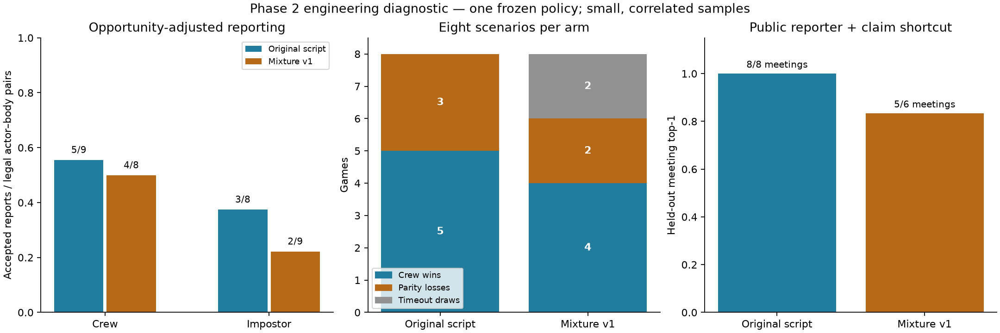

# Phase 2 results: varied opponents, inconsistent claims and remaining shortcuts

2026-10-28. **Exploratory development diagnostics. Phase 6.1 acceptance pending.** All historical policies/results remain unchanged. The new mixture is opt-in; it does not replace the registered training opponent. No neural training, reward change, canonical mechanic change or final-test access occurred.

The defense/vote observation is real. The strongest explanation supported by these records is **inconsistent claim semantics in the learned action policy**, alongside imperfect belief predictions and exploitable behavior signatures. It is not generally explained by different actors, random validation sampling or a late belief reversal. We cannot establish a single causal learning mechanism from these diagnostics.

The new opponent mixture produces legitimate variation, including both reporting and leaving bodies. It has **not** demonstrated a sufficiently improved learning environment: meetings and natural crew evidence opportunities declined, public behavior remained highly identifying, and two games timed out. Do not begin the next learning run on the strength of diversity alone.

## What was examined

- All **96** existing completed recordings: **48 validation games** across A/B/zero plus **48 sampled training games** across A/B. Training records are a sample, not the whole training history. Splits use the registered seed partitions, not filename patterns.
- A new paired comparison: seeds **2760080–2760087**, frozen shaped Model B against baseline and mixture, **16 complete games across eight scenarios**. First four seeds are ordinary natural starts, next two are deduction-only natural starts, last two use the unchanged legal body prefix. Canonical lobby settings, including 900-second timeout and role-specific vision, stayed fixed. Both arms used the same greedy frozen policy and original/common evaluation reward profile. No policy update or reward feedback influences the action policy.
- Twelve engineering situation families at development seeds **2760070–2760079**, including self-report, leaving bodies, innocent reports, framing, witnessed/unwitnessed kills, weak/strong evidence, competing claims, multiple suspects and new evidence after a defense. These are constructed tests, not twelve independent natural games. Learned crewmates were not forced to claim, vote or report.
- Separate frozen A/B/zero probes at **2760074**: empty emergency, unwitnessed body meeting and directly witnessed body meeting. Discussion and voting distributions were inspected without executing a neural action.

Exact numerical aggregates are in [metrics.json](results/metrics.json); components and reproduction commands are in [README](README.md). Complete raw observations, memories, role labels, replays and prior failed analysis outputs remain local and unmodified.

## Defense followed by a vote

In validation, B selected **45 defenses**. **44** were followed by a vote against the same target by the **same actor in the same meeting**: **34** targets were impostors and **10** were innocents. The remaining defense is not counted as a matched defense/vote sequence. Cross-agent links and cross-meeting links are analyzed separately; they are not individual reversals. A and zero had no such validation sequences.

All 44 matched defenses were the **argmax** legal action. Their probabilities were only **6.7346–7.2383%**, close to a broad distribution over many actions. “Highest probability” does not mean high confidence. The defended target already had at least **80% suspicion in 39/44** cases and was the top suspicion candidate in **41/44**. On the same target, defense exceeded accusation by a median **0.00065466 probability**, or about **0.0655 percentage points**. A small action-type preference can determine a greedy statement even while the target representation strongly indicates suspicion.

There were **seven** sequences with no intervening public claim, and **three** with maximum recorded belief change below 1e-6. Other sequences did receive claims and some beliefs changed substantially. Phase changes are distinguished from evidence. Historical full private packets/last-seen memories were not recorded; we cannot assert their exact contents or universally claim there was no private evidence.

A representative, preserved counterexample is shaped `ordinary-2790005`, p4, meeting m1:

| Moment | Selected behavior | Suspicion of p3 |
|---|---|---:|
| 126.2s | Defend p3, argmax action probability 7.2296% | 97.8059% |
| 129.6s | Vote against p3 | 97.8059% |

The target was the impostor. Only the transition to voting occurred between these actions; no new public claim was delivered. This particular correct vote does **not** establish a new deduction or a rational belief reversal. Another preserved example (`body-2790000`, one observer) rose from **48.25% to 99.09%** between its defense and vote after public claims; evidence-associated belief change is possible and must not be prohibited by a rigid rule. These examples are retrospective, not causal explanations.

Accepted claim kinds, subject IDs, neural candidates, selected indices, timestamps and submitted ballots agree. The existing action builder maps `claim_defend` to `DEFEND_PLAYER` and `claim_suspect` to `SUSPECT_PLAYER`; no swapped-action or spectator-label explanation was found. The real moments were inspected in the unchanged Spectator V2; genuine local screenshots are under `local-runs/behavior-views-v1/`. This is behavioral inspection, not repeated general UI QA.

In sampled stochastic training, A had four same-owner/meeting sequences and B six; only three of those ten defenses were argmax. Sampling is relevant to those training cases, but it does not explain the 44 greedy validation cases. Selected accusations with at most 20% target suspicion occurred **30/36** times for A and **31/37** for B in that sampled training set. No selected accusations occurred in B's validation games. These units must not be pooled.

**Interpretation:** Claim actions have no direct semantic-correctness reward component in the frozen configuration. Shared target scoring, small type-logit differences, sparse training and indirect team/ballot credit are plausible contributors. These are hypotheses, not an isolated causal result. The network does distinguish action types; this is not proof that the architecture cannot represent coherent claims. Frozen belief quality, its calibration under new claim distributions, and policy semantics require separate tests. Do not call this strategic deception by a crewmate.

## Evidence-conditioned frozen behavior

The original “no direct witness” probe already produced **99.983%** impostor suspicion. It was retained as `evidence-probe-v1`, not relabeled as weak evidence or discarded. The second prospectively clarified probe added an empty legal emergency meeting: no kill, body, report or claim.

| History | Shared belief on impostor at voting | Model A argmax | Model B argmax | Frozen zero argmax |
|---|---:|---|---|---|
| Empty emergency | 23.43% | Skip | Skip | Incorrect vote |
| Unwitnessed body meeting | 99.98% | Skip | Correct vote | Incorrect vote |
| Directly witnessed body meeting | ~100% | Skip | Correct vote | Correct vote |

B therefore showed evidence/context-conditioned skipping versus voting in this one probe. It **still defended** its highly suspected target during both body discussions, including after a direct witness. A still skipped despite very strong evidence. The zero reference's tiny argmax changes are not trained competence. All policies used **one shared frozen Phase 4 belief predictor**, not three independently trained belief models. Candidate sets and participants differ across contexts; raw action probabilities and this one seed do not establish generalization or isolate evidence from every contextual cue.

## New opponent and opportunity-adjusted comparison

The preserved baseline is `ReporterController` with hunter/evidence movement/social behavior and its existing prompt/inspect/bypass reporting variation. It prioritizes a nearest legal kill; reports can be delayed or bypassed. Historical report event shares alone were insufficient to infer role bias because impostor legal-opportunity packets were absent.

The new mixture uses overlapping aggressive, stealthy, self-report, evasive and social preferences. All have nonzero report hazards and can abstain. Mode draws occur within matches with independent mode/report/kill/movement/social RNG streams. Reports accumulate only during legal exposure; kill decisions consider locally visible density; victims are sampled with weights favoring nearby legal targets; navigation/fake tasks use legal public destinations and local sightings. Claims/votes use public meeting identities. A misleading claim is an ordinary legal message, not fabricated direct evidence. No emergency or sabotage strategy was added. Profile names describe preferences, not guaranteed behavior or human realism.

All five modes occurred. Living players from both roles reported. The following denominators include only play after the legal-prefix handoff:

| Measure | Baseline | Mixture |
|---|---:|---:|
| Crew accepted reports / legal actor-body pairs | 5/9 | 4/8 |
| Impostor accepted reports / legal actor-body pairs | 3/8 | 2/9 |
| Crew report submissions / legal decision windows | 9/9 | 8/8 |
| Impostor report submissions / legal decision windows | 4/43 | 2/40 |
| Accepted kills / legal kill decision windows | 9/9 | 9/18 |
| Self-reports / post-handoff kills | 3/9 | 2/9 |
| Kills not self-reported | 6/9 | 7/9 |
| Bodies remaining undiscovered after post-handoff kills | 3 | 5 |
| Emergency meetings | 0 | 0 |

The body fixtures give three learners one legal body simultaneously. All three selected/submitted reports; one won the race. Thus 6 submissions produced 2 accepted reports per arm. The baseline impostor also submitted once and lost that race. Zero accepted impostor reports in those two fixtures does **not** mean there was no willingness or legal opportunity. Visible/range/legal/decision pairs, tick exposure and action delays are separately retained in the aggregates; they are not independent observations.

| Context | Crew wins, baseline / mixture | Meetings, baseline / mixture | Correct/wrong crew ballots, baseline → mixture |
|---|---:|---:|---|
| Ordinary, four scenarios | 2/4 / 1/4 | 4 / 3 | 7/5 → 3/6 |
| Deduction natural, two scenarios | 1/2 / 1/2 | 2 / 1 | 3/3 → 3/0 |
| Body prefix, two scenarios | 2/2 / 2/2 | 2 / 2 | 6/0 → 6/0 |

Baseline endings: five crew ejections of the impostor, three parity losses. Mixture: four crew ejections, two parity losses, two **timeout draws**. There were no task-win endings. No submitted/published crew skips occurred in this assay. These are actual replay ballots, not historical reward-ledger counters.

Natural crew legal body pairs fell **3 → 2**; the six controlled crew pairs per arm came from only two bodies. Total post-handoff task events rose **66 → 80** because match lengths/exposure changed, including two 900-second timeouts. That is **not** improved task efficiency. Impostor report delays varied: accepted baseline reports were about 6.4s after first legality; the two mixture delays were 40.0s and 3.4s. The full count/latency data is in the aggregates. No evidence supports claiming more frequent crew evidence or better deduction opportunities overall.

Victim/movement behavior differs by implementation and recorded command distribution. Legal per-target kill ranks and every impostor movement decision packet were not retained in the first assay; raw victim IDs across different role assignments cannot establish a meaningful victim preference. Frequent random destination replacement and reduced discovery are plausible contributors to timeouts, not an isolated navigation bug or a measured realism improvement. Future tests should separately compare goal retention and pursuit while holding reporting fixed.

## Shortcuts remain

Accuse-reporter identification, excluding the observing reporter and averaging actor forecasts per meeting, scored **3/8** baseline versus **2/6** mixture meetings overall. In **natural** games it was **3/6 versus 2/4: 50% in both**. The overall difference is not evidence of a weakened shortcut: meeting coverage and context composition changed. Reporter role shares and opportunity-adjusted report behavior are different quantities.

A more revealing shortcut used only **public reporter status and delivered claim kind before voting**. A smoothed categorical classifier with balanced class priors held out every row from the evaluated scenario seed. It used no role truth, hidden position, private belief, ballot target or outcome as an input.

| Held-out public-behavior identification | Baseline | Mixture |
|---|---:|---:|
| All meetings, top-1 impostor identification | 8/8 | 5/6 |
| Natural meetings only | 6/6 | 3/4 |
| Controlled body meetings only | 2/2 | 2/2 |
| All-meeting binary balanced accuracy | 100% | 91.67% |

The deterministic learned crew commonly defend, while the original script uses other formats; one mixture defense creates overlap but does not eliminate the signature. Small folds, correlated participants, differing meeting availability and one fixed crewmate policy make this a **shortcut warning**, not an estimated real-world classifier capability or a significance claim. Lower reporter-only accuracy does not prove genuine deduction when another public token can identify the role.

## Confirmed accounting bug and preservation

The earlier viewer audit and a new focused test confirm that `ActorLedger.consume` drops a legal own ballot when the voter becomes inactive/ejected in the same step. This can suppress its count and reward component. Across the preserved registered validation set, six matches omit six ballots in aggregate: two correct, four incorrect. New comparison recordings likewise use actual published ballots rather than treating ledger counts as authoritative. No reward source or historical result was corrected in this task.

Other historical observability gaps remain: 27 component histories have an unattributed starting balance (maximum 0.095), 24 inactive-prefix actors lack reward records, full private histories and scripted decision packets were not recorded. The viewer's explicit unavailable/unattributed labels remain appropriate.

Preservation verified **1,031 existing files** (all original tracked files except the intentionally updated register), **155 historical artifacts**, **145 viewer/artwork baseline files**, and **13 approved V2 source/test files**, all byte-identical. Other branch refs and the R001–R020 history remain unchanged. A/B/zero strictly source-compatible loads and file/tensor hashes passed. The exact benchmark source is recoverable at local snapshot `91f7692`; small subsequent observer/reporting fixes do not change opponents or actor behavior. No branch merge, push, partner-branch modification or final-test opening occurred.

## Verification, runtime and next experiment

The paired assay took **827.68s (13m47.68s)** including a full no-audit/no-recorder repeat (**46.20s**). Event hashes, actor action summaries and decision counts matched exactly. Sixteen recordings contain **12,211 living owner-bound neural decisions**, **56 eligible submitted ballots** and **1,041 adjacent meeting-frame pairs** with frozen positions/ghost positions/task progress. No illegal actions were recorded. This is a correctness/noninterference check, not a clean recording-overhead benchmark or a training throughput estimate.

The first two-history probe took 34.06s; the clarified three-history probe took 33.40s. Correctness tests and read-only historical analysis are separate from the 15-minute paired-run ceiling. General V2 UI verification was not repeated; four actual behavioral views were rendered and inspected. Detailed test evidence and final file lists are in [VALIDATION.md](VALIDATION.md).

**Recommendation:** review a separately versioned same-step ballot-credit repair first. Then run a small **frozen-policy** follow-up that counterbalances reporter role and public claim format, compares coherent patrol-goal retention with the present mixture, and registers minimum *natural* reporting/meeting exposure. Keep empty, unwitnessed and witnessed evidence strata distinct. Do not promote this mixture to the training default yet.

After those checks, a separately approved learning pilot can compare two fresh, matched shared-crew policies (original opponent versus frozen versioned mixture), around 1,024 individual decisions per arm with complete-match accounting and fixed checkpoint selection. Use the same approved reward coefficients/architecture and a new provenance version for the accounting repair. Include fixed held-out ordinary and controlled development scenarios, zero-update reference, claim/belief/vote consistency and public-shortcut baselines. Exact seeds, cost ceiling and coverage must be registered before execution. Do not combine A/B gradients, force social actions, retune rewards or infer acceptance from task wins. No such follow-up or learning run has started.
