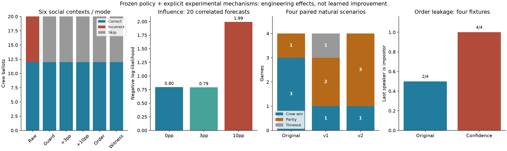

# Phase 2.1 results: meeting mechanisms, direct evidence and opponent v2

2026-10-28. **Bounded engineering, frozen policies, no training. Phase 6.1 acceptance pending.** Historical environment/results/checkpoints remain unchanged; all new behavior is opt-in. The versioned ballot repair works. The guard removes several inconsistent/low-confidence choices in these fixtures, but that is an external intervention.10-point social influence and heterogeneous confidence ordering have material negative results and should not become defaults.

See [aggregate metrics](results/metrics.json), [design](DESIGN.md), [launch instructions](README.md), [verification/file list](VALIDATION.md) and [permanent research register](../research/ISSUES.md).

## What ran and what the units mean

The main execution took **949.68s (15m49.68s)**, within its 1,800s overall ceiling and shorter section ceilings. A separate full opponent-v2 repeat with extra auditing/recording disabled took **41.37s**. It matched event hashes, actor summaries and decision counts exactly. No optimizer/update ran, and strict A/B/zero checkpoint file/tensor checks passed.

- **Social:** six constructed contexts × six modes = **36 one-meeting segments**. Contexts: empty emergency, innocent report, impostor report, direct witness, false/conflicting claims, legitimate evidence after a defense. Four shared-policy crewmates retain independent observations/memory. Contexts share four engineering seeds 2760090–2760093; they are not36 independent scenarios. In conflicting/changed contexts, scripted setup claims precede neural handoff; they are not counted as learned claims. Ordering is inapplicable when that handoff is already in voting.
- **Visibility/reporting:** seven legal geometry/history conditions × two modes = **14 segments**, sharing engineering seed 2760092. A segment ends after one meeting or 25 simulated roaming seconds. Some reach a genuine terminal result; others remain unfinished. They are not automatically full games or losses/draws.
- **Opponents:** original, v1 and v2 against frozen B on **four paired natural scenarios**,2760096–2760099, two ordinary/two deduction-only = **12 complete games**. The canonical 900s simulator timeout stayed fixed. No scenario rejection, retries or reward-coefficient selection occurred.
- **Historical:** read-only audit of all 96 existing recordings and16 Phase 2 comparison recordings. Historical validation, sampled training and engineered prefixes remain separate.

All actor architecture, canonical mechanics, task ownership, ghost behavior, vision4.5/6.75 and reward coefficients remain unchanged. The social fixtures retain the existing shaped coefficients; natural opponent comparisons retain the existing original/common evaluation profile, as in Phase 2. These reward quantities are not pooled. Raw neural inputs remain unchanged; an explicit adapter filters/reweights choices afterward. Replay probabilities therefore describe actual **hybrid choices**, with raw NN probabilities and raw/adjusted belief separately logged. They are not newly learned probabilities.

## Ballot accounting repair

New `EligibleLedger`, schema **`crewmate-phase21-accounting-v1`**, retains eligibility from before the step. A valid accepted own ballot receives its correct/wrong/skip category once even if its voter is ejected during resolution. Dead-before-step actors do not get personal vote/report credit; invalid submissions receive no ballot credit; automatic timeout skips remain distinct from explicit skips. Per-meeting deduplication and existing coefficients are retained.

Focused tests reproduce the historical missing -1 incorrect-ballot component, then verify the repaired credit, same-step terminal/ejection ordering, correct votes, skips, duplicates and dead/invalid cases. **All62 diagnostic summaries** agree with actual published ballots, including automatic skips where applicable. The old source and historical results retain their original behavior for reproducibility; this is a separately versioned repair, not a retroactive correction or silent training integration.

## Suspicion-consistent choices

Each actor's frozen posterior is normalized over other eligible living candidates for meeting decisions. Configurable default hypotheses: defense≤30%, accusation/vote≥70%, target margin≥10 points, strong-candidate label≥85%. Continue/withhold/skip remain available. Reporting is independent of these thresholds. Reaching70% permits an accusation/vote; it does not force one. Direct evidence and adjusted social state are recorded separately.

| Six-context comparison | Correct votes | Wrong votes | Skips | Defenses above allowed suspicion | Defense→same-target vote links |
|---|---:|---:|---:|---:|---:|
| Unrestricted frozen B | 12 | 8 | 0 | 9 | 12 |
| Guard, zero influence | 12 | 0 | 8 | 0 | 0 |
| Guard +3pp | 12 | 0 | 8 | 0 | 0 |
| Guard +10pp | 12 | 0 | 8 | 0 | 0 |
| Guard +10pp +confidence order | 12 | 0 | 8 | 0 | 1 |
| Guard +witness priority | 12 | 0 | 8 | 0 | 0 |

All modes produced four genuine crew-win endings and two unfinished matches after the observed meeting. Thus this assay does **not** establish a complete-match win-rate improvement. The eight wrong votes were replaced by abstention. Removing above-threshold defenses partly follows by construction; it is not learned intelligence or proof that the belief predictor is correct.

The remaining ordered defense→vote link is an important non-bug: that actor's adjusted suspicion rose from **2.61% at defense to 79.64% at voting** during discussion. Both actions were admissible under its current state. A sequence alone is not a contradiction, and this change is not proof that every intervening claim was reliable or causally decisive. Legitimate updates remain possible.

## Social influence: normalization works,10 points is unsafe as a default

Only typed received claims influence a living non-speaker listener. Each has private state. Repeated speaker/target claims do not stack; opposite repeats cancel/lock; different speakers' contributions net out. Requested target shift is capped20pp and distributions are clipped/normalized. A single55% target becomes65% under a10pp accusation. Authenticated own direct evidence is protected by default. No hidden role determines reliability.

The frozen predictor already processes claims. Adding an overlay can double-count hearsay. Multi-target normalization also means a nominal10pp adjustment is not a guarantee that every final candidate differs by exactly 10pp. Maximum observed first-vote L1 shift was **0.472** for10pp, versus 0.140 for3pp.

Calibration below uses **20 correlated first-voting actor-meeting forecasts per mode**, not20 independent scenarios. One shared frozen Phase 4 predictor serves all actors/policies; it was not retrained. These are eligible-normalized base/adjusted beliefs, not vote-action probabilities.

| Guard influence | Top-1 | NLL, lower better | Brier, lower better | Pooled five-bin ECE |
|---|---:|---:|---:|---:|
| 0pp | 60% | 0.798 | 0.394 | 0.176 |
| 3pp | 67.5% | 0.792 | 0.382 | 0.091 |
| 10pp | 70% | 1.994 | 0.362 | 0.068 |

Despite the improved descriptive top-1/Brier/ECE,10pp **assigned zero probability to the actual impostor in one of 20 forecasts**; NLL uses a1e-12 scoring floor. It had no ballot/outcome gain over the zero-influence guard. ECE on a tiny sample does not establish calibration or cancel this tail failure. No such zero occurred at 0/3pp.

A separate **synthetic operator stress test**, not a fabricated neural forecast or game result, starts a target at 65%:0pp leaves65%,3pp gives68%,10pp gives75%. Under the70% voting threshold, a delivered false accusation can open a wrong-vote option only in the10pp case; skipping remains available. This demonstrates a manipulation pathway, not an observed forced herd vote. The six actual contexts did not exhibit a new vote-consensus change attributable to influence. We cannot conclude that the mechanism is safe from herding.

Keep influence at zero by default. Smaller nonzero influence merits further frozen-policy reliability tests; no magnitude was tuned during the execution. Future alternatives such as reliability-weighted/log-odds updates or a probability floor require separate design, not a post-hoc correction of this result.

## Speaking order and privacy

The experimental rule ranks living participants by their maximum private confidence in another eligible player, ties by ID, frozen at discussion start. Actual turn order changes; membership, speaking legality, ghosts and hidden ballots remain governed by existing rules. Exact scores never enter an actor packet. **The rank itself intentionally releases relative private confidence.**

The crew-only Phase 4 memory rejects impostor inputs. Its contract was preserved. Scripted participants use an explicitly labelled own-local-evidence proxy, while learned crew use their actual frozen/adjusted state. These heterogeneous estimators are a confound, not interchangeable calibrated probabilities.

In all **four applicable contexts**, the scripted impostor became the last speaker: **4/4**, versus **2/4** under original ordering. This creates a public role signature. The changed/conflicting contexts started neural control in voting and are not counted as ordering tests. No consistent outcome benefit was measured. Keep original ordering as the default; this particular confidence-based variant is unsuitable for general training without addressing information release and provider comparability.

## Witnessed kills: actual evidence, legal range and timing

Historical direct-witness records were attributed to surviving crewmates, excluding the killer/victim and separating setup from policy control. A spectator dot being nearby is not evidence that the actor saw the kill. Old full private observation packets are unavailable; legal reporting opportunity is counted only when an actual neural candidate list contains that body report.

| Registered validation baseline | Direct-witness actor/body pairs | Pairs with a legal reporting choice | Legal choices not selecting report | Own reports |
|---|---:|---:|---:|---:|
| Model A | 6 | 5 | 6 | 0 |
| Model B | 4 | 3 | 0 | 3 |
| Frozen zero | 44 | 34 | 573 | 0 |

Thirteen zero-reference witness pairs ended with the witness dying before a body report. These are correlated repeated opportunities, not independent refusals or a rate over distinct games. Races, out-of-range evidence and absence of a fresh choice remain separate. The owner's exact viewed episode is unknown; these counts must not be presented as identifying that episode.

The new legal-prefix comparison found:

- **Immediate reportable kill:** existing B accepted at 45.4s; priority accepted at 45.2s. Kill event time45.0s, first legal post-step opportunity45.2s: latency **0.4→0.2s from kill**, or **0.2→0s from first legality**. The controlled context includes a legitimate pre-kill NN pending choice; it is not a full naturally controlled pre-kill match. Priority explicitly interrupts the scheduling hold.
- **Multiple witnesses/race:** same0.2s timing improvement; multiple submissions compete for one accepted report. No duplicate personal credit.
- **Outside report range:** no illegal report. Priority issued one legal body approach; the focal actor did not obtain reporting range before another actor resolved the body. This is an attempted approach, not demonstrated focal report success.
- **Wall-obstructed and spectator-only:** focal actors received no direct witness evidence, and no witness-specific report/approach was invented. Team ejections in these fixtures can follow other reports/claims; they do not demonstrate focal witnessed deduction.
- **Witness killed before handoff:** no ghost report, neural action or vote. A blank post-handoff witness counter does not erase its earlier witnessed history.
- **Unwitnessed later discovery/unknown killer:** existing and priority-enabled B both reported at 72.8s. No special witness mechanism applied. Body reporting did not depend on85% suspicion or knowing a killer.

The bonus/report overrides are scripted engineering mechanisms, never neural improvement. A separate edge test found that v1's model guard could mask an authenticated killer when the frozen posterior was wrong. **V1.1 repairs that precedence** and excludes contradictory vote targets while retaining abstention. All **278 recorded meeting decisions** from the completed v1 comparison have identical masks/bonuses under the fix; its changed path is covered by an adversarial regression. The original run remains intact at source snapshot `0cae29e`.

## Clustering: several mechanisms, no arbitrary separation rule

Offline proximity uses roaming snapshots after handoff and living crew, not meeting poses or ghosts. Distances are physical map units and **do not imply line of sight**. For eight ordinary registered validation games per policy:

| Policy | Roaming exposure within 2.5 units of another living crew | Follow choices | Task choices | Room choices | Living tasks / roaming actor-minute |
|---|---:|---:|---:|---:|---:|
| A | 32.37% | 0 | 202 | 0 | 1.827 |
| B | 25.66% | 1 | 141 | 0 | 1.492 |
| Zero | 95.14% | 0 | 0 | 1,369 | 0 |

A/B each had26 pairs of navigation requests to the same target within 2s; zero had885. Shared common-task consoles, similar task preferences, corridor constraints, spawn proximity and repeated room requests are plausible contributors. Travel per completed living task was40.76 units for A and42.05 for B; this is a proxy, not an optimal-route efficiency measurement. Zero's denominator is absent, not zero travel per task.

Explicit following explains little here; the zero reference can stay grouped without having learned a survival strategy. No experiment isolated survival incentives or proved a pathfinding defect. Grouping can improve witness coverage, and B is not uniformly clustered. No crew-separation rule was warranted or added. If needed, preregister task/route-commit ablations rather than forcing agents apart.

## Opponent v2: more pressure, fewer timeouts, evidence coverage still limited

V2 preserves all original/v1 code. It retains public patrol goals, uses bounded visible-target pursuit updates, keeps legitimate weighted victim selection and existing stochastic report/kill preferences, and overlaps defense/accusation/neutral speech formats. No hidden crew memory, global victim lookup, impossible movement or sabotage. It logged1,403 retained-goal decision windows and15 pursuit updates in this assay.

| Four paired natural scenarios | Original | Mixture v1 | Goal-retaining v2 |
|---|---:|---:|---:|
| Crew wins / parity losses / timeout draws | 3 / 1 / 0 | 1 / 2 / 1 | 1 / 3 / 0 |
| Meetings | 4 | 4 | 3 |
| Crew reports / legal actor-body pairs | 2/2 | 3/3 | 2/2 |
| Impostor reports / legal actor-body pairs | 2/4 | 1/5 | 1/6 |
| Kills / legal kill-decision windows | 5/5 | 6/8 | 9/13 |
| Self-reports / kills | 2/5 | 1/6 | 1/9 |
| Bodies undiscovered | 1 | 2 | 6 |
| Mean simulated match seconds | 130.65 | 436.75 | 288.50 |

V2 removed the one observed v1 timeout and increased parity pressure. It also left more bodies undiscovered and produced fewer meetings; natural crew legal-body exposure did not increase. Higher kill totals are affected by early ejections/different match lengths, not an isolated efficiency effect. Victim-target rank distributions were not fully logged; legitimate selection is verified by candidate restrictions/tests, not claimed as measured realistic targeting.

The pre-existing leave-whole-scenario-out public reporter/claim-kind probe identified the impostor in **4/4 original**, **4/4 v1**, and **0/3 v2** meetings. V2 had only three meeting-producing seeds. A failed small classifier is not proof of unpredictability or absence of an inverted/alternative shortcut. Reporter shares, claim-format overlap, outcome changes and meeting selection all differ. No broad robustness claim or default promotion is justified.

## Preservation, verification and next learning step

**41 tests passed**. All62 ballot summaries match recorded valid results. The unchanged viewer/parser indexed47 genuine completed recordings, containing10,729 living neural decisions,180 eligible submitted ballots and2,972 frozen adjacent meeting frames. Fifteen unfinished segments remain `.writing` and hidden. Two specific hybrid moments were rendered/inspected; general spectator UI verification was not repeated.

Preserved byte-for-byte:1,053 existing tracked files except the intentionally updated register,155 historical artifacts/checkpoints,145 pinned viewer/artwork files and13 approved V2 files. Other refs and R001–R024 remain unchanged. New R025–R029 document repairs, negative results and limits. No full training, reward retuning, production integration, push, merge, partner edits or reserved-final access.

**Recommendation:** retain original ordering and zero influence. Treat guard and witness priority as diagnostic/curriculum controls, with raw-policy evaluation kept separate. First replicate the guard/v2 exposure and public-signature results on fresh registered development scenarios; especially require enough *natural* legal reporting/meeting opportunities. V2 alone is not yet a balanced learning distribution.

Then seek approval for a small matched fresh-initialization shared-crew learning pilot with the repaired accounting, unchanged architecture/coefficients and a registered baseline/v2 opponent pool. Evaluate the learned policy unrestricted, plus separately labelled guard/witness controls, on ordinary, empty-evidence, innocent/impostor reporter and direct-witness strata. Around1,024 individual decisions per arm is a pilot proposal, not a claim that it will resolve claim semantics. Exact new development seeds, complete-match overshoot, fixed checkpoint selection, exposure criteria, runtime ceiling and a new training/checkpoint source lock must be registered first. Additional claim-consistency objectives or architecture changes need separate approval. **No learning pilot has started.**
